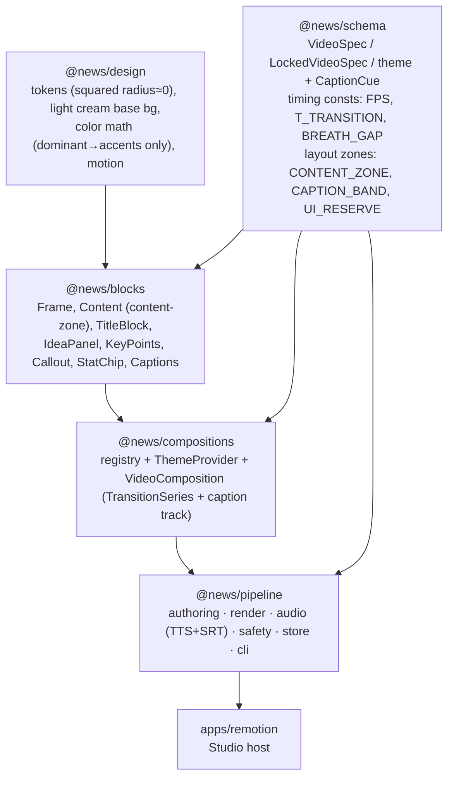
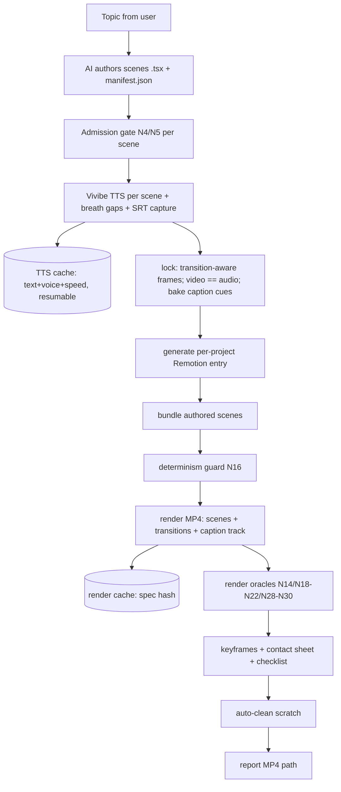

# Design Document: author-mode-v2

## Overview

`author-mode-v2` turns the tool into a **pure AUTHOR-mode** generator: for each
video the AI writes bespoke Remotion scene code, composing a small library of
reusable **slot-based blocks** for on-brand structure. It removes PICK mode,
adds real scene transitions with audio that stays in sync, frees pacing, wires
the layout/quality oracles as guardrails, makes each project a self-contained
and resumable unit, and refactors packages into clean layers.

The philosophy is unchanged from the repo's north star — *freedom with a guard
rail*: unbounded authored imagery, kept stable by the admission gate, the design
system, the render oracles, and the review loop.

**Goals**
- Pure AUTHOR-mode: no fixed templates, no planner catalog.
- A reusable `@news/blocks` layer of empty, themed, slot-based containers.
- Smooth transitions (`slide` default, `fade` for recap/CTA) with no voice clip.
- Free pacing; deterministic renders; self-contained, resumable projects.
- Oracles wired as guardrails before free authoring is enabled.
- A clean, layered, cycle-free package structure.
- **Design direction (R15–R18):** content biased into an upper *content zone*;
  the old top-left eyebrow+headline header convention removed; burned-in
  single-line Vietnamese captions for sound-off viewing; a squared (un-rounded),
  clearly-delineated block language on a neutral, lighting-robust default
  background; and selective visualization (plain text/list scenes are
  first-class).

**Non-Goals**
- No changes to `math_video_tool` / `news_video_tool`.
- No media payloads (assetRef / image / logo / video URLs) — carried over.
- No live/auto transcript overlay. Burned-in single-line captions derived from
  narration ARE in scope (see R16) — and the active word is highlighted with a
  smooth karaoke ramp; this reverses the earlier blanket no-caption/no-karaoke rule.
- No external AI API key; authoring is driven in-session.

## Architecture

### Layered packages

Dependency rule (no cycles): `schema → design → blocks → compositions →
pipeline → apps`.



Authored scenes (per project) import only from the admission whitelist:
`react`, `remotion`, `@news/design`, `@news/compositions`, `@news/blocks`,
`zod`.

### Pipeline data flow



### Target file structure

```text
packages/
  schema/src/            # + timing.ts (FPS, T_TRANSITION, BREATH_GAP); zones.ts (CONTENT_ZONE, CAPTION_BAND, UI_RESERVE); CaptionCue type; free-pacing validators
  design/src/            # tokens (squared radius≈0), light cream base bg, color math (dominant→accents), motion
  blocks/src/            # NEW: frame/, text/, data/, layout/, captions/ + index barrel
  compositions/src/      # registry.ts, theme-context.tsx, video.tsx (TransitionSeries + caption track); scenes/* DELETED
  pipeline/src/
    authoring/           # admission, register, authored-entry, author-contract
    audio/               # tts (+SRT capture), captions (cue segmentation), lock, sfx
    render/              # renderer, determinism, cache
    safety/              # static-grid, render-grid (oracles), build-grid, content-rules, forbidden-api
    store/               # store
    cli/                 # cli
    orchestrator.ts
apps/remotion/           # Studio host (Root, sample fixture)
```

## Components and Interfaces

### Block library (`@news/blocks`)

Blocks are generic, slot-based, theme-aware containers — empty frames the AI
fills. They are NOT content templates. All blocks are **squared** (corner
radius ≈ 0), each renders as a **clearly delineated** unit (hairline border or
flat panel fill), read the active per-project theme via `useTheme()`, keep
content inside the **content zone**, and contain no banned APIs.

```typescript
export const Frame: React.FC<{ children: React.ReactNode }>;                       // full-bleed neutral bg + subtle grid
/** Safe-margin column constrained to the CONTENT_ZONE (upper/middle bias, never the very top, never the caption band). */
export const Content: React.FC<{ children: React.ReactNode; gap?: number; align?: "top" | "center" }>;

/** Eyebrow-free title block: a headline (+ optional kicker/body) placed in the
 *  content zone. Replaces StoryHeader; it does NOT pin a small-uppercase eyebrow
 *  above a left-aligned headline in the top-left corner. */
export const TitleBlock: React.FC<{ headline: string; kicker?: string; body?: string }>;

/** An empty titled panel the AI drops a key idea into (the "khung ghi ý"). */
export const IdeaPanel: React.FC<{ title?: string; children: React.ReactNode; emphasis?: boolean }>;

/** Bulleted key points / recap; the block owns numbering & rhythm. */
export const KeyPoints: React.FC<{ items: string[]; title?: string }>;

export const Callout: React.FC<{ children: React.ReactNode; tone?: "accent" | "signal" | "danger" }>;
export const StatChip: React.FC<{ value: string; label: string }>;

/** Caption track renderer (used by the master composition, not authored scenes):
 *  draws the single active CaptionCue line inside the CAPTION_BAND with a
 *  high-contrast fill + backing scrim. */
export const Captions: React.FC<{ cues: CaptionCue[] }>;
```

`Frame`/`Content` move here from `@news/compositions/primitives`. The old
`StoryHeader` (top-left `eyebrow` + left-pinned big headline) is **removed** and
superseded by `TitleBlock` (R15.3); `VisualFrame`'s rounded card is reworked to
the squared, delineated language (R17.1–17.2). `Content` is constrained to the
`CONTENT_ZONE` so authored content never lands in the caption band or platform-UI
reserve (R15.2).

### Layout zones, neutral base & captions

**Layout zones** (constants in `@news/schema/zones.ts`, all in 1080×1920 space):

```typescript
export const CONTENT_ZONE = { top: 96, bottom: 1190, left: 80, right: 1000 }; // ~5%→~62% height
export const CAPTION_BAND  = { top: 1230, bottom: 1610, left: 96, right: 984 }; // ~64%→~84% height
export const UI_RESERVE    = { bottom: 300, right: 140 }; // platform UI: bottom band + right action rail
```

- The `Content` block lays out inside `CONTENT_ZONE` (upper/middle bias). It must
  not extend below `CONTENT_ZONE.bottom`.
- The caption track renders inside `CAPTION_BAND`, above `UI_RESERVE.bottom`.
- Numbers are tunable; they are the single source of truth shared by blocks, the
  composition, and the N14 oracle.

**Base background.** The default theme uses a fixed **light, warm cream editorial
base** (paper ≈ `#F2ECDC`, near-black ink ≈ `#17150F`) — neutral in the sense
that it is not a tinted wash of the dominant, and it reads in dark/bright/glare
conditions. The per-project `dominant` drives `accent`/`signal`/data-viz only,
not the base. `fg` stays near-black ink; contrast (N18) holds for any dominant.
`docs/design-language.md` is the authoritative, up-to-date description of the
look and `@news/design` `designNotes` mirrors it.

> Note: an earlier draft of this spec specified a *mid-dark charcoal* base. The
> implemented and current design language is the light cream base above; see
> `docs/design-language.md`.

**Captions.** Single-line, deterministic, derived from narration:

1. **Timing source.** `@news/tts` is extended to also return each scene's SRT
   (Vivibe `srtUrl`, now captured). The audio layer parses it into intra-
   scene segments. When no SRT exists (mock/none), narration is split into
   single-line cues distributed evenly across the scene's measured speech frames.
2. **Segmentation.** `audio/captions.ts` segments narration into short
   single-line cues that fit `CAPTION_BAND` width at the caption font size
   (sentence/clause boundaries first, then length-based wrap). One line shows at
   a time — no stacking; the active word is highlighted (smooth karaoke).
3. **Bake into lock.** Cues are offset by each scene's `startFrame` and stored on
   the locked spec as a top-level `captions: CaptionCue[]`, so rendering is a
   pure function of the frame.
4. **Render.** The master composition renders `<Captions cues={spec.captions} />`
   as a top-level overlay (like the audio track — outside `TransitionSeries`),
   showing the cue whose `[startFrame, endFrame)` contains the current frame.

`VideoComposition` switches from manual contiguous `<Sequence>` to
`<TransitionSeries>`:

```tsx
<ThemeProvider theme={makeTheme(spec.theme?.dominant)}>
  <AbsoluteFill style={{ backgroundColor: theme.colors.bg }}>
    <TransitionSeries>
      {spec.scenes.map((scene, i) => (
        <React.Fragment key={scene.id}>
          <TransitionSeries.Sequence durationInFrames={scene.sequenceFrames}>
            <SceneContent scene={scene} />
          </TransitionSeries.Sequence>
          {i < spec.scenes.length - 1 && (
            <TransitionSeries.Transition
              timing={linearTiming({ durationInFrames: T_TRANSITION })}
              presentation={scene.transitionToNext === "fade" ? fade() : slide()}
            />
          )}
        </React.Fragment>
      ))}
    </TransitionSeries>
    {spec.audio.narrationSrc && <Audio src={resolveAudio(spec.audio.narrationSrc)} />}
    <Captions cues={spec.captions ?? []} />
  </AbsoluteFill>
</ThemeProvider>
```

Audio is a single top-level `<Audio>` (continuous), NOT inside the transition
sequences. `transitionToNext` defaults to `slide`; recap/CTA scenes use `fade`.
The `<Captions>` overlay is likewise top-level (outside `TransitionSeries`) so a
caption line is never clipped or slid by a scene transition.

### Audio assembly (breath + natural endings + caption timing)

In `@news/pipeline/audio`:
- Remove the trailing-period→comma substitution in `prepareTtsText`; keep
  sentence-final punctuation.
- Build the mixed track as
  `clip_1 + silence(BREATH_GAP) + clip_2 + … + clip_n` (ffmpeg).
- Per-scene measured `s_i` excludes the gap; the gap is added structurally.
- Capture each scene's SRT alongside its audio clip (Vivibe `srtUrl` →
  downloaded sidecar; cached with the clip so resume reuses it). `captions.ts`
  parses SRT → intra-scene `{ startMs, endMs, text }` segments, re-segments them
  into single-line cues, and the lock offsets them by the scene `startFrame`.
  No SRT (mock/none) ⇒ even split of the narration across the scene's `s_i`.

### Render oracles (guardrails, delivered with PICK removal)

`runRenderGrid(locked, { framesDir, mp4Path })` is invoked in `renderProject`
after render, before "done":

| Id | Catches | Severity |
|----|---------|----------|
| N14 | content outside the **content zone** / clipped at edges / intruding into the caption band or platform-UI reserve / **caption-clearance gap** | hard |
| N15 | two blocks overlap (illegible) | hard (rect-fed; exported for callers) |
| N17 | headline/body/**caption line** truncated/ellipsized or overflowing its band | hard (box-fed; exported for callers) |
| N18 | text/background contrast below threshold | warning |
| N19 | dead-air / near-blank frame while narration plays | warning |
| N20 | pacing: too many words/sec for the scene length | warning |
| N21 | hard cut with no transition / flicker | warning |
| N22 | narration vs durationInFrames drift beyond tolerance | warning |
| N23 | richness: a long scene with almost no motion | warning (multi-frame; exported, NOT auto-run — masked by the always-on ambient tilt) |
| N28 | total duration outside the brief's target ± tolerance | warning |
| N29 | **caption track**: no caption visible while speech plays, or caption out of band | warning |
| N30 | content density: a scene fills too much of the content zone (overcrowded) | warning |

N14 is upgraded to be zone-aware (uses the `@news/schema` zone constants): it
distinguishes authored content (must be in `CONTENT_ZONE`) from the caption
track (allowed in `CAPTION_BAND`), and fails anything in `UI_RESERVE`. N29 is a
new oracle for the new caption feature (graduated per the "new defect class →
new oracle + self-test" rule).

Each ships a non-vacuous self-test.

### CLI

```text
author scaffold <id>     # create projects/<id>/ + empty manifest.json
render <id> [--draft] [--force-full] [--no-cache]  # admit → TTS(resumable) → lock → bundle → render → oracles → review → clean (full requires a prior draft)
doctor                   # env (Vivibe), ffmpeg, browser, registry health
```

`generateAuthoredEntry` (already added) writes
`projects/<id>/authored/_entry.tsx` for bundling and is deleted after render.

## Data Models

### Project manifest (`projects/<id>/manifest.json`)

```typescript
type Manifest = {
  theme: { dominant: string; mood?: string };
  scenes: Array<{
    id: string;                 // scene-NN, sequential
    component: string;          // authored component id
    props: Record<string, unknown>;
    narration: string;
    role?: "hook" | "body" | "recap" | "cta";
    transitionToNext?: "slide" | "fade";
  }>;
};
```

### Caption cues (baked into the locked spec)

```typescript
type CaptionCue = {
  startFrame: number;   // absolute, offset by the scene's startFrame
  endFrame: number;     // exclusive; [startFrame, endFrame)
  text: string;         // a single line that fits CAPTION_BAND width
  sceneId: string;      // provenance, for oracles/review
};
```

The locked spec gains a top-level `captions: CaptionCue[]` (sorted, non-
overlapping). It is part of the spec-hash render-cache key, so changing
narration changes the cues and invalidates the render (consistent with P4).

### Self-contained project layout

```text
projects/<id>/
  manifest.json
  authored/<scene>.tsx     # AI-written, admitted scene modules
  audio/scene-01.* … narration.mixed.wav
  video-spec.lock.json     # transition-aware frame-accurate spec
  renders/<id>.mp4
  review/                  # keyframes + contact.jpg + review.json
  logs/
```

Deleting the folder deletes the whole video. Shared regenerable caches live at
`.video-tool/cache/{tts,renders}`; `--no-cache` bypasses them.

### Transition-aware locked timing

For `n` scenes with measured speech frames `s_i` and `T = T_TRANSITION`:
- Assembled audio frames `A = Σ s_i + (n-1)·T` (silent breath gaps between).
- Sequence durations: `d_1 = s_1 + T`, `d_i = s_i + 2T` (middle), `d_n = s_n + T`.
- Total video `= Σ d_i − (n-1)T = Σ s_i + (n-1)T = A`, so transition overlaps
  land exactly on silent gaps. Edge cases: `n = 1` → `d_1 = s_1`, no gap;
  no-narration scene → `s_i = DEFAULT_HOLD`.

## Correctness Properties

### Property 1: Audio/video length sync
Total locked video frames equal assembled audio frames for any `n ≥ 1` and any
per-scene speech frames `s_i` (transition overlaps are added back exactly).
**Validates: Requirements 5.2, 5.3**

### Property 2: No clipped speech
Each transition overlap window coincides with a silent breath gap; no spoken
word plays under an overlap on the outgoing side.
**Validates: Requirements 4.1, 5.2**

### Property 3: Determinism
Rendering the same locked spec frame twice is byte-identical (N16);
blocks/scenes/transitions are frame-derived only (no Math.random/Date/network).
**Validates: Requirements 12.1, 12.2, 12.3**

### Property 4: Cache identity
`specHash(a) === specHash(b)` iff identical render inputs; unchanged narration ⇒
identical TTS key ⇒ reused clip; a changed scene invalidates only its clip.
**Validates: Requirements 9.1, 9.3, 9.5**

### Property 5: Admission before reference
A scene id is referenceable only after its module passes the admission gate and
registers; a module with a banned API never reaches the bundler.
**Validates: Requirements 1.3, 10.2**

### Property 6: Safe layout gate
A rendered project that fails an auto-run hard oracle (N14 content-zone /
caption-clearance, N16 determinism) is never declared "done". N15 (overlap) and
N17 (truncation) are hard in severity but rect/box-fed and not auto-run on a flat
still, so layout collisions are caught in practice by N14 + the keyframe review.
**Validates: Requirements 7.1, 7.4**

### Property 7: Deterministic, in-band captions
For any frame `f`, the visible caption is a pure function of `f` over the baked
`CaptionCue[]` (no network/clock); at most one cue is active at a time; every
cue's rendered line stays inside `CAPTION_BAND` and clear of `UI_RESERVE`.
**Validates: Requirements 16.1, 16.2, 16.6, 12.2**

### Property 8: Content stays in the content zone
Every authored scene's rendered content bounding box is contained in
`CONTENT_ZONE` (no content in the caption band or platform-UI reserve).
**Validates: Requirements 15.2, 15.4**

## Error Handling

- **Admission failure:** report N4/N5 violations with file:line; block bundling;
  do not import the module.
- **Missing Vivibe config:** stop and report the exact missing key/voice; never
  downgrade silently.
- **TTS interruption:** persist per-scene clips + a `tts-manifest.json`; a rerun
  resumes only missing clips (Vivibe `.export-id` sidecar resumes polling).
- **Oracle hard error:** keep the project out of "done"; surface scene-scoped
  messages for re-authoring.
- **Lock invariant violation:** `validateLockedTimings` throws before render.
- **Render/bundle failure:** mark project `failed` with the cause; leave already
  cached clips/renders intact for resume.

## Testing Strategy

- **Unit:** schema timing/pacing validators + layout-zone constants; block
  render-free render with default theme (incl. squared tokens / content-zone
  `Content`); caption segmentation (single-line, fits band width) + SRT-parse +
  even-split fallback; lock math property test (P1) + caption-cue offset test
  (P7); cache identity test (P4).
- **Self-tests:** each render oracle (zone-aware N14 / N15 / N17 / N19 / N21 /
  N22 / **N29 caption**) with a known-bad fixture (fires) and a clean fixture
  (passes); admission gate accept/reject fixtures; forbidden-API lint over
  `blocks` + `compositions`.
- **Integration:** short authored render (transitions + voice + captions)
  asserting smooth boundaries, captions in-band and in-sync, and content within
  the content zone; determinism guard byte-identical (P3).
- **Migration:** after each wave, `npm run typecheck`, `npm test`,
  `npm run build` must pass; PICK-era tests removed/rewritten.

## Migration sequencing (waves)

1. **W1 Foundation** — schema timing consts + **layout-zone constants** +
   free-pacing validators; **neutral base + squared (radius≈0) design tokens**;
   create `@news/blocks` (move `Frame`/`Content`; `Content`→content-zone;
   replace `StoryHeader` with eyebrow-free `TitleBlock`; add IdeaPanel/KeyPoints/
   Callout/StatChip + a `Captions` renderer); admission whitelist + webpack alias.
2. **W2 Transitions + audio + captions** — add `@remotion/transitions`;
   TransitionSeries; transition-aware lock; breath-gap audio; **SRT capture +
   single-line caption segmentation + caption cues baked into the lock +
   `<Captions>` overlay in the composition**; short render test (transitions,
   voice, captions).
3. **W3 Remove PICK** — delete scenes/* + planner/*; update barrel; update/remove
   PICK tests; update AGENTS + content-guide **(AUTHOR-only + caption/layout/
   design direction; remove the N9 caption ban)**.
4. **W3‖ Oracles (parallel with W3)** — wire `runRenderGrid` + zone-aware
   **N14** / N15 / N17 / N19 / N21 / N22 **+ N29 caption** self-tests. Lands
   with/before free authoring.
5. **W4 Productionize** — `author scaffold` + `render` CLI; authoring-contract
   steering **(zones, captions, squared/neutral look, when-to-visualize)**;
   resumable synthesis skip logic (incl. cached SRT); render cache + `--no-cache`.
6. **W5 Refactor structure** — regroup `pipeline/src`; ensure no cycles.
7. **W6 Real video** — author a ~2-min Gemma/Shortcast video with transitions,
   voice, **burned-in captions**, a recap scene, and at least one plain text/list
   scene; render; review.
