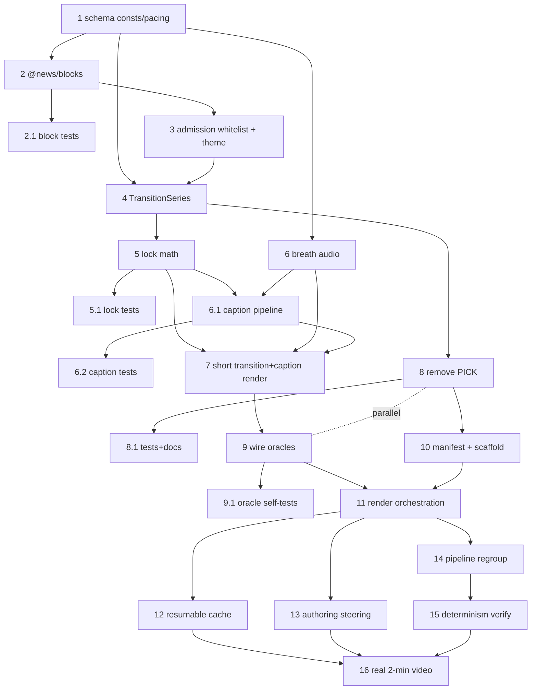

# Implementation Plan: author-mode-v2

## Overview

Waves are ordered so the quality guardrails (oracles, Wave 3‖) land together
with PICK removal — before pure free authoring is exercised. Each wave ends with
`npm run typecheck`, `npm test`, `npm run build` green. Tasks are coding-only and
reference the requirements they satisfy.

## Tasks

### Wave 1 — Foundation: schema constants + `@news/blocks`

- [x] 1. Shared timing constants + layout zones + free pacing in `@news/schema`
  - Add `T_TRANSITION` (frames) and `BREATH_GAP` (seconds) constants; export.
  - Add `zones.ts`: `CONTENT_ZONE`, `CAPTION_BAND`, `UI_RESERVE` constants and a
    `CaptionCue` type; export. Add `captions: CaptionCue[]` to the locked spec.
  - Relax `validateVideoSpecStructure`: drop fixed scene-count bounds and the
    duration-preset equality; keep sequential `scene-NN` ids + single-paragraph
    narration; make `duration` optional/target.
  - _Requirements: 6.1, 6.2, 6.3, 11.3, 4.3, 15.1, 16.2_

- [x] 2. Create `@news/blocks` package (squared, neutral, content-zone)
  - New package `@news/blocks` (package.json, tsconfig, root alias, Remotion +
    renderer webpack aliases).
  - Update `@news/design` tokens: squared radius (≈0) and a light, warm cream
    paper base (near-black ink + bold ink borders; dominant drives accents only).
  - Move `Frame`/`Content` (from compositions `primitives.tsx`) in; constrain
    `Content` to `CONTENT_ZONE` (upper/middle bias). Replace `StoryHeader` with
    an eyebrow-free `TitleBlock` (no top-left small-uppercase header).
  - Add slot-based blocks `IdeaPanel`, `KeyPoints`, `Callout`, `StatChip` and a
    `Captions` renderer (single active line in `CAPTION_BAND`, high-contrast +
    scrim) — all themed, squared, delineated, deterministic.
  - _Requirements: 2.1, 2.2, 2.3, 11.1, 15.2, 15.3, 16.1, 16.6, 17.1, 17.2, 17.3_

- [x] 2.1 Block tests + forbidden-API coverage
  - Render-free tests: each block renders with default theme; `Content` stays in
    `CONTENT_ZONE`; squared tokens applied; `Captions` renders one line in band;
    forbidden-API lint includes `packages/blocks/src`.
  - _Requirements: 2.3, 12.1, 14.3, 15.2, 17.1_

- [x] 3. Admission whitelist + theme context wiring for blocks
  - Add `@news/blocks` to `DEFAULT_ADMISSION_POLICY.allowedImports`.
  - Re-export `useTheme`/`ThemeProvider` location so blocks + authored scenes
    share one theme context instance.
  - _Requirements: 2.4, 1.3_

### Wave 2 — Transitions + audio sync

- [x] 4. Add `@remotion/transitions` and switch the master composition
  - Add dependency pinned to `4.0.472`.
  - Rewrite `video.tsx` to use `TransitionSeries` with per-scene
    `transitionToNext` (`slide` default, `fade` for recap/CTA); keep a single
    top-level `<Audio>` and a top-level `<Captions cues={spec.captions} />`
    overlay (outside the transition series).
  - _Requirements: 3.1, 3.2, 3.3, 5.1, 16.1_

- [x] 5. Transition-aware lock math
  - Implement `d_1=s_1+T`, `d_i=s_i+2T`, `d_n=s_n+T`; total `= Σ s_i + (n-1)T`.
  - Replace the contiguity check with an overlap-aware `validateLockedTimings`
    (total equals assembled audio length). Handle `n=1` and no-narration scenes.
  - _Requirements: 5.2, 5.3, 3.4_

- [x] 5.1 Lock math tests
  - Property test: total video frames == assembled audio frames for random
    `s_i`/`n`; overlap windows coincide with gaps.
  - _Requirements: 5.2, 14.3_

- [x] 6. Audio breath + natural endings
  - Remove the period→comma substitution in `prepareTtsText`.
  - Assemble mixed track with `silence(BREATH_GAP)` between clips; derive gap
    frames from `T_TRANSITION`.
  - _Requirements: 4.1, 4.2, 4.3_

- [x] 6.1 Caption pipeline (SRT capture → single-line cues → bake into lock)
  - Extend `@news/tts` to return + cache each scene's SRT (Vivibe `srtUrl`);
    download a sidecar next to the clip so resume reuses it.
  - Add `audio/captions.ts`: parse SRT to intra-scene segments and re-segment
    into single-line cues that fit `CAPTION_BAND` width; no-SRT fallback splits
    narration evenly across the scene's measured speech frames.
  - In the lock, offset cues by each scene `startFrame` and write
    `captions: CaptionCue[]` (sorted, non-overlapping) onto the locked spec.
  - _Requirements: 16.1, 16.2, 16.3, 16.4_

- [x] 6.2 Caption pipeline tests
  - SRT parse; single-line segmentation fits band width with no truncation;
    even-split fallback; cue offset + non-overlap + at-most-one-active (P7).
  - _Requirements: 16.1, 16.2, 16.4, 14.3_

- [x] 7. Short transition + caption render test
  - Author 2–3 throwaway scenes; render a short clip with voice; confirm smooth
    transitions, no clipped speech, and a single in-band caption line tracking
    the voice.
  - _Requirements: 3.1, 4.1, 5.2, 16.1, 16.6_

### Wave 3 — Remove PICK  ‖  Wave 3 oracles (parallel)

- [x] 8. Remove PICK-mode code
  - Delete `packages/compositions/src/scenes/*` and
    `packages/pipeline/src/planner/*`.
  - Update `@news/compositions` barrel: export registry + theme-context + master
    composition only (no auto-registered templates).
  - Remove planner usage from the orchestrator's `createVideoProject` (or replace
    with a manifest loader).
  - _Requirements: 1.1, 1.2, 1.4, 10.4_

- [x] 8.1 Update/remove PICK-era tests + docs
  - Remove/rewrite `registry.test.ts` (template catalog) and `planner.test.ts`.
  - Update `AGENTS.md` + `docs/ai-content-guide.md` to AUTHOR-only language AND
    the design direction: captions are now REQUIRED (remove the N9 caption clause
    and the no-subtitles lines incl. in `designNotes`), content in the content
    zone, no top-left header, squared/neutral look, selective visualization.
  - _Requirements: 14.2, 13.3, 16.5, 18.1_

- [x] 9. Wire render oracles into the loop (parallel with task 8)
  - Invoke `runRenderGrid(locked, { framesDir, mp4Path })` in `renderProject`
    after render and fold its report into the gate before "done".
  - Implement/confirm zone-aware N14 (content in `CONTENT_ZONE`; captions allowed
    in `CAPTION_BAND`; nothing in `UI_RESERVE`), N15 overlap, N17 truncation
    (incl. caption overflow) — hard; N19 dead-air, N21 transition/flicker, N22
    audio-sync, N29 caption (visible-while-speech / in-band / contrast) — warning.
  - _Requirements: 7.1, 7.3, 7.4, 15.4, 16.6_

- [x] 9.1 Non-vacuous self-tests for each oracle
  - Known-bad fixture per oracle proving it fires (incl. content-in-caption-band
    for N14 and a missing/out-of-band caption for N29); clean fixture proving it
    passes.
  - _Requirements: 7.2, 14.3_

### Wave 4 — Productionized AUTHOR path

- [x] 10. Project manifest contract + scaffold
  - Define `manifest.json` schema (theme.dominant, ordered scenes: component id,
    props, narration, optional `role` recap/cta).
  - `author scaffold <id>` creates the project skeleton + empty manifest.
  - _Requirements: 8.1, 10.3_

- [x] 11. `render <id>` orchestration (admit → TTS → lock → bundle → render → oracles → review → clean)
  - Admit every authored scene before bundling; block on violations.
  - Use `generateAuthoredEntry`; render; run oracles + review; auto-remove the
    generated entry, concat lists, temp frames.
  - _Requirements: 10.1, 10.2, 10.3, 8.3, 8.4_

- [x] 12. Resumable + shared cache
  - Per-scene TTS skip when cached clip exists; record done scenes in
    `tts-manifest.json`; resume only missing clips after interruption.
  - Render cache by `specHash`; add `--no-cache`.
  - _Requirements: 9.1, 9.2, 9.3, 9.4, 9.5_
  - _Note: render cache + `--no-cache` + per-scene TTS cache (findCached) +
    Vivibe export-id resume sidecar are in place; SRT sidecars are cached with
    clips. Full interruption-resume is exercised at real render time._

- [x] 13. Authoring-contract steering doc
  - Write the authoring guide (required exports, import whitelist incl.
    `@news/blocks`, banned APIs, available blocks, the content-zone / caption-
    band / platform-UI reserve layout zones, the squared/neutral design language,
    safe-area rules, "compose blocks for text, author code for imagery", and
    when-to-visualize vs. plain text/list guidance).
  - _Requirements: 13.1, 13.2, 15.1, 17.1, 18.1, 18.2, 18.3_

### Wave 5 — Structure refactor

- [x] 14. Regroup `@news/pipeline/src` by concern
  - Move modules into `authoring/`, `audio/`, `render/`, `safety/`, `store/`,
    `cli/`; update barrels and imports; verify no import cycles.
  - _Requirements: 11.2, 11.4_

- [x] 15. Verify determinism end-to-end
  - Determinism guard (N16) still byte-identical on an authored sample; ensure
    transitions/timings are frame-derived only.
  - _Requirements: 12.1, 12.2, 12.3_

### Wave 6 — Real video

- [x] 16. Author + render the ~2-minute Gemma/Shortcast video
  - Author bespoke scenes (incl. a recap scene using `KeyPoints` and at least one
    plain text/list scene per Requirement 18); set dominant color; render with
    voice + transitions + burned-in single-line captions; complete the review
    checklist (content in content zone, captions in-band and in-sync).
  - Confirm self-contained folder + scratch cleaned.
  - _Requirements: 1.1, 2.5, 3.1, 4.1, 8.1, 8.2, 8.3, 15.2, 16.1, 18.1_
  - _Status: DONE. Real Vivibe-voiced video shipped — project `ondevice-ai`
    ("AI chạy ngay trên máy của bạn"), 14 authored scenes (statement / bespoke
    SVG diagram / CountUp stat / KeyPoints recap+list / BarChart / two-column
    compare), light-editorial design, 4192 frames ≈ 139.7s (within the 120s ±20s
    target), burned-in single-line VI captions from the TTS SRT. Full pipeline
    green: admit → manifest → static grid → Vivibe TTS → lock → build gate →
    determinism → TransitionSeries render → render oracles **0 errors / 0
    warnings** → review → done; self-contained folder, scratch cleaned. Verified
    via the draft→full workflow (`scripts/build-video.ts`): fast low-res draft
    (`quality:"draft"`) for the motion/pacing review loop, then the full-quality
    render. Oracles recalibrated this wave (N14 frame-chrome tolerance, N20 VI
    pacing, transition-aware N22, new soft-duration N28) — all with self-tests._

## Task Dependency Graph



Critical path: 1 → 2 → 4 → 5 → 6/6.1/7 → (8 ‖ 9) → 11 → 12/13 → 16.

```json
{
  "waves": [
    { "wave": 1, "tasks": ["1", "2", "2.1", "3"], "rationale": "Foundation: shared timing + layout-zone constants, free-pacing validators, neutral/squared design tokens, and the @news/blocks slot library (content-zone Content, eyebrow-free TitleBlock, Captions renderer)." },
    { "wave": 2, "tasks": ["4", "5", "5.1", "6", "6.1", "6.2", "7"], "rationale": "Real transitions + transition-aware lock math + breath-gap audio + single-line caption pipeline (SRT→cues→lock→overlay); verified by a short render." },
    { "wave": 3, "tasks": ["8", "8.1", "9", "9.1"], "rationale": "Remove PICK AND wire the render oracles (zone-aware N14 + caption N29) in parallel — guardrails and the caption-rule reversal land before pure free authoring." },
    { "wave": 4, "tasks": ["10", "11", "12", "13"], "rationale": "Productionize: manifest + scaffold/render CLI, resumable+shared cache (incl. cached SRT), authoring-contract steering (zones, captions, squared/neutral, when-to-visualize)." },
    { "wave": 5, "tasks": ["14", "15"], "rationale": "Regroup pipeline by concern (no cycles) and verify determinism end-to-end." },
    { "wave": 6, "tasks": ["16"], "rationale": "Author + render the real ~2-minute video with transitions, voice, burned-in captions, a recap scene, and a plain text/list scene." }
  ]
}
```

## Notes

- Wave 3 oracles (task 9) are intentionally parallel to PICK removal (task 8):
  guardrails must exist before pure free authoring.
- `@news/blocks` are empty slot containers, never content templates.
- Captions are single-line and burned-in (smooth word-paged karaoke); this
  deliberately reverses the prior N9 no-caption rule (docs updated in task 8.1).
- Content lives in the content zone; the bottom caption band + platform-UI
  reserve stay clear; the look is squared/neutral (no top-left eyebrow header).
- Run `npm run typecheck`, `npm test`, `npm run build` after each wave.
- Do not modify `math_video_tool` / `news_video_tool`.
