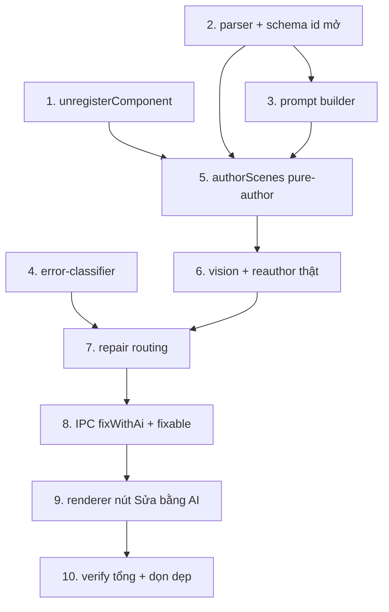

# Implementation Plan

## Overview

Kế hoạch triển khai cho spec **desktop-author-mode**: đưa `apps/desktop` về
pure-AUTHOR + agent self-repair, bám `design.md`. Mỗi task incremental, để app
luôn ở trạng thái dựng được.

**Quy tắc bất biến cho MỌI task** — sau khi hoàn tất, chạy lưới verify và để xanh
hết (R8.1, R8.3):

```
npm run typecheck
npx tsx scripts/test.ts apps/desktop      # (không chạy raw vitest)
cd apps/desktop && node build-electron.mjs && npm run build:renderer
```

- Property test: ≥100 run fast-check, tag `// Feature: desktop-author-mode, Property <n>: <name>`,
  dùng `fc.asyncProperty` + `await fc.assert` cho callback async (R8.2).
- Đường engine `npx tsx scripts/build-*.ts` KHÔNG được đổi hành vi (R2.4) — chỉ
  thêm export mới, không sửa luồng cũ.
- Bất biến reconcile (P1–P10, preserved-invariants, client-channel-coverage) tiếp
  tục pass (R8.4).

## Tasks

- [x] 1. T1 — Seam `unregisterComponent` trong `@news/compositions`
  - [x] 1.1 Thêm `export function unregisterComponent(id: string): void { registry.delete(id); }` vào `packages/compositions/src/registry.ts`; export ở `packages/compositions/src/index.ts` và re-export qua `packages/pipeline/src/authoring/index.ts` (+ `@news/pipeline` barrel).
  - [x] 1.2 Unit test: register → getComponent thấy → unregister → getComponent undefined → register lại cùng id KHÔNG ném (chứng minh seam cho phép reauthor/cross-project refresh). Đặt cạnh `registry.test.ts`.
  - [x] 1.3 Chạy lưới verify (cả `npm test` toàn repo cho gói compositions).
  - _Requirements: R3.2_

- [x] 2. T2 — `manifest-schema` id mở + `reply-parser` (P1, P2)
  - [x] 2.1 Sửa `apps/desktop/src/main/authoring/manifest-schema.ts`: bỏ `KIT_COMPONENT_IDS`/`KitComponentId`; `component` → `z.string().regex(/^[a-z][a-z0-9-]{1,40}$/)`; bỏ ràng buộc props theo kit (giữ `props` là `z.record`). Giữ `extractJsonObject`/`parseAuthorManifest` nhưng chỉ còn validate manifest (không kèm code).
  - [x] 2.2 Tạo `apps/desktop/src/main/authoring/reply-parser.ts`: `parseAuthorReply(text)` (trích manifest JSON + mọi khối ```tsx có marker `// component: <id>`, đối chiếu id literal trong `registerComponent`, phủ `scenes[].component`), `parseReauthorReply(text, expectId)`; kiểu `AuthoredModule`, `ParsedAuthorReply`, `ParseReason`.
  - [x] 2.3 Property test P1 — Author-reply parse roundtrip: sinh manifest hợp lệ + đủ khối code → `ok` + `modules` phủ đúng; thiếu code → `missing-code`; marker lệch id literal → `id-mismatch`. `// Feature: desktop-author-mode, Property 1: author-reply parse roundtrip` (_R1.7, R1.3_).
  - [x] 2.4 Property test P2 — Reauthor single-module: `parseReauthorReply(text, id)` chỉ `ok` khi đúng một khối cùng id; còn lại `!ok`. `Property 2: reauthor single-module` (_R3.2, R3.3_).
  - [x] 2.5 Chạy lưới verify.
  - _Requirements: R1.7, R1.8, R1.3, R3.2_

- [x] 3. T3 — `contract-text` + prompt builder (author + reauthor)
  - [x] 3.1 Tạo `apps/desktop/src/main/authoring/contract-text.ts` export hằng `AUTHORING_CONTRACT` (cô đọng từ `.kiro/steering/authoring-contract.md`: exports bắt buộc, import whitelist, banned APIs N5, blocks, layout zones + đường kẻ đen/N14, design cream-squared/`useTheme`, captions trung tâm, determinism + motion, visualize diversely).
  - [x] 3.2 Viết lại `apps/desktop/src/main/authoring/prompt.ts`: `buildAuthorMessages(input, research)` nhúng QUY TẮC NỘI DUNG + `AUTHORING_CONTRACT` + đặc tả AI_Output_Contract (manifest JSON + khối ```tsx marker) + một ví dụ module hợp lệ rút gọn; thêm `buildReauthorMessages({sceneId, componentId, currentCode, issues?, intent?, stillDataUrl?})` trả message đa-phần khi có ảnh. Bỏ import `SCENE_KIT`.
  - [x] 3.3 Unit test: `buildAuthorMessages` chứa các mục contract bắt buộc (whitelist, banned, output-format) cho cả URL/topic; `buildReauthorMessages` kèm `image_url` khi có `stillDataUrl`, text-only khi không; luôn yêu cầu đúng một khối cùng id.
  - [x] 3.4 Chạy lưới verify.
  - _Requirements: R1.5, R7.5_

- [x] 4. T4 — `error-classifier` (P3)
  - [x] 4.1 Tạo `apps/desktop/src/main/agent/error-classifier.ts`: `ErrorClass`, `CONTENT_CHECKS`, `CONTENT_STAGES`, `classifyIssue(SafetyIssue)`, `classifyError(SerializedPipelineError)` (config/tts→infra; cause target-closed/ECONN/gateway→infra; check∈CONTENT_CHECKS→content; render-stage vỡ-bundle signature→content; CONTENT_STAGES→content; mặc định infra).
  - [x] 4.2 Property test P3 — phân loại toàn phần & ổn định: ∀ issue check∈CONTENT_CHECKS→"content"; ∀ cause chứa token infra→"infra"; idempotent. Self-test non-vacuous mỗi nhánh (N14→content, target-closed→infra, config→infra, render+"Transform failed"→content). `Property 3: error classification total & stable` (_R4.1, R4.2, R4.3, R4.5_).
  - [x] 4.3 Chạy lưới verify.
  - _Requirements: R4.1, R4.2, R4.3, R4.5_

- [x] 5. T5 — `authorScenes` pure-author + gỡ Scene_Kit (R1.1–R1.4, R1.6, R1.9)
  - [x] 5.1 Viết lại `NineRouterAuthoringBackend.authorScenes`: gọi AI → `parseAuthorReply` → cho mỗi module `unregisterComponent(id)` + `writeAuthoredScene(sceneFileName(id), code)` → `writeJson(manifest)` (id mở) → `admitProjectScenes(id,{load:loadAuthoredTsx})`. Thất bại parse/admission → `{scenes:[], message}` (KHÔNG kit fallback). Bỏ import/nhánh `SCENE_KIT`.
  - [x] 5.2 Tạo `apps/desktop/src/main/authoring/scene-files.ts`: `sceneFileName(componentId)` (sanitize, không bắt đầu `_`) + `resolveSceneFile(projectId, sceneId, loadManifest)` thuần.
  - [x] 5.3 Xoá `apps/desktop/src/main/authoring/starter-kit.ts` và mọi import còn lại (R1.9); viết lại/loại test phụ thuộc kit, thay bằng module mẫu nội bộ test quanh `parseAuthorReply`.
  - [x] 5.4 Unit test: authorScenes với fake `client.chat` trả reply hợp lệ → ghi đúng số file + manifest id mở + gọi admit; reply hỏng → `{scenes:[]}` không ghi kit.
  - [x] 5.5 Property test P5 — `resolveSceneFile`: sceneId không có / file thiếu → null; khớp đúng component→path. `Property 5: localized scene-file resolution` (_R3.3, R3.8_).
  - [x] 5.6 Chạy lưới verify.
  - _Requirements: R1.1, R1.2, R1.3, R1.4, R1.6, R1.9, R3.3, R3.8_

- [x] 6. T6 — Vision client + `reauthor` thật (R3.1–R3.8)
  - [x] 6.1 Mở rộng `NineRouterClient.chat` để `message.content` nhận `string | Part[]` (`Part = {type:"text",text} | {type:"image_url",image_url:{url}}`); giữ body `{model, messages, stream:false}`. Cập nhật kiểu `ChatMessage` dùng chung (prompt.ts + client).
  - [x] 6.2 Hiện thực `reauthor(projectId, targets: ReauthorTarget[])`: resolve file → đọc mã gốc → (N14/N18) đọc `review/<sceneId>.png` thành data URL → `buildReauthorMessages` → `client.chat` → `parseReauthorReply(reply, componentId)` → ghi đè + `unregisterComponent` + re-admit; **rollback** mã gốc + re-admit khi re-admit fail; `resolveSceneFile`=null → fail lần thử. Đổi `AuthoringBackend.reauthor` sang `(projectId, ReauthorTarget[])`.
  - [x] 6.3 Degrade vision (R3.7): nếu `chat` có ảnh ném HTTP lỗi → log cảnh báo → gọi lại text-only (loại phần image), không crash. Test bằng fake fetch.
  - [x] 6.4 Unit test reauthor: rewrite hợp lệ → ghi đè + re-admit ok; rewrite vi phạm admission → file/registry rollback về bản gốc (project vẫn render được); needsVision chỉ bật với N14/N18.
  - [x] 6.5 Chạy lưới verify.
  - _Requirements: R3.1, R3.2, R3.3, R3.4, R3.5, R3.6, R3.7, R3.8_

- [x] 7. T7 — Repair-loop định tuyến infra/content (P4)
  - [x] 7.1 Sửa `apps/desktop/src/main/agent/repair-loop.ts`: phân loại `report.hardErrors` qua `classifyIssue`; có Infra_Error → trả `{kind:"infra", attempts}` (không gọi reauthor); chỉ gom cảnh Content_Error thành `ReauthorTarget[]` (kèm `issues`) cho `reauthor`; giữ dừng-ở-report-sạch trong budget. Thêm nhánh `infra` vào `RepairOutcome` (`agent-worker.ts`). Cập nhật `RepairLoopDeps.reauthor` chữ ký + `CustomLoopAgentWorker.generateValidateRepair`.
  - [x] 7.2 Property test P4 — budget & routing: luôn dừng trong maxAttempts; `passed` ở report sạch đầu tiên; có infra→`infra` & KHÔNG reauthor; chỉ truyền cảnh content cho reauthor. `Property 4: repair budget and routing` (_R3.4, R4.2, R7.3_).
  - [x] 7.3 Cập nhật `custom-loop-worker.test.ts`/`repair-loop.test.ts` cho chữ ký reauthor mới.
  - [x] 7.4 Chạy lưới verify.
  - _Requirements: R3.4, R4.2, R7.3_

- [x] 8. T8 — IPC `projects:fixWithAi` + `fixWithAi` + cờ fixable (P6)
  - [x] 8.1 Thêm `"projects:fixWithAi"` vào `apps/desktop/src/shared/channels.ts` (`INVOKE_CHANNELS`). Thêm `fixable?: boolean` vào `ProjectStage.error` + `FriendlyError` (`shared/types.ts`).
  - [x] 8.2 `WorkspaceController`: `runRender` đặt `fixable` theo outcome (`exhausted`→true; `infra`→false; catch→`classifyError`); thêm `fixWithAi(projectId)` (bỏ qua nếu stage≠error; setStage rendering; gọi `generateValidateRepair`; ready|error theo kết quả). Phát `friendlyError` kèm `fixable`. Mọi message qua `redact`.
  - [x] 8.3 Wire handler `"projects:fixWithAi"` trong `index.ts`; bảo đảm preload bridge phủ kênh mới (generic theo `INVOKE_CHANNELS`).
  - [x] 8.4 Property test P6 — redaction giữ nguyên cho đường mới: mọi message fixWithAi/exhausted/infra không lộ N-code/`.tsx`/MCP/stack/`{}`. `Property 6: redaction holds for new paths` (_R5.5, R7.2_).
  - [x] 8.5 Unit test `fixWithAi`: stage error fixable → passed→ready, exhausted→error(fixable); bỏ qua khi stage≠error; không bấm trùng khi đang rendering. Cập nhật `client-channel-coverage` test (kênh mới có trong allow-list + preload) — R8.4.
  - [x] 8.6 Chạy lưới verify.
  - _Requirements: R4.4, R5.1, R5.2, R5.3, R5.4, R5.5, R5.6, R7.1, R7.4_

- [x] 9. T9 — Renderer nút "Sửa bằng AI"
  - [x] 9.1 Trong workspace view (`apps/desktop/src/renderer/...`), stage `error`: luôn có "Thử lại"/"Quay lại"; nếu `stage.fixable` thêm nút "Sửa bằng AI" gọi `projects:fixWithAi`; chuyển sang `rendering` thì hiện percent + disable nút (chống bấm trùng).
  - [x] 9.2 Cập nhật kiểu/handler renderer cho `fixable` + kênh mới; smoke test view nếu có harness.
  - [x] 9.3 Chạy lưới verify (`build:renderer`).
  - _Requirements: R5.1, R5.3, R5.4_

- [x] 10. T10 — Verify tổng + dọn dẹp
  - [x] 10.1 Rà bỏ mọi tham chiếu chết tới Scene_Kit/`KIT_COMPONENT_IDS`; xác nhận không còn import mồ côi (R1.9).
  - [x] 10.2 Chạy `npm test` toàn repo: xác nhận desktop xanh; 2 timeout `orchestrator.test.ts` là pre-existing (không tính regression).
  - [x] 10.3 Cập nhật README/Settings tooltip ghi kỳ vọng chi phí/độ trễ pure-author + "Sửa bằng AI" (R7.5).
  - [x] 10.4 Lưới verify cuối (typecheck + desktop test + build:main + build:renderer) xanh toàn bộ; bất biến reconcile P1–P10 + preserved-invariants vẫn pass (R8.4).
  - _Requirements: R6.1, R6.2, R6.4, R7.5, R8.1, R8.3, R8.4_

## Task Dependency Graph

T1 (seam unregister) và T2 (parser/schema) độc lập, làm trước. T3 (prompt) cần
T2 (kiểu manifest/parser). T4 (classifier) độc lập. T5 (authorScenes pure-author)
cần T1+T2+T3. T6 (reauthor + vision) cần T5 (+T1/T3). T7 (repair routing) cần
T4+T6. T8 (IPC fixWithAi) cần T7. T9 (renderer) cần T8. T10 (verify tổng) cuối.

```json
{
  "waves": [
    { "wave": 1, "tasks": ["1", "2", "4"], "rationale": "Seam unregister, parser+schema, error-classifier — độc lập nhau." },
    { "wave": 2, "tasks": ["3"], "rationale": "Prompt builder cần kiểu manifest/parser từ T2." },
    { "wave": 3, "tasks": ["5"], "rationale": "authorScenes pure-author + gỡ kit cần seam (T1), parser (T2), prompt (T3)." },
    { "wave": 4, "tasks": ["6"], "rationale": "Vision client + reauthor thật cần authorScenes/scene-files (T5) + seam/prompt." },
    { "wave": 5, "tasks": ["7"], "rationale": "Repair-loop định tuyến cần classifier (T4) + reauthor (T6)." },
    { "wave": 6, "tasks": ["8"], "rationale": "IPC fixWithAi + fixable cần outcome infra/exhausted từ repair-loop (T7)." },
    { "wave": 7, "tasks": ["9"], "rationale": "Renderer nút Sửa bằng AI cần kênh + cờ fixable (T8)." },
    { "wave": 8, "tasks": ["10"], "rationale": "Verify tổng + dọn dẹp sau khi mọi mảnh đã wire." }
  ]
}
```



## Notes

- Mỗi task con `(_Requirements: ...)` tham chiếu requirement nó thoả; property
  test mang tag `// Feature: desktop-author-mode, Property {n}: {name}`, ≥100
  vòng fast-check, dùng `fc.asyncProperty`+`await fc.assert` cho async.
- "Lưới verify" = `npm run typecheck` + `npx tsx scripts/test.ts apps/desktop` +
  `cd apps/desktop && node build-electron.mjs && npm run build:renderer`. PHẢI
  rebuild main bundle sau khi sửa `apps/desktop/src/main/*` (main không hot-reload).
- Thay đổi engine giới hạn ở seam `unregisterComponent` (T1) — KHÔNG sửa luồng
  `renderProject`/admission cũ; đường `npx tsx scripts/build-*.ts` giữ nguyên hành
  vi (R2.4). KHÔNG đụng `mcp.json`, `packages/mcp/src/bin.ts`.
- Reauthor là **atomic per-scene**: rewrite hỏng admission → rollback mã gốc,
  project luôn dựng được. fixWithAi cấp budget mới mỗi lần bấm.
- Giới hạn có chủ đích: lỗi type thuần (không vỡ bundle) không được auto-bắt ở
  render hot-path; cú pháp/import/banned bị bắt ở admission (N4).
