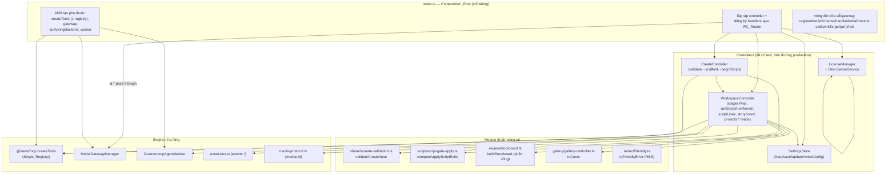
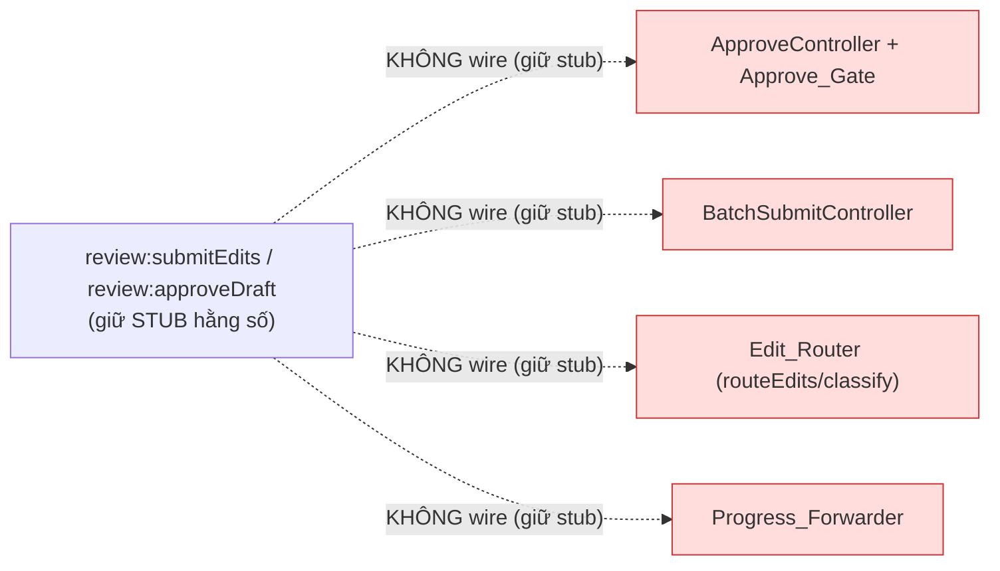

# Design Document

## Overview

Đây là thiết kế cho refactor **bảo toàn hành vi** (behavior-preserving) hợp nhất đường thực thi của Electron desktop app (`apps/desktop`). Vấn đề cốt lõi: toàn bộ logic nghiệp vụ production đang nằm nội tuyến trong `apps/desktop/src/main/index.ts` (~360 dòng, một "God module"), trong khi ~200 test lại kiểm chứng các controller control-plane **không được chạy trên đường production**. Mục tiêu (theo Requirements):

- `index.ts` trở thành **Composition_Root mỏng** — chỉ wiring (khởi tạo phụ thuộc, lắp ráp controller, đăng ký IPC_Router, vòng đời cửa sổ/gateway, `media://` scheme, `setEventTarget`). (R4.1, R4.2)
- Mọi logic nghiệp vụ của 23 IPC_Handler được ủy quyền cho controller **đã có test** nằm trên đúng đường thực thi. (R4.1, R4.5)
- Không còn `Dead_Controller`: mỗi controller hoặc được wire, hoặc bị gỡ có chủ đích cùng test mồ côi. (R5.1–R5.3)
- **Hành vi HIỆN TẠI trong `index.ts` là chuẩn (authoritative)**. Khi một controller/test phân kỳ với hành vi hiện tại, ta **sửa controller + test cho khớp hành vi hiện tại**, KHÔNG sửa ngược production cho khớp controller cũ. (R4.4)
- `Review_Edit_Loop` là tính năng **hoãn có chủ đích**: giữ stub (`review:submitEdits` → `{ ok: true, revision: 1 }`; `review:approveDraft` → `{ ok: false, reason: "draft-first" }`), và **gỡ bỏ** các controller chỉ phục vụ vòng này. (R1.5, R1.6, R5.5)

Nguyên tắc xuyên suốt: sau **mỗi** Incremental_Step, `Typecheck` + `Test_Suite` desktop + `Electron_Bundle` đều xanh và hành vi quan sát được không đổi (R6).

## Architecture

### Trạng thái hiện tại (vấn đề)

`index.ts` vừa wiring vừa chứa: `loadSettings`/`saveSettings`, logic Dev_License (`DEV_LICENSE_CODE = "123"`), điều phối staged (`runScript`/`runRender`/`stages` Map/`setStage`/`scriptLinesOf`/`storyboardScenesOf`), và 23 IPC_Handler nội tuyến. Các controller (`CreateController`, `ApproveController`, `BatchSubmitController`, `Edit_Router`, `ScriptApprovalGate`, `LicenseManager`, `HttpLicenseService`, `Disclosure_Map`…) đứng ngoài đường này.

### Kiến trúc đích

`index.ts` chỉ còn lắp ráp và ủy quyền. Logic sống trong bốn nhóm module có test: `LicenseManager` (+ `DevLicenseService`), `SettingsStore`, `WorkspaceController` (điều phối staged + đọc project/script), `CreateController`. Các controller chỉ phục vụ Review_Edit_Loop bị gỡ.



### Các controller bị gỡ (chỉ phục vụ Review_Edit_Loop — R5.5)



### Bố cục module sau refactor

```
apps/desktop/src/main/
  index.ts                       # Composition_Root (wiring thuần)
  license/
    license-manager.ts           # WIRE (giữ nguyên) + interface LicenseService
    dev-license-service.ts       # MỚI: DevLicenseService (mã "123")
    (license-service.ts)         # GỠ HttpLicenseService (xem §quyết định)
  settings/
    settings-store.ts            # MỚI: SettingsStore (khớp Current_Behavior)
  workspace/
    workspace-controller.ts      # MỚI: stages + runScript/runRender + reads
  create/create-controller.ts    # WIRE (cập nhật khớp current)
  script/script-gate-apply.ts    # WIRE (cập nhật thứ tự fold)
  review/storyboard.ts           # giữ buildStoryboard; GỠ BatchSubmitController
```

## Components and Interfaces

### 1. Composition_Root (`index.ts`)

Chỉ giữ bốn loại wiring (R4.2). Trình tự khởi động giữ nguyên: `registerMediaScheme()` trước app ready; `handleMediaProtocol()` + `startGateway()` + `createWindow()` khi ready (R7.6). `setEventTarget(win.webContents)` khi mở, `setEventTarget(null)` khi đóng (R7.7). Single_Registry: đúng một `createTools` (R4.6, R8.1).

```ts
// Lắp ráp (pseudocode minh hoạ trách nhiệm, KHÔNG chứa logic nghiệp vụ)
const tools = createTools({ ttsConfig: () => settingsStore.voiceConfig() }); // 1 registry
const gateway = new ModelGatewayManager(buildNineRouterGatewayDeps({ client, openExternal }));
const authoringBackend = new NineRouterAuthoringBackend({
  client, tools, model: () => gateway.selectedModel()?.id, apiKey: () => undefined,
  onRenderProgress: (ratio, projectId) => events.progress({ projectId, ratio, phase: "draft" }),
});
const worker = new CustomLoopAgentWorker(authoringBackend);

const settingsStore = new SettingsStore({ home: videoToolHome(), defaults: defaultSettings,
  envApiKey: vivibeApiKey, envVoiceId: defaultVivibeVoiceId });
const license = new LicenseManager({ service: new DevLicenseService(), machineId: "dev" });
const workspace = new WorkspaceController({ tools, worker, events, settings: settingsStore,
  loadManifest, writeJson, projectPaths, mediaUrl, exists: existsSync, rm, reveal: (p) => shell.openPath(p) });
const create = new CreateController({ tools, worker, beginScript: (id, input) => workspace.beginScript(id, input) });

registerIpcRouter(ipcMain, buildHandlers({ license, settingsStore, workspace, create, gateway }));
```

`buildHandlers` chỉ là bảng ánh xạ channel → method controller (xem bảng dưới); không có nhánh nghiệp vụ. Hai handler `review:*` là stub hằng số (R1.5/R1.6) — không phải logic nghiệp vụ nên được phép nằm tại đây dưới dạng pass-through phẳng.

### 2. Bảng ánh xạ 23 IPC_Handler → chủ sở hữu logic (R1.1, R4.1)

| IPC_Handler | Chủ sở hữu sau refactor | Ghi chú hành vi (Current_Behavior) |
|---|---|---|
| `license:get` | `LicenseManager.current()` | thin pass-through |
| `license:activate` | `LicenseManager.activate(key)` qua `DevLicenseService` | trim `"123"`→active(now); khác→error invalid (R3.2/R3.3) |
| `ai:gatewayState` | `ModelGatewayManager.state()` | thin pass-through |
| `ai:listProviders` | `gateway.listProviders()` | thin |
| `ai:connectedAccounts` | `gateway.refreshConnections()` | thin |
| `ai:beginConnect` | `gateway.beginConnect(id)` | thin |
| `ai:listModels` | `gateway.listModels()` | thin |
| `ai:selectModel` | `gateway.selectModel({id,label})` | model đã chọn lưu trong gateway, bỏ biến module-level |
| `ai:selectedModel` | `gateway.selectedModel()` | thin |
| `projects:list` | `WorkspaceController.list()` | `tools.list_projects`→`toCards`→bọc `mediaUrl`; lỗi→`[]` (R1.7) |
| `projects:create` | `CreateController.create(raw)` | validate→scaffold→`beginScript`; invalid ném `reason` (R1.3) |
| `projects:stage` | `WorkspaceController.stage(id)` | quy tắc phục hồi đĩa (R2.8) |
| `projects:open` | `WorkspaceController.open(id)` | storyboard, lỗi→scenes rỗng (R1.7) |
| `projects:delete` | `WorkspaceController.delete(id)` | `stages.delete` + `rm(root)` |
| `projects:reveal` | `WorkspaceController.reveal(id)` | `shell.openPath` (seam tiêm) |
| `script:get` | `WorkspaceController.scriptGate(id)` | scriptLines + `scriptGateEnabled`; lỗi→`scenes:[]` (R1.7) |
| `script:applyEdits` | `WorkspaceController.applyEdits()` → `applyScriptEdits` | guard empty-narration (R1.4); re-set stage nếu đang `script` |
| `script:approve` | `WorkspaceController.approve(id)` → `runRender` | (R2.4) |
| `script:setEnabled` | `SettingsStore.setScriptGateEnabled(v)` | `Boolean(enabled)` + ghi đĩa (R3.9) |
| `review:submitEdits` | stub hằng số tại Composition_Root | `{ ok: true, revision: 1 }` (R1.6) |
| `review:approveDraft` | stub hằng số tại Composition_Root | `{ ok: false, reason: "draft-first" }` (R1.5) |
| `settings:get` | `SettingsStore.current()` | thin |
| `settings:update` | `SettingsStore.update(patch)` | merge patch ưu tiên, ép `voiceProvider`, ghi đĩa, trả về (R3.8) |

### 3. WorkspaceController (`workspace/workspace-controller.ts`) — MỚI

Nơi ở có test cho điều phối Staged_Workspace (hiện là `runScript`/`runRender` + `stages` Map nội tuyến) **và** các thao tác đọc project/script. Tất cả phụ thuộc Electron/engine được tiêm qua seam để test không cần Electron.

```ts
export interface WorkspaceDeps {
  tools: ReturnType<typeof createTools>;
  worker: AgentWorker;
  events: { progress; scene; status; friendlyError };   // event-bus
  settings: Pick<SettingsStore, "scriptGateEnabled" | "maxRepairAttempts">;
  loadManifest; writeJson; projectPaths;                 // @news/pipeline
  mediaUrl: (p: string | null) => string | null;
  exists: (p: string) => boolean;
  rm; reveal;
}

export class WorkspaceController {
  private readonly stages = new Map<string, ProjectStage>();
  setStage(id, stage): void;                 // + events.status (building/draft-ready/error)
  beginScript(id, input): void;              // setStage(writing) + void runScript  (R2.1)
  private runScript(id, input): Promise<void>;   // R2.2/R2.3/R2.7
  approve(id): void;                         // void runRender                       (R2.4)
  private runRender(id): Promise<void>;      // R2.5/R2.6/R2.7/R2.9
  stage(id): Promise<ProjectStage>;          // recovery rules                        (R2.8)
  list(): Promise<ProjectCardVM[]>;          // toCards + mediaUrl, fallback []       (R1.7)
  open(id): Promise<StoryboardModel>;        // fallback scenes []                    (R1.7)
  delete(id): Promise<void>;
  reveal(id): Promise<void>;
  scriptGate(id): Promise<ScriptGateModel>;  // fallback scenes []                    (R1.7)
  applyEdits(id, edits): Promise<ApplyResult>;   // qua applyScriptEdits              (R1.4)
}
```

Bất biến hành vi cần bảo toàn chính xác:
- `runScript`: `setStage(writing)` → `worker.author({ scriptGate: settings.scriptGateEnabled })`; nếu `kind !== "authored"` → `error` + `friendlyError(retry:"create")`; nếu gate ON → stage `script` kèm `scriptLinesOf`; nếu gate OFF → `runRender` ngay (R2.2/R2.3). Catch → `error` + `friendlyError(retry:"create")` (R2.7).
- `runRender`: `setStage(rendering, percent:0)`; `onProgress(ratio)` → `setStage(rendering, percent: Math.round(ratio*100))` + `events.progress(phase:"draft")` (R2.5/R2.9); `onSceneProduced` → `events.scene(stillPath bọc mediaUrl)`; `passed` → `ready` kèm storyboard stills thật (R2.6); thất bại/throw → `error` + `friendlyError(retry:"draft")` (R2.7).
- `stage(id)` phục hồi: không còn trong Map → đọc đĩa: `scenes.length === 0` ⇒ `writing`; có stills (`<reviewDir>/<sceneId>.png` tồn tại) ⇒ `ready`; còn lại ⇒ `script`; throw ⇒ `writing` (R2.8).
- Storyboard `ready`/`open` dùng `buildStoryboard` (phần sống của `storyboard.ts`, R5.6) **đã hợp nhất** để bọc đường dẫn qua `mediaUrl` (khớp `storyboardScenesOf` hiện tại) thay vì trả `${root}/review/...` thô.

### 4. SettingsStore (`settings/settings-store.ts`) — MỚI

Đóng gói `Settings_Store` (`news-studio-settings.json`) đúng theo Current_Behavior (KHÔNG dùng `normalizeSettings` vì nó clamp `maxRepairAttempts` — đó là phân kỳ, R4.4). Dùng lại `defaultSettings(videoToolHome())`.

```ts
export class SettingsStore {
  constructor(deps: { home; defaults; envApiKey; envVoiceId; readFile?; writeFile?; exists? });
  current(): SettingsModel;
  // load: merge saved CHỒNG LÊN defaults (saved ưu tiên), ép voiceProvider="vivibe",
  //       ép aiAccount = default.aiAccount; lỗi đọc/parse → defaults, không ném (R3.4/R3.5)
  update(patch): SettingsModel;        // {...cur, ...patch, voiceProvider:"vivibe"} + save + return (R3.8)
  setScriptGateEnabled(v): void;       // scriptGateEnabled = Boolean(v) + save (R3.9)
  voiceConfig(): { apiKey; voiceId };  // setting.trim() nếu khác rỗng, else env fallback (R3.7)
  private save(): void;                // ghi JSON đã loại trừ aiAccount (R3.6)
  scriptGateEnabled; maxRepairAttempts;
}
```

`voiceConfig()` chính là callback `ttsConfig` truyền vào `createTools` — giữ nguyên nguồn cấu hình Voice (R8.4: không tự fallback mock/none, chỉ chuyển đúng config xuống tools).

### 5. LicenseManager + DevLicenseService

`LicenseManager` (đã có test) khớp sẵn máy trạng thái `unactivated → active/error` (R3.1). Không đổi logic. Thêm `DevLicenseService implements LicenseService` để hiện thực Dev_License "123":

```ts
export class DevLicenseService implements LicenseService {
  async activate(key: string): Promise<ActivationOutcome> {
    return key.trim() === "123" ? { ok: true, nodeLocked: true } : { ok: false, reason: "invalid" };
  }
  async verify(): Promise<ActivationOutcome> { return { ok: false, reason: "invalid" }; }
}
```

`license:activate` → `manager.activate(key)` → `DevLicenseService.activate` → `outcomeToState(outcome, now())`. Kết quả: trim `"123"` → `{ kind:"active", machineLocked:true, lastVerifiedAt: <ISO now> }`; ngược lại (kể cả rỗng) → `{ kind:"error", reason:"invalid" }` (R3.2/R3.3). Trạng thái `activating` trung gian không quan sát được qua giá trị trả về của handler nên hành vi tương đương.

### 6. CreateController — WIRE (cập nhật khớp Current_Behavior)

`CreateController` hiện tại (web-dashboard) trả friendly-error và tự gọi `worker.author`, KHÔNG khớp luồng staged hiện tại (vốn `validate → scaffold → setStage writing → runScript`). Theo R4.4, cập nhật `CreateController` để khớp current và để nó là **đường create duy nhất** (R4.5):

```ts
export class CreateController {
  constructor(deps: { tools; beginScript: (id, input) => void });
  async create(raw: string): Promise<{ projectId: string }> {
    const v = validateCreateInput({ raw });
    if (!v.ok) throw new Error(v.reason);                       // R1.3 (không scaffold)
    const prompt = v.classified.kind === "url" ? v.classified.url : v.classified.text;
    const res = await this.tools.scaffold_project({ prompt });  // Single_Registry (R4.6)
    if (!res.ok) throw new Error(res.error.cause);              // khớp current
    const input: AuthorInput = v.classified.kind === "url"
      ? { kind: "url", url: v.classified.url } : { kind: "topic", text: v.classified.text };
    this.beginScript(res.data.projectId, input);               // → WorkspaceController (R2.1)
    return { projectId: res.data.projectId };
  }
}
```

`validateCreateInput` vẫn ở `shared/create-validation.ts`, dùng chung cho renderer + production — KHÔNG gỡ (R5.7). Test `create-controller.test.ts` + `create-flow.test.ts` được cập nhật để khẳng định hành vi current (ném `reason` khi invalid, scaffold đúng 1 lần qua 1 registry, gọi `beginScript`).

### 7. Bảng quyết định controller (R5.1–R5.7)

| Controller | Quyết định | Lý do / test mồ côi |
|---|---|---|
| `CreateController` (class) | **WIRE** (cập nhật) | đường create duy nhất; cập nhật `create-controller.test.ts`, `create-flow.test.ts` |
| `validateCreateInput` | **GIỮ** | shared, dùng bởi production + renderer (R5.7) |
| `LicenseManager` + `outcomeToState`/`canCreate` | **WIRE** | không đổi logic; `license-manager.test.ts`, phần `outcomeToState`/`LicenseManager` của `license-lifecycle.test.ts` giữ |
| `DevLicenseService` | **WIRE (MỚI)** | hiện thực Dev_License "123"; thêm test |
| `HttpLicenseService` (`license-service.ts`) | **GIỮ** (R5.4 justification) | adapter licensing online tương lai, đứng sau seam `interface LicenseService`, độc lập (không shadow đường production), đã có test test đúng chính nó; `DevLicenseService` là impl được wire, đổi sang online sau này chỉ là một dòng wiring. Giữ describe `HttpLicenseService` trong `license-lifecycle.test.ts` |
| `script-gate-apply.ts` (`computeScriptEdits`/`applyScriptEdits`) | **WIRE** (cập nhật thứ tự fold) | dùng cho `script:applyEdits`; cập nhật fold theo thứ tự scene của manifest để chọn đúng `sceneId` lỗi như current; cập nhật `script-gate-apply.test.ts` |
| `ScriptApprovalGate` (`script-gate.ts`) | **GỠ** | current chỉ gate bằng `settings.scriptGateEnabled` (do WorkspaceController xử lý); ngữ nghĩa pending-approve KHÔNG thuộc current; gỡ `script-gate.test.ts` |
| `storyboard.ts` → `buildStoryboard` | **GIỮ phần sống** (R5.6) | dùng dựng storyboard stage `ready`; hợp nhất bọc `mediaUrl`; giữ test `buildStoryboard` |
| `storyboard.ts` → `BatchSubmitController` + `validateBatch` | **GỠ** | chỉ phục vụ Review_Edit_Loop (R5.5); gỡ phần `BatchSubmitController` của `storyboard.test.ts` + `batch-submit-controller.ts`/`.test.ts` |
| `Edit_Router` (`edit-router.ts`) | **GỠ** | chỉ `BatchSubmitController` dùng; gỡ `edit-router.test.ts` (R5.5) |
| `ApproveController` + `Approve_Gate` (`approve-controller.ts`, `approve-gate.ts`) | **GỠ** | phục vụ full-render/Review_Edit_Loop (R5.5; R8.2 không wire full-render); gỡ `approve-gate.test.ts`, `approve-progress.test.ts` |
| `Progress_Forwarder` (`progress-forwarder.ts`) | **GỠ** | chỉ `approve-progress.test.ts` dùng, không trên production (current map `onProgress` nội tuyến); gỡ test (R5.5) |
| `Disclosure_Map` (`disclosure.ts`) | **GỠ** | `views.tsx` không tham chiếu → dead; gỡ `disclosure.test.ts`. *Thay thế hợp lệ R5.4: giữ nếu UI settings dùng tới* — xem §Quyết định mở |
| `normalizeSettings` (`settings-model.ts`) | **GỠ** (giữ `defaultSettings`) | không trên production (clamp = phân kỳ); gỡ describe `normalizeSettings` trong `settings-model.test.ts`; `defaultSettings` giữ (App.tsx + SettingsStore dùng) |
| `toCards` (`gallery-controller.ts`) | **GIỮ/WIRE** | đã dùng bởi `projects:list` |
| `toFriendlyError` (`redact/friendly.ts`) | **GIỮ** | redaction R8.5; dùng ở đường lỗi create/render, bảo toàn thông điệp current |
| `preserved-invariants.test.ts` | **CẬP NHẬT** | bỏ phụ thuộc `ApproveController`; kiểm chứng R8.3/R8.4/R8.5 trực tiếp qua `tools.render_full`; giữ kiểm chứng Single_Registry (R8.1) qua `tools.scaffold_project` |

### §Quyết định mở (đề xuất, cần xác nhận khi triển khai)

- **`HttpLicenseService`**: **GIỮ** (đã chốt). Đây là adapter licensing online tương lai, đứng sau seam `interface LicenseService`, hoàn toàn độc lập và KHÔNG shadow đường production (khác bản chất với chuỗi Review_Edit_Loop) — test của nó kiểm đúng chính nó, không tạo "false confidence". Theo R5.4 nó được giữ kèm justification này. `DevLicenseService` là impl được wire vào production; để bật online về sau chỉ cần đổi đúng một dòng wiring `new DevLicenseService()` → `new HttpLicenseService({ endpoint })` và thêm endpoint config — không đụng `LicenseManager`/IPC/renderer.
- **`Disclosure_Map`**: **GỠ** (đã chốt, S6) — `views.tsx` không dùng và không nằm trong seam tương lai nào.
- **`toFriendlyError` (`redact/friendly.ts`)**: **GIỮ** (R5.4 justification). Tiện ích redaction thuần (Property 6 test test chính nó). Current_Behavior của dashboard hiện surfacing `e.message`/`error.cause` trực tiếp, KHÔNG đi qua `toFriendlyError` — wiring nó vào sẽ đổi message hiển thị = đổi hành vi (ngoài phạm vi refactor). Giữ lại cho bước cải thiện dashboard-redaction về sau (và khi hiện thực Review_Edit_Loop). Bất biến redaction R8.5 hiện được kiểm ở biên engine-tool trong `preserved-invariants.test.ts`.

## Data Models

Refactor này **không** đổi định dạng dữ liệu lưu trữ hay hợp đồng IPC (out of scope). Các shape giữ nguyên từ `shared/types.ts`:

- `LicenseState`, `SettingsModel`, `ProjectStage` (`writing | script | rendering | ready | error`), `ScriptLine`, `SceneCard`, `StoryboardModel`, `ScriptGateModel`, `ApplyResult`, `ProgressEvent`/`SceneEvent`/`StatusEvent`/`FriendlyError`.
- `Settings_Store` trên đĩa: JSON của `SettingsModel` **loại trừ `aiAccount`** (R3.6) — không đổi.
- `media://` URL: `media://file/<encoded-abs-path>` qua `mediaUrl()` — không đổi (R7.6).

Không thêm bảng/khóa mới. `SettingsStore`/`WorkspaceController` chỉ tái cấu trúc *nơi chứa* logic, không đổi *hình dạng* dữ liệu.

## Correctness Properties

*Một property là đặc tính/hành vi phải đúng trên MỌI thực thi hợp lệ của hệ thống — một phát biểu hình thức về điều phần mềm phải làm. Properties là cầu nối giữa đặc tả người-đọc-được và đảm bảo đúng-đắn máy-kiểm-được.*

Refactor này có nhiều logic thuần đã tách (license, settings, script-edits, stage recovery) phù hợp property-based testing. Các tiêu chí kiến trúc (R4.1–R4.3), không-dead-controller (R5.x), và CI (R6.x) KHÔNG phải property tính toán — chúng được bảo đảm bằng review + Test_Suite/Typecheck/Bundle xanh. Các bất biến engine (R8.3–R8.5) và Single_Registry (R4.6/R8.1) được kiểm bằng example/integration (xem Testing Strategy).

Mọi property phủ cùng một bất biến tổng quát của refactor: **controller đã wire tạo ra output quan sát được trùng khớp Current_Behavior** cho toàn dải input.

### Property 1: License activate mapping

*Với mọi* chuỗi `key`, `LicenseManager.activate(key)` qua `DevLicenseService`: nếu `key.trim() === "123"` thì trạng thái là `{ kind: "active", machineLocked: true, lastVerifiedAt }` với `lastVerifiedAt` là chuỗi ISO 8601 hợp lệ; ngược lại (mọi `key` mà `trim() !== "123"`, kể cả rỗng/toàn whitespace) trạng thái là `{ kind: "error", reason: "invalid" }` và KHÔNG bao giờ là `active`.

**Validates: Requirements 3.2, 3.3**

### Property 2: Settings load merge precedence

*Với mọi* `defaults` và `saved` (partial bất kỳ), kết quả `SettingsStore.current()` sau load thỏa: với mọi khóa khác `voiceProvider`/`aiAccount`, giá trị bằng `saved[k]` nếu có mặt, ngược lại `defaults[k]`; `voiceProvider === "vivibe"`; và `aiAccount === defaults.aiAccount` (luôn ép theo default, bỏ qua giá trị saved).

**Validates: Requirements 3.4**

### Property 3: Settings update merge precedence (không clamp)

*Với mọi* `current` và `patch`, `SettingsStore.update(patch)` trả về `{ ...current, ...patch, voiceProvider: "vivibe" }`: mọi khóa trong `patch` được ưu tiên, `voiceProvider` luôn `"vivibe"`, và `maxRepairAttempts` KHÔNG bị clamp (giữ đúng giá trị merge — khác `normalizeSettings`); đồng thời giá trị persisted ra đĩa khớp kết quả trả về (đã loại `aiAccount`).

**Validates: Requirements 3.8**

### Property 4: Settings persistence loại trừ aiAccount

*Với mọi* `SettingsModel`, sau khi `save()`, văn bản JSON đọc lại từ `Settings_Store` KHÔNG chứa khóa `aiAccount`, và mọi khóa còn lại bằng đúng giá trị tương ứng của settings.

**Validates: Requirements 3.6**

### Property 5: Voice config resolution

*Với mọi* `settings.voiceApiKey`/`settings.voiceId` (bao gồm undefined/rỗng/whitespace) và fallback env `vivibeApiKey()`/`defaultVivibeVoiceId()`, `voiceConfig()` trả `apiKey` = `voiceApiKey.trim()` nếu khác rỗng sau trim, ngược lại env key; và `voiceId` = `voiceId.trim()` nếu khác rỗng sau trim, ngược lại env voice id.

**Validates: Requirements 3.7**

### Property 6: Script-gate setEnabled là Boolean coercion

*Với mọi* giá trị `enabled` truyền vào, sau `SettingsStore.setScriptGateEnabled(enabled)` thì `scriptGateEnabled === Boolean(enabled)` và trạng thái đã được ghi xuống `Settings_Store`.

**Validates: Requirements 3.9**

### Property 7: Empty-narration guard cho applyEdits

*Với mọi* tập `scenes` (theo thứ tự manifest) và `edits`, nếu tồn tại một edit làm narration của một scene chỉ còn ký tự trắng thì `applyScriptEdits` trả `{ ok: false, reason: "empty-narration", sceneId }` với `sceneId` là scene **đầu tiên theo thứ tự manifest** bị làm rỗng, KHÔNG scene nào bị thay đổi và hàm `writeScenes` KHÔNG được gọi; ngược lại mọi edit hợp lệ được áp đúng và `writeScenes` được gọi đúng một lần.

**Validates: Requirements 1.4**

### Property 8: Project stage recovery rules

*Với mọi* trạng thái trên đĩa của một project không còn trong `stages` Map, `WorkspaceController.stage(id)` trả: `writing` nếu manifest không có scene; `ready` nếu có ít nhất một still `<reviewDir>/<sceneId>.png`; `script` trong các trường hợp còn lại; và `writing` nếu việc đọc đĩa ném lỗi.

**Validates: Requirements 2.8**

### Property 9: Render progress mapping gắn đúng projectId

*Với mọi* `ratio ∈ [0,1]` mà `worker` phát trong `runRender(projectId)`, `WorkspaceController` đặt stage `{ kind: "rendering", percent: Math.round(ratio*100) }` và phát `events:progress` với `{ projectId, ratio, phase: "draft" }` — `projectId` luôn là project đang render.

**Validates: Requirements 2.5, 2.9**

### Property 10: Create invalid input ném reason và không scaffold

*Với mọi* `raw` không hợp lệ theo `validateCreateInput` (rỗng/toàn whitespace/quá dài/URL hỏng), `CreateController.create(raw)` ném lỗi mang đúng `reason` của kết quả validate và `tools.scaffold_project` KHÔNG được gọi.

**Validates: Requirements 1.3**

## Error Handling

Refactor bảo toàn nguyên các nhánh xử lý lỗi của Current_Behavior; chỉ đổi *nơi chứa*:

- **Fallback đọc dữ liệu (R1.7)**: `WorkspaceController.list()` → `[]` khi `tools.list_projects` lỗi; `open()` → `{ scenes: [], globalNotes: "" }` khi `loadManifest` ném; `scriptGate()` → `{ scenes: [] }` khi ném. Lỗi không lan ra renderer.
- **Settings (R3.5)**: `SettingsStore` nuốt lỗi đọc/parse (`try/catch` + `console.warn`) và trả `defaults`; lỗi ghi cũng nuốt (`console.warn`) — không làm dừng khởi động.
- **Staged flow (R2.7)**: `runScript`/`runRender` bắt mọi throw, đặt stage `error` kèm `message` và phát `events:friendlyError` với `retry` đúng (`create` cho giai đoạn viết, `draft` cho render). Thông điệp giữ nguyên như current (`"Có lỗi khi viết kịch bản."` / `"Có lỗi khi dựng video."` / `outcome.message`).
- **Create (R1.3)**: `create` ném `reason` (invalid) hoặc `res.error.cause` (scaffold fail) — IPC chuyển thành lỗi reject ở renderer, đúng như current.
- **Redaction (R8.5)**: `toFriendlyError` tiếp tục dùng cho đường lỗi engine để không lộ chi tiết nội bộ (`VOICE_ID`, khóa cấu hình, đường dẫn, stack trace) lên UI; được kiểm trong `preserved-invariants.test.ts`.
- **IPC_Router (R7.5)**: kênh chưa có handler tiếp tục ném `"No handler registered"`.

## Testing Strategy

### Cách tiếp cận kép

- **Property tests** (≥100 vòng, dùng `fast-check`, đã có trong repo): bao 10 property phổ quát ở trên cho logic thuần (license, settings, script-edits, stage recovery, create-validate, render-progress).
- **Unit/example tests**: stub `review:*` (R1.5/R1.6), fallback đọc lỗi (R1.7/R3.5), ipc-router đăng ký đúng kênh + `"No handler registered"` (R7.1/R7.5), preload chỉ phơi `window.dashboard` (R7.2/R7.3).
- **Integration/characterization**: `preserved-invariants.test.ts` (cập nhật) kiểm Single_Registry (R4.6/R8.1) qua `tools.scaffold_project`, và bất biến engine draft-first/voice-no-downgrade/redaction (R8.3/R8.4/R8.5) qua `tools.render_full` trực tiếp.

### Cấu hình property test

- Mỗi property test gắn tag tham chiếu design property, định dạng:
  `// Feature: reconcile-main-controllers, Property {n}: {tên property}`
- Tối thiểu 100 vòng/property (mặc định fast-check).
- Mỗi correctness property hiện thực bằng MỘT property test.

### Verify mỗi Incremental_Step (R6)

Sau mỗi bước chạy (ở gốc monorepo):

```
npm run typecheck      # R6.1
npm test               # R6.2 (desktop suite qua scripts/test.ts)
npm run build:renderer && npm run build:main   # R6.3 (Electron_Bundle)
```

Nếu bất kỳ bước nào đỏ → sửa trước khi sang bước kế (R6.4). Lệnh dài (dev server) KHÔNG chạy trong CI bước này — người dùng tự chạy thủ công nếu cần.

> Lưu ý: các property test dùng generator ngẫu nhiên (fast-check); khi chạy `npm test` đây là test thuộc property-based suite.

## Incremental Migration Strategy (R6.5)

Mỗi bước độc lập, tự đứng vững, để lại Typecheck + Test_Suite + Bundle xanh và hành vi quan sát được không đổi. Thứ tự chọn để giảm rủi ro: gỡ phần chết trước (thu nhỏ bề mặt), rồi trích-và-wire từng controller, cuối cùng làm gầy `index.ts`.

| Bước | Nội dung | Bảo toàn / Validates |
|---|---|---|
| **S0** | Chốt characterization baseline: chụp bảng case Current_Behavior cho `license:activate`, `settings:update`/load, `script:applyEdits` (empty-narration), `projects:stage` recovery — dùng làm lưới so sánh tương đương. | R1.2 |
| **S1** | **Gỡ Review_Edit_Loop set**: xoá `ApproveController`, `approve-gate.ts`, `batch-submit-controller.ts`, `edit-router.ts`, `progress-forwarder.ts` + test mồ côi; gỡ phần `BatchSubmitController` của `storyboard.test.ts` (giữ `buildStoryboard`); cập nhật `preserved-invariants.test.ts` bỏ `ApproveController`. Giữ stub `review:*` nội tuyến. | R5.5, R1.5, R1.6, R5.6 |
| **S2** | **SettingsStore**: tạo `settings/settings-store.ts` (khớp current, không clamp), thêm property test (P2–P6); wire `settings:get/update`, `script:setEnabled`, và `ttsConfig` của `createTools` qua store; gỡ `loadSettings`/`saveSettings` nội tuyến; gỡ `normalizeSettings` + test mồ côi (giữ `defaultSettings`). | R3.4–R3.9, R8.4 |
| **S3** | **License**: thêm `dev-license-service.ts` (P1) + test; wire `license:get/activate` qua `LicenseManager`; gỡ `DEV_LICENSE_CODE`/biến `license` nội tuyến. GIỮ `HttpLicenseService` + interface + test (R5.4, adapter online tương lai). | R3.1–R3.3, R5.1, R5.4 |
| **S4** | **WorkspaceController**: trích `stages`/`setStage`/`runScript`/`runRender`/`scriptLinesOf`/`storyboardScenesOf` + `projects:list/stage/open/delete/reveal` + `script:get/applyEdits/approve` vào `workspace/workspace-controller.ts` (seam tiêm); hợp nhất `buildStoryboard` để bọc `mediaUrl`; thêm property test (P7–P9); wire handlers tương ứng. | R2.1–R2.9, R1.4, R1.7, R5.6 |
| **S5** | **CreateController**: cập nhật class khớp current (validate→scaffold→`beginScript`), cập nhật `create-controller.test.ts`/`create-flow.test.ts` (P10); wire `projects:create` qua controller; gỡ logic create nội tuyến. | R1.3, R2.1, R4.5, R4.6 |
| **S6** | **Gỡ Disclosure_Map** (`disclosure.ts` + test) nếu không dùng (hoặc giữ kèm justification R5.4); rà soát `index.ts` còn lại chỉ wiring (R4.1–R4.3); kiểm `INVOKE_CHANNELS`/`EVENT_CHANNELS`/`DashboardApi` không đổi. | R4.1–R4.3, R5.1, R7.1–R7.3 |
| **S7** | Quét cuối: không còn module control-plane có test mà ngoài đường production; chạy đủ lưới Typecheck/Test/Bundle; đối chiếu lại lưới characterization S0. | R5.3, R6.1–R6.3, R1.2 |

## IPC Allowlist & Preload Contract (R7)

Không thay đổi bề mặt biên renderer↔main:

- `INVOKE_CHANNELS` (23 kênh) và `EVENT_CHANNELS` (4 kênh) trong `shared/channels.ts` **giữ nguyên** (R7.1). Không có nhu cầu sửa allowlist → không kích hoạt R7.4.
- `DashboardApi` trong `shared/ipc-contract.ts` **giữ nguyên**; preload chỉ phơi `window.dashboard`, không phơi `ipcRenderer`/Node (R7.2/R7.3).
- `IPC_Router` tiếp tục chỉ đăng ký kênh thuộc allowlist và ném `"No handler registered"` cho kênh thiếu handler (R7.5).
- `registerMediaScheme()` (trước app ready) + `handleMediaProtocol()` (khi ready) giữ nguyên; mọi đường dẫn media trả renderer tiếp tục bọc `mediaUrl()` (R7.6).
- `setEventTarget(win.webContents)` khi tạo cửa sổ và `setEventTarget(null)` khi đóng giữ nguyên (R7.7).
