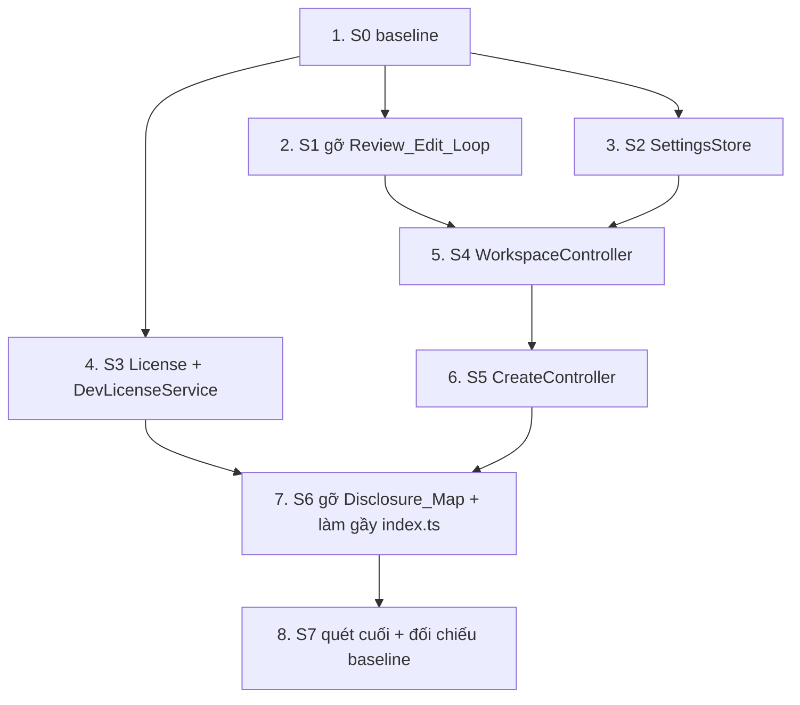

# Implementation Plan

## Overview

Kế hoạch triển khai cho refactor **bảo toàn hành vi** `reconcile-main-controllers`.
Bám đúng Incremental Migration Strategy (S0–S7) trong `design.md`. **Quy tắc bất biến cho MỌI task:** sau khi hoàn tất phải chạy lưới verify và để xanh hết —

```
npm run typecheck
npm test
npm run build:renderer && npm run build:main
```

và hành vi quan sát được của app KHÔNG đổi (R6). Khi cập nhật một controller cho khớp Current_Behavior thì **test của nó phải được cập nhật trong cùng task và pass** (R4.4, R4.7).

## Tasks

- [x] 1. S0 — Lưới characterization baseline
  - [x] 1.1 Viết test characterization chụp lại Current_Behavior làm lưới so sánh tương đương: bảng case cho `license:activate` (trim `"123"` → active; khác → error invalid), `settings` load/merge + `update`, `script:applyEdits` guard empty-narration, và quy tắc phục hồi `projects:stage`. Đặt dưới `apps/desktop/src/main/` cạnh khu vực tương ứng.
  - [x] 1.2 Chạy lưới verify (typecheck + test + bundle) để xác nhận baseline xanh trước khi đụng code.
  - _Requirements: R1.2_

- [x] 2. S1 — Gỡ chuỗi Review_Edit_Loop (REMOVE-set) + test mồ côi
  - [x] 2.1 Xoá `apps/desktop/src/main/review/approve-controller.ts`, `review/approve-gate.ts`, `review/batch-submit-controller.ts` (chứa `validateBatch`), `review/edit-router.ts` (chứa `routeEdits`), `review/progress-forwarder.ts` cùng các file test chỉ phục vụ chúng: `approve-gate.test.ts`, `approve-progress.test.ts` (test này cũng phủ `approve-controller.ts` + `progress-forwarder.ts` — hai file đó không có test riêng), `batch-submit-controller.test.ts`, `edit-router.test.ts`.
  - [x] 2.2 Trong `review/storyboard.ts` chỉ giữ `buildStoryboard` (phần sống); gỡ class `BatchSubmitController` và các import đã chết ở đầu file (`import { routeEdits } from "./edit-router.js"`, `import { validateBatch } from "./batch-submit-controller.js"`). Trong `storyboard.test.ts` gỡ block `describe("BatchSubmitController...")`, giữ `describe("buildStoryboard")`.
  - [x] 2.3 Cập nhật `preserved-invariants.test.ts`: bỏ phụ thuộc `ApproveController`; giữ kiểm chứng bất biến engine qua `tools.render_full`/`tools.scaffold_project` (chuẩn bị cho S7).
  - [x] 2.4 Xác nhận hai handler `review:submitEdits`/`review:approveDraft` vẫn là stub hằng số (`{ ok: true, revision: 1 }` / `{ ok: false, reason: "draft-first" }`) — KHÔNG wire gì vào.
  - [x] 2.5 Chạy lưới verify.
  - _Requirements: R5.5, R5.6, R1.5, R1.6_

- [ ] 3. S2 — `SettingsStore` (mới, có property test)
  - [ ] 3.1 Tạo `apps/desktop/src/main/settings/settings-store.ts` khớp Current_Behavior: `current()`, `load` (merge saved chồng lên `defaultSettings(videoToolHome())` với saved ưu tiên, ép `voiceProvider="vivibe"`, ép `aiAccount = default.aiAccount`, lỗi đọc/parse → defaults không ném), `update(patch)` (merge patch ưu tiên + ép `voiceProvider` + save + return, KHÔNG clamp), `setScriptGateEnabled(Boolean(v))` + save, `voiceConfig()` (setting.trim() nếu khác rỗng, else env fallback), `save()` (ghi JSON loại trừ `aiAccount`). Tiêm seam đọc/ghi file để test không cần đĩa thật.
  - [ ] 3.2 Property test P2 — Settings load merge precedence. `// Feature: reconcile-main-controllers, Property 2: Settings load merge precedence` (_R3.4_).
  - [ ] 3.3 Property test P3 — Settings update merge precedence (không clamp) + persisted khớp return. `Property 3` (_R3.8_).
  - [ ] 3.4 Property test P4 — Persistence loại trừ `aiAccount`. `Property 4` (_R3.6_).
  - [ ] 3.5 Property test P5 — Voice config resolution. `Property 5` (_R3.7_).
  - [ ] 3.6 Property test P6 — `setScriptGateEnabled` là Boolean coercion + ghi đĩa. `Property 6` (_R3.9_).
  - [ ] 3.7 Wire `settings:get`/`settings:update`/`script:setEnabled` và callback `ttsConfig` của `createTools` qua `SettingsStore`; gỡ `loadSettings`/`saveSettings` nội tuyến trong `index.ts`; gỡ `normalizeSettings` (+ test mồ côi) khỏi `settings-model.ts`, GIỮ `defaultSettings`.
  - [ ] 3.8 Chạy lưới verify.
  - _Requirements: R3.4–R3.9, R8.4_

- [ ] 4. S3 — License: `DevLicenseService` + wire (GIỮ `HttpLicenseService`)
  - [ ] 4.1 Tạo `apps/desktop/src/main/license/dev-license-service.ts` (`DevLicenseService implements LicenseService`): `activate` → trim `"123"` ⇒ `{ ok: true, nodeLocked: true }`, ngược lại `{ ok: false, reason: "invalid" }`; `verify` → `{ ok: false, reason: "invalid" }`. Thêm test cho nó.
  - [ ] 4.2 Property test P1 — License activate mapping qua `LicenseManager` + `DevLicenseService`. `Property 1` (_R3.2, R3.3_).
  - [ ] 4.3 Wire `license:get`/`license:activate` qua `LicenseManager` (dùng `DevLicenseService`); gỡ `DEV_LICENSE_CODE` và biến `license` nội tuyến trong `index.ts`. Khởi tạo license `unactivated` (R3.1).
  - [ ] 4.4 GIỮ `license-service.ts` (`HttpLicenseService`) + `interface LicenseService` + describe test của nó (R5.4 — adapter licensing online tương lai, đứng sau seam).
  - [ ] 4.5 Chạy lưới verify.
  - _Requirements: R3.1–R3.3, R5.1, R5.4_

- [ ] 5. S4 — `WorkspaceController` (mới, có property test)
  - [ ] 5.1 Tạo `apps/desktop/src/main/workspace/workspace-controller.ts`, trích từ `index.ts`: `stages` Map + `setStage` (+ `events.status`), `beginScript`/`runScript`, `approve`/`runRender`, `scriptLinesOf`, `storyboardScenesOf`, và các thao tác đọc `list`/`stage`/`open`/`delete`/`reveal`/`scriptGate`/`applyEdits`. Mọi phụ thuộc Electron/engine/pipeline tiêm qua seam (`tools`, `worker`, `events`, `settings`, `loadManifest`, `writeJson`, `projectPaths`, `mediaUrl`, `exists`, `rm`, `reveal`).
  - [ ] 5.2 Hợp nhất `buildStoryboard` để bọc đường dẫn still qua `mediaUrl` (khớp `storyboardScenesOf` hiện tại) thay vì trả path thô — tiêm `mediaUrl` qua tham số/seam. **Cập nhật `storyboard.test.ts`** (kỳ vọng hiện là `stillPath: "/p/p1/review/scene-01.png"` thô) cho khớp đầu ra mới (R5.6, R4.4).
  - [ ] 5.3 Bảo toàn chính xác các nhánh: `runScript` (gate ON → stage `script`; gate OFF → `runRender`; lỗi → `error` + `friendlyError` retry `create`), `runRender` (`onProgress` → `percent: Math.round(ratio*100)` + `events.progress` phase `draft`; `onSceneProduced` → `events.scene` bọc `mediaUrl`; `passed` → `ready` stills thật; lỗi → `error` + `friendlyError` retry `draft`), fallback đọc (`list`→`[]`, `open`→scenes rỗng, `scriptGate`→`scenes:[]`).
  - [ ] 5.4 Property test P7 — Empty-narration guard cho `applyScriptEdits` (chọn `sceneId` đầu tiên theo thứ tự manifest; không ghi khi lỗi). `Property 7` (_R1.4_). Cập nhật `script-gate-apply.ts` (thứ tự fold theo manifest) + `script-gate-apply.test.ts` cho khớp.
  - [ ] 5.5 Property test P8 — Project stage recovery rules (không scene→`writing`; có still→`ready`; còn lại→`script`; lỗi đọc→`writing`). `Property 8` (_R2.8_).
  - [ ] 5.6 Property test P9 — Render progress mapping gắn đúng `projectId`. `Property 9` (_R2.5, R2.9_).
  - [ ] 5.7 Wire các handler `projects:list/stage/open/delete/reveal` và `script:get/applyEdits/approve` qua `WorkspaceController`; gỡ các hàm/biến nội tuyến tương ứng khỏi `index.ts`.
  - [ ] 5.8 Chạy lưới verify.
  - _Requirements: R2.1–R2.9, R1.4, R1.7, R5.6_

- [ ] 6. S5 — `CreateController` cập nhật + wire
  - [ ] 6.1 Cập nhật class `CreateController` khớp Current_Behavior: `create(raw)` = `validateCreateInput` (invalid → ném `reason`, KHÔNG scaffold) → `tools.scaffold_project` (fail → ném `res.error.cause`) → `beginScript(projectId, input)` qua `WorkspaceController` → trả `{ projectId }`. Dùng `validateCreateInput` từ `shared/create-validation.ts` (GIỮ, R5.7).
  - [ ] 6.2 Property test P10 — Create invalid input ném `reason` và KHÔNG gọi `scaffold_project`. `Property 10` (_R1.3_). Cập nhật `create-controller.test.ts` + `create-flow.test.ts` khẳng định hành vi current (scaffold đúng 1 lần qua 1 registry, gọi `beginScript`).
  - [ ] 6.3 Wire `projects:create` qua `CreateController`; gỡ logic create nội tuyến khỏi `index.ts`.
  - [ ] 6.4 Chạy lưới verify.
  - _Requirements: R1.3, R2.1, R4.5, R4.6_

- [ ] 7. S6 — Gỡ `Disclosure_Map` + làm gầy Composition_Root
  - [ ] 7.1 Xoá `apps/desktop/src/renderer/settings/disclosure.ts` + `disclosure.test.ts` (không nơi nào dùng).
  - [ ] 7.2 Rà soát `index.ts` chỉ còn 4 loại wiring (init phụ thuộc, lắp ráp controller, đăng ký handler qua IPC_Router, vòng đời cửa sổ/gateway + `registerMediaScheme`/`handleMediaProtocol` + `setEventTarget`); chuyển mọi logic nghiệp vụ còn sót vào controller (R4.1–R4.3).
  - [ ] 7.3 Xác nhận `INVOKE_CHANNELS`/`EVENT_CHANNELS` (`channels.ts`) và `DashboardApi` (`ipc-contract.ts`) KHÔNG đổi; preload chỉ phơi `window.dashboard`. Giữ test `client.test.ts`/`ipc-router` xanh.
  - [ ] 7.4 Xác nhận wiring `media://` + `setEventTarget(win)/null` còn nguyên (R7.6, R7.7).
  - [ ] 7.5 Chạy lưới verify.
  - _Requirements: R4.1–R4.3, R5.1, R7.1–R7.7_

- [ ] 8. S7 — Quét cuối + đối chiếu baseline
  - [ ] 8.1 Rà toàn `apps/desktop/src/main` + `renderer`: không còn module control-plane nào vừa có test vừa nằm ngoài đường production (trừ `HttpLicenseService` đã giữ kèm justification R5.4).
  - [ ] 8.2 Cập nhật `preserved-invariants.test.ts` kiểm Single_Registry (đúng 1 `createTools`, R4.6/R8.1) và bất biến engine draft-first/voice-no-downgrade/redaction qua `tools.render_full` trực tiếp (R8.2–R8.5).
  - [ ] 8.3 Chạy lại lưới characterization S0 để xác nhận hành vi quan sát được trùng khớp baseline; chạy lưới verify đầy đủ lần cuối.
  - _Requirements: R5.3, R6.1–R6.3, R1.2, R8.1–R8.5_

## Task Dependency Graph

Các bước là tuyến tính có chủ đích (refactor bảo toàn hành vi, mỗi bước thu nhỏ bề mặt cho bước sau). S0 thiết lập lưới so sánh; S1 gỡ phần chết trước; S2/S3 độc lập với nhau nhưng cùng cần S0; S4 dùng `SettingsStore` (S2); S5 dùng `WorkspaceController.beginScript` (S4); S6/S7 dọn cuối.

```json
{
  "waves": [
    { "wave": 1, "tasks": ["1"], "rationale": "Lưới characterization baseline trước khi đụng code." },
    { "wave": 2, "tasks": ["2", "3", "4"], "rationale": "S1 gỡ phần chết; S2 SettingsStore và S3 License độc lập, chỉ cần baseline S0." },
    { "wave": 3, "tasks": ["5"], "rationale": "WorkspaceController cần S1 (đã gỡ chết) và S2 (SettingsStore)." },
    { "wave": 4, "tasks": ["6"], "rationale": "CreateController dùng WorkspaceController.beginScript (S4)." },
    { "wave": 5, "tasks": ["7"], "rationale": "Làm gầy index.ts + gỡ Disclosure_Map sau khi S3 và S5 đã wire xong." },
    { "wave": 6, "tasks": ["8"], "rationale": "Quét cuối + đối chiếu baseline sau khi mọi controller đã wire/gỡ." }
  ]
}
```



## Notes

- Mỗi task con đánh dấu `(_Requirements: ...)` tham chiếu requirement nó thoả; các property test mang tag `// Feature: reconcile-main-controllers, Property {n}: {name}` và chạy ≥100 vòng (fast-check).
- "Lưới verify" = `npm run typecheck` + `npm test` (wrapper `tsx scripts/test.ts`) + `npm run build:renderer && npm run build:main`, chạy ở gốc monorepo. Lệnh dài (dev server) KHÔNG nằm trong lưới này.
- Mọi thay đổi giới hạn trong `apps/desktop`; KHÔNG sửa `channels.ts`/`ipc-contract.ts`/preload trừ khi có justification trong design (R7.4). KHÔNG đụng `@news/*` packages, `mcp.json`, hay `packages/mcp/src/bin.ts`.
- `HttpLicenseService` được GIỮ có chủ đích (R5.4); `review:*` giữ stub có chủ đích — đây KHÔNG phải dead-controller vi phạm R5.
