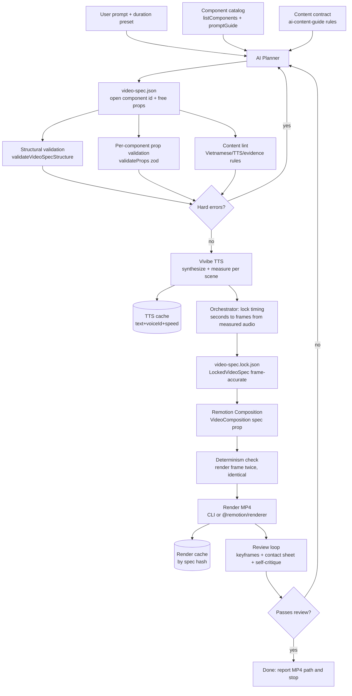
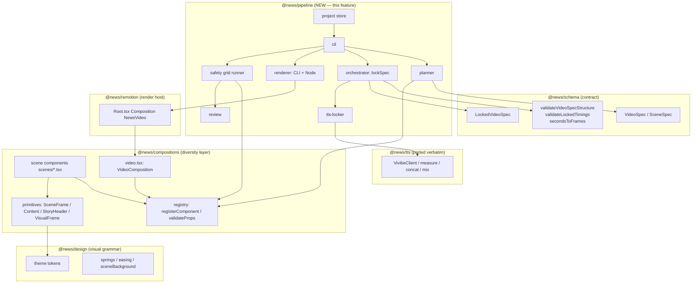
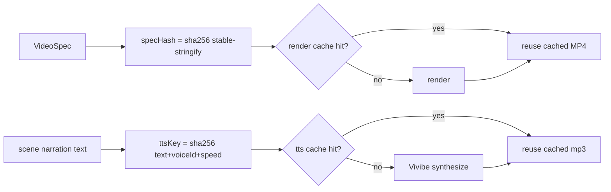

# Design Document: render-pipeline

## Overview

`render-pipeline` is the end-to-end engine of `news_remotion_tool`: it turns a
plain-text prompt into a finished Vietnamese 9:16 short-form news MP4 by letting
AI **author and parameterize real Remotion (React) scene components** instead of
filling ~40 locked HyperFrames templates. The diversity unlock (`news_video_tool`
forbade AI from touching visuals; this tool invites it to) is made safe by a
**strict, enumerated safety grid** — the direct web-stack analogue of
`math_video_tool`'s `mvlib` F1–F30 lint/oracle/review system.

The philosophy is borrowed verbatim from `math_video_tool`: *freedom with a
guard rail*. There, AI writes free Manim scenes but a grid of static lint +
post-render oracles + a mandatory perceptual review loop keeps quality stable
(success metric: ≤2 manual fixes per video). Here, AI writes free React scenes,
and a parallel grid of TypeScript typecheck + per-component Zod validation +
forbidden-API lint + determinism checks + a 9:16 safe-area oracle + a keyframe
review loop keeps quality stable. Content discipline (evidence gate,
no-hallucination, Vietnamese/TTS phonetic rules, hook/CTA rules, pacing) is
preserved from `news_video_tool/AGENTS.md` and `docs/ai-content-guide.md`.

This document specifies the pipeline end-to-end (HLD + LLD) so a later tasks
phase can implement it incrementally and finish by **rendering one real test
video on an arbitrary topic**. It reuses the already-scaffolded packages
(`@news/schema`, `@news/design`, `@news/tts`, `@news/compositions`,
`@news/remotion`) and does not redesign them from scratch.

This design is scoped to `news_remotion_tool` only. It does **not** modify
`math_video_tool`; that tool is referenced solely as the proven reference design
whose safety mechanisms we mirror.

## Goals and Non-Goals

**Goals**
- A deterministic, cacheable Prompt → MP4 pipeline on the Remotion stack.
- A two-mode AI authority model (PICK existing components / AUTHOR new ones) with
  a clearly drawn line and an admission handshake for authored code.
- A concrete, enumerated safety grid (`N1`–`N28`) split into static lint,
  build/type, deterministic-render, and perceptual review tiers, each mapped to
  its `math_video_tool` F-code equivalent.
- Explicit contracts (signatures + types) for the registry, validators, the
  orchestrator (`VideoSpec → LockedVideoSpec`), the renderer, and the review loop.
- Preserve every content rule from the existing news tool.
- Make Phase 1 (PICK-mode parity) shippable first, with a runnable test render.

**Non-Goals**
- No changes to `math_video_tool`.
- No media payloads (images, logos, screenshots, uploads, auto-fetch) — V2's
  no-media rule from `news_video_tool` carries over.
- No subtitles / caption tracks / karaoke (forbidden by content guide).
- Phase 2 (AI AUTHOR mode + sandbox) and Phase 3 (richer primitive library) are
  specified but not required for the first test render.

## License and Assumptions

- **Remotion license**: free for individuals, non-profits, and for-profit orgs
  ≤3 people. A company-scale prompt-to-video product needs a paid company
  license. The user confirmed individual / non-profit use, so the **free tier
  applies**. Recorded as a constraint/assumption, not a blocker.
- **FPS = 30**, **canvas 1080×1920 (9:16)**, **styleId `clean-luxury-tech`**,
  **language `vi`** — all fixed by `@news/schema` and `@news/design`.
- **Duration presets**: 60 / 90 / 120 / 180s (`SCENE_PACING` / `SCENE_BOUNDS`).
  `duration` is a *pacing target*, not a wall-clock guarantee; the final
  `renderDuration` may exceed it after natural Vietnamese TTS (rule preserved
  from both existing tools — do not rerender solely for being longer).
- **TTS** is Vivibe/LucyLab via `@news/tts` (ported verbatim). Provider/voice are
  taken from `.env`; if a key/endpoint/voice is missing, the pipeline **stops and
  reports** rather than falling back to a lower-quality voice.
- **Determinism is mandatory**: scene visuals are pure functions of the frame.
  `Math.random()` / `Date.now()` / network / fs are forbidden in scene code;
  Remotion's `random(seed)` is the only randomness source.

---

# Part A — High-Level Design

## Architecture

### A.1 Pipeline Architecture



### Data-flow description (stage by stage)

1. **Prompt → AI Planner.** The planner reads the user prompt + chosen duration
   preset, the **component catalog** (`listComponents()` → id + `promptGuide` +
   `example` per component), and the content contract. It silently builds a
   hidden creative brief (audience, pain, angle, central tension, allowed
   evidence, tone, takeaway) and emits a `VideoSpec`.
2. **AI Planner → `video-spec.json`.** A `VideoSpec` (renderer-agnostic): each
   scene names an **open** `component` id and carries **free-form `props`** plus
   `headline` / `body` / `eyebrow` / `narration` / `sfx`. This is the diversity
   surface — the planner is not boxed into a closed enum.
3. **Validation (three independent validators, all run before TTS).**
   - *Structural*: `validateVideoSpecStructure` (scene count vs `SCENE_BOUNDS`,
     duration sum, sequential ids, headline length, narration pacing, unknown
     component ids).
   - *Per-component props*: `validateProps(componentId, props)` against each
     component's own Zod schema (the registry contract).
   - *Content*: Vietnamese/TTS/evidence rules (see `N5`–`N9`).
   Hard errors bounce back to the planner; warnings are advisory.
4. **Validated spec → Vivibe TTS.** Per scene, narration is synthesized (cache
   keyed by `text + voiceId + speed`), each clip's true duration measured, then
   normalized/concatenated into one mixed narration track (BGM optional).
5. **TTS → Orchestrator → `video-spec.lock.json`.** The orchestrator converts
   measured seconds to frames (`secondsToFrames`, FPS=30), assigns
   `startFrame` / `durationInFrames` per scene, and totals `durationInFrames`,
   producing a `LockedVideoSpec`. `validateLockedTimings` asserts the timeline is
   contiguous and ends exactly at the total.
6. **Locked spec → Remotion Composition.** `apps/remotion` already exposes one
   `<Composition id="NewsVideo">` driven entirely by the `spec` input prop, with
   `calculateMetadata` deriving `durationInFrames`/`fps` from the spec.
   `VideoComposition` lays each scene as a `<Sequence>` and plays a single
   `<Audio>` narration track — Remotion mixes audio at render time, so the manual
   WAV pad/concat dance is no longer required for the render itself.
7. **Determinism check → Render MP4.** A pre-render guard renders a sampled frame
   twice and byte-compares (`N16`). Then the MP4 is produced via the Remotion CLI
   or the Node `@remotion/renderer` API with `inputProps = { spec }`.
8. **Render → Review loop.** Keyframes per scene are extracted (renderStill or
   ffmpeg), a contact sheet is built, and the agent runs a self-critique
   checklist before declaring done — the mandatory perceptual loop modeled on
   `math_video_tool`.
9. **Done.** On success, report the MP4 path and **stop** (no extra
   screenshot/QA loops unless the user asks — preserved from both tools).

## Components and Interfaces

### A.2 Component Architecture



**Key decision: introduce one new package `@news/pipeline`** for planner,
orchestrator, TTS-locking, renderer, safety-grid runner, review loop, project
store, and CLI. The five scaffolded packages stay as-is; `@news/pipeline` is the
orchestration brain that wires them together (the analogue of `mvlib.build`).

## A.3 Project Storage Layout

All generated artifacts live under `VIDEO_TOOL_HOME/.video-tool/` (default
`VIDEO_TOOL_HOME` = repo root), mirroring `news_video_tool`'s hygiene rules. Each
video is a self-contained project (mirroring `math_video_tool`'s
`projects/<slug>/` rule — deleting the folder deletes the whole video).

```text
VIDEO_TOOL_HOME/.video-tool/
  cache/
    tts/                         # shared Vivibe cache, keyed by text+voiceId+speed (regenerable)
    renders/                     # shared render cache, keyed by spec hash (regenerable)
  manual-specs/                  # hand-curated prompt/spec inputs kept for reuse
  projects/<id>/
    brief.json                   # prompt, duration preset, resolved settings, status
    video-spec.json              # planner output (VideoSpec)
    video-spec.lock.json         # LockedVideoSpec (frame-accurate, post-TTS)
    tts-manifest.json            # per-scene { text, voiceId, speed, audioPath, duration }
    audio/
      scene-01.mp3 ...           # per-scene synthesized clips (or cache symlinks)
      narration.mixed.wav        # concatenated + (optional) BGM-mixed track
    authored/                    # Phase 2: AI-authored scene .tsx + admission report
    renders/
      <id>.mp4                   # final output
    review/
      scene-01.png ...           # per-scene keyframes (renderStill)
      contact.jpg                # contact sheet for perceptual review
      review.json                # self-critique checklist results
    logs/
      plan.log validate.log tts.log lock.log render.log review.log
```

Hygiene rules carried over: never write scratch specs/MP4s/screenshots to the
repo root; treat `node_modules`, `dist`, `cache/tts`, successful renders, and
`.env` as user-owned runtime state; quarantine uncertain artifacts in
`.cleanup-quarantine/<timestamp>/` instead of deleting.

## Data Models

### A.4 Data Models

The contract types already exist in `@news/schema`; this feature consumes them
and adds three new pipeline-level models. (Code-level shapes are in Part B.)

- **`VideoSpec`** (existing): `version`, `title`, `styleId`, `duration`,
  `ratio`, `language`, `scenes: SceneSpec[]`. Open `component` + free `props`.
- **`SceneSpec`** (existing): `id` (`scene-NN`), `component`, `durationInSeconds`,
  `headline`, `body?`, `eyebrow?`, `narration`, `props`, `sfx?`.
- **`LockedVideoSpec` / `LockedSceneSpec`** (existing): adds `fps`,
  `durationInFrames`, per-scene `startFrame` / `durationInFrames` / `audio`,
  plus `audio.narrationSrc`.
- **`ProjectBrief`** (new): persisted project state — prompt, duration,
  resolved TTS settings, status enum, timestamps.
- **`TtsManifest`** (new): per-scene synthesis record used for locking + caching.
- **`SafetyReport`** (new): the aggregate result of running the grid (per-check
  id, severity, pass/fail, message) — the analogue of `mvlib`'s build report.

---

# Part B — Low-Level Design (TypeScript)

> All code sections use TypeScript, matching the existing monorepo (React 19,
> Remotion 4.0.472, Zod 4). Signatures below are contracts for the tasks phase;
> bodies are sketched where the algorithm matters.

## B.1 AI Authority Model

AI operates in exactly two modes. The line sits at **"is the rendered code
already in the trusted registry?"**

### Mode (a) — PICK + PARAMETERIZE (Phase 1, default, always available)

AI chooses an existing **registered** component id and supplies `props`. Safety
is total because the component code is repo-owned and its props are Zod-checked.
This is the spiritual equivalent of `news_video_tool`'s "fill a locked template",
except the catalog is open/extensible and validation lives next to each visual.

```typescript
// The planner only emits component ids returned by listComponents().
type PlannerCatalogEntry = {
  id: string;
  promptGuide: string;          // when to pick this component
  schema: z.ZodType;            // its props contract (for the planner to satisfy)
  example: unknown;             // a valid example payload
};

function buildPlannerCatalog(): PlannerCatalogEntry[] {
  return listComponents().map((d) => ({
    id: d.id,
    promptGuide: d.promptGuide,
    schema: d.schema,
    example: d.example,
  }));
}
```

### Mode (b) — AUTHOR NEW component (Phase 2, the diversity unlock)

AI writes a new React/TSX scene component. This is where Remotion beats the
locked-template tool: visuals become unbounded code. It is also where the safety
grid earns its keep. Authored code is **admitted** only through a strict
handshake:

```typescript
/** Contract every authored scene module MUST satisfy to be admitted. */
type AuthoredModuleContract = {
  // 1. A default export that is the registration result of registerComponent(...)
  //    (i.e. the module self-registers exactly one component).
  // 2. A named export `schema` that is a zod object for its props.
  // 3. A named export `example` that parses against `schema`.
};

type AdmissionPolicy = {
  /** Only these module specifiers may be imported by authored code. */
  allowedImports: ReadonlyArray<string>; // ["react", "remotion", "@news/design",
                                          //  "@news/compositions", "zod"]
  /** Identifiers/expressions that are hard-banned anywhere in the AST. */
  bannedApis: ReadonlyArray<string>;      // ["Math.random", "Date.now", "Date",
                                          //  "fetch", "XMLHttpRequest", "eval",
                                          //  "Function", "require", "import(",
                                          //  "fs", "child_process", "process",
                                          //  "window.location", "document.cookie",
                                          //  "dangerouslySetInnerHTML"]
  /** Must export default registerComponent result + `schema` + `example`. */
  requiredExports: ReadonlyArray<string>; // ["default", "schema", "example"]
};

type AdmissionResult =
  | { admitted: true; componentId: string }
  | { admitted: false; violations: SafetyIssue[] };

/**
 * Static gate for authored code. Parses the TSX to an AST and enforces the
 * import whitelist + banned-API blacklist + required exports BEFORE the module
 * is ever imported/executed. This is the web analogue of mvlib.lint (F2/F3/F9/
 * F26/F27/F28): catch forbidden constructs statically, never trust at runtime.
 */
function admitAuthoredComponent(
  tsxPath: string,
  policy: AdmissionPolicy,
): AdmissionResult;
```

**Where the line sits:** Mode (a) requires no admission (registry is trusted).
Mode (b) requires (1) static admission (`admitAuthoredComponent`), (2) a clean
TypeScript typecheck, (3) successful registration via the normal
`registerComponent` handshake, and only then can the planner reference its id.
Phase 1 ships with Mode (a) only; Mode (b) and its sandbox land in Phase 2.

**Sandbox note (Phase 2):** authored modules are bundled and executed only
inside the Remotion webpack/Chromium render context (no Node `fs`/`process`
access from scene code), and the admission AST gate runs first so a module that
references banned APIs never reaches the bundler.

## B.2 The Safety Grid (`N1`–`N28`)

The heart of this design. Like `mvlib`'s F1–F30, the grid **fails hard** on
technical defects so sloppy specs/components cannot ship, while reserving
*warning* severity for advisory richness/pacing nudges that need human eyes.
Checks are organized into four tiers. Each row lists **id · what it catches ·
severity · `math_video_tool` equivalent**.

### Tier 1 — Static lint (pre-TTS, on spec + authored code)

| Id | Catches | Severity | math equivalent |
|----|---------|----------|-----------------|
| `N1` | Scene count outside `SCENE_BOUNDS`, durations don't sum to preset, non-sequential ids | hard | F1 (duration vs target) |
| `N2` | Unknown `component` id (not in registry) | hard | F2/F9 (unknown symbol → tofu) |
| `N3` | Per-component **Zod prop validation** fails (missing/extra/invalid fields) | hard | F20 (label/container contract via primitives) |
| `N4` | Authored code imports outside whitelist, or missing required exports | hard | F3 (wrong text in wrong context) |
| `N5` | **Forbidden API** in authored code: `Math.random`, `Date.now`/`Date`, `fetch`/network, `fs`, `eval`/`Function`, `dangerouslySetInnerHTML` | hard | F18-class guard (cache/determinism) + lint F26/F27/F28 |
| `N6` | **Phonetic spellings** in display/narration (`Ô pân A I`, `Gút gồ`, `Đíp xích`, `A Pê I`) | hard | content rule (Vietnamese/TTS) |
| `N7` | **Spaced abbreviations** (`A I`, `A P I`, `G P T`, `L L M`) | hard | content rule |
| `N8` | Display field contains spelled-out numbers (`năm hai nghìn…`) instead of compact (`2026`, `92%`) | warning | content rule |
| `N9` | **Evidence-gate / hallucination**: invented source/date/price/quote/percentage not in prompt/context; manual numbering in list payloads; generic CTA (subscribe/like/follow) | hard (invention) / warning (style) | content rule (evidence gate) |

### Tier 2 — Build / type checks (pre-render)

| Id | Catches | Severity | math equivalent |
|----|---------|----------|-----------------|
| `N10` | **TypeScript typecheck** fails (`tsc --noEmit`) across compositions + authored code | hard | (compile step before render) |
| `N11` | Webpack bundle for the composition fails (broken import, alias, syntax) | hard | Manim import/build failure |
| `N12` | `validateLockedTimings` fails (timeline not contiguous / wrong total) | hard | F1 (timing integrity) |
| `N13` | Missing/empty narration audio for a scene that declares narration; audio not found at `narrationSrc` | hard | F18 (missing sound) |

### Tier 3 — Deterministic-render oracles (post-render, measurable)

| Id | Catches | Severity | math equivalent |
|----|---------|----------|-----------------|
| `N14` | **9:16 safe-area / overflow**: scene content paints outside the safe rect or is clipped at frame edges | hard | F4 (text overflow) |
| `N15` | **Overlap**: two text/visual blocks collide (illegible stack) | hard | F5 (overlap oracle) |
| `N16` | **Determinism**: rendering the same frame twice yields a non-identical buffer (hidden randomness/time) | hard | F18-class + deterministic caching |
| `N17` | **Text truncation / ellipsis**: a headline/body is visually cut (`…` or hard clip) — the web analogue of chip overflow | hard | F20 (label overflow → `chip`/`math_chip`) |
| `N18` | **Contrast & font availability**: text/background contrast below threshold, or a font in `theme.fonts` failed to load (fallback tofu) | warning | F2 (glyph/tofu) |
| `N19` | **Dead air / blank frames**: long stretch on near-empty/black frame while narration plays | warning | F15 (dead air) + F6 (empty frames) |
| `N20` | **Pacing**: scene `durationInFrames` too short for its narration word count (`SCENE_PACING`), or a beat holds static too long | warning | F29 (long static hold) |
| `N21` | **Transition / flicker**: adjacent scenes hard-cut with no transition, or a near-identical clear-and-rebuild flicker | warning | F24 (flicker) + F22 (connector/transition) |
| `N22` | **Audio sync**: total narration length vs `durationInFrames` drift beyond tolerance; trailing silence/cut voice | warning | F18 (audio audit on MP4) |
| `N23` | **Visual richness**: a long scene only fades in/out static text (no motion/transform/reveal) | warning | F21 (show, don't tell) |

### Tier 4 — Perceptual review loop (mandatory before "done")

| Id | Catches | Severity | math equivalent |
|----|---------|----------|-----------------|
| `N24` | Keyframes not extracted / contact sheet not built | hard (process gate) | review.py keyframe extraction |
| `N25` | Self-critique checklist not completed (layout, alignment, transition jank, clutter) | hard (process gate) | mandatory perceptual loop |
| `N26` | Hook quality: scene-01 not a direct hook (greeting/definition opener) | warning | content rule (hook in 3s) |
| `N27` | CTA quality: final scene not topic-specific (generic subscribe/like) | warning | content rule (final CTA) |
| `N28` | Template-fit: a high-evidence component used without supplied evidence (decoration-only) | warning | F21 + evidence gate |

**Severity semantics** (preserved from `news_video_tool` Studio diagnostics):
**hard error blocks render/lock/done**; **warning is advisory** fit/pacing
feedback that does not block export by itself. Like `math_video_tool`, every new
class of defect caught by eye should graduate into a new oracle + self-test so
the grid strengthens over time.

### Safety-grid runner contract

```typescript
type Severity = "error" | "warning";

type SafetyIssue = {
  check: string;          // "N3", "N14", ...
  severity: Severity;
  sceneId?: string;       // scene-NN when scoped to a scene
  path?: string;          // prop path / file path
  message: string;
};

type SafetyReport = {
  ok: boolean;            // false if any severity === "error"
  issues: SafetyIssue[];
  ranTiers: Array<"lint" | "build" | "render" | "review">;
};

/** Tier 1+2: runs on the spec before TTS/lock. Pure, fast, no render. */
function runStaticGrid(
  spec: VideoSpec,
  opts: { authoredDir?: string; promptContext: string },
): SafetyReport;

/** Tier 3: runs on rendered frames/MP4. Needs a render or per-scene stills. */
function runRenderGrid(
  locked: LockedVideoSpec,
  artifacts: { framesDir: string; mp4Path?: string },
): Promise<SafetyReport>;

/** Tier 4: builds the contact sheet and records the self-critique result. */
function runReviewGate(
  projectId: string,
  checklist: ReviewChecklist,
): Promise<SafetyReport>;

/** Aggregate gate used by the CLI: any error in any requested tier blocks. */
function gate(reports: SafetyReport[]): { ok: boolean; issues: SafetyIssue[] };
```

## B.3 Component / Registry Contracts

These exist in `@news/compositions/registry.ts` and are the stable contract the
pipeline depends on. Reproduced here as the LLD reference (no change required for
Phase 1):

```typescript
type SceneComponentProps<P = Record<string, unknown>> = {
  headline: string;
  body?: string;
  eyebrow?: string;
  props: P;
};

type SceneComponentDefinition<P = unknown> = {
  id: string;
  displayName: string;
  promptGuide: string;             // when the planner should pick this
  schema: z.ZodType<P>;            // per-component prop contract (powers N3)
  Component: React.FC<SceneComponentProps<P>>;
  example: P;                      // valid example for docs/fixtures
};

function registerComponent<P>(def: SceneComponentDefinition<P>): SceneComponentDefinition<P>;
function getComponent(id: string): SceneComponentDefinition | undefined;
function listComponents(): SceneComponentDefinition[];
function knownComponentIds(): ReadonlySet<string>;
function validateProps(
  componentId: string,
  props: unknown,
): { ok: boolean; errors: { path: string; message: string }[] };
```

### Timeline composition (existing `video.tsx`)

`VideoComposition` maps each `LockedSceneSpec` to a `<Sequence from={startFrame}
durationInFrames={durationInFrames}>`, resolves its component via
`getComponent(scene.component)`, and renders a `MissingComponent` fallback if the
id is unknown (which `N2` should already have blocked). A single `<Audio>` plays
`spec.audio.narrationSrc`. Remotion mixes audio at render time.

### Orchestrator: `VideoSpec → LockedVideoSpec`

```typescript
/**
 * Convert a validated VideoSpec into a frame-accurate LockedVideoSpec by
 * resolving each scene's true duration from MEASURED TTS audio (not the
 * planner's target seconds). Mirrors news_video_tool's lock step and math's
 * "duration follows natural voice" rule: renderDuration may exceed the preset.
 */
async function lockSpec(
  spec: VideoSpec,
  tts: TtsManifest,
  opts: { fps?: number; mixedNarrationSrc?: string },
): Promise<LockedVideoSpec> {
  const fps = opts.fps ?? FPS;
  let startFrame = 0;
  const scenes = spec.scenes.map((scene) => {
    const measured = tts.byScene[scene.id];           // measured seconds
    const seconds = measured?.duration ?? scene.durationInSeconds;
    const durationInFrames = secondsToFrames(seconds, fps); // >= 1
    const locked = { ...scene, startFrame, durationInFrames,
                     audio: measured ? { src: measured.audioPath, duration: measured.duration } : undefined };
    startFrame += durationInFrames;
    return locked;
  });
  const locked: LockedVideoSpec = {
    ...spec, fps, durationInFrames: startFrame, scenes,
    audio: { narrationSrc: opts.mixedNarrationSrc },
  };
  const timing = validateLockedTimings(locked);   // N12
  if (!timing.ok) throw new Error(timing.errors.join("; "));
  return locked;
}
```

### Renderer module (CLI + Node `@remotion/renderer`)

```typescript
type RenderOptions = {
  spec: LockedVideoSpec;            // passed as inputProps
  outPath: string;                  // projects/<id>/renders/<id>.mp4
  compositionId?: string;           // default "NewsVideo"
  concurrency?: number;             // default from remotion.config
  onProgress?: (ratio: number) => void;
};

/** Node API path: bundle → selectComposition → renderMedia. */
async function renderVideo(opts: RenderOptions): Promise<{ outPath: string; durationInFrames: number }> {
  await ensureBrowser();
  const bundleUrl = await bundle({ entryPoint: remotionEntry() });
  const composition = await selectComposition({
    serveUrl: bundleUrl,
    id: opts.compositionId ?? "NewsVideo",
    inputProps: { spec: opts.spec },                  // calculateMetadata derives fps/duration
  });
  await renderMedia({
    composition,
    serveUrl: bundleUrl,
    codec: "h264",
    outputLocation: opts.outPath,
    inputProps: { spec: opts.spec },
    onProgress: ({ progress }) => opts.onProgress?.(progress),
  });
  return { outPath: opts.outPath, durationInFrames: opts.spec.durationInFrames };
}

/** Per-scene still extraction for the review loop (renderStill at scene midpoints). */
async function renderSceneStills(
  spec: LockedVideoSpec,
  outDir: string,
): Promise<string[]>;
```

The CLI path is the existing `npm run render -- NewsVideo out.mp4` with
`--props=<lockfile>`. Both paths feed identical `inputProps`, so they produce
identical output (determinism preserved).

## B.4 Determinism and Caching



- **TTS cache** (existing `ttsCacheKey(text, voiceId, speed)`): keyed only by
  content + voice + speed, so re-planning that keeps narration identical reuses
  audio. Lives in `cache/tts/`.
- **Render cache** (new): keyed by `specHash(LockedVideoSpec)` (stable JSON
  stringify of the locked spec, which already embeds frames + audio paths). A hit
  means an identical locked spec → identical frames → reuse the MP4.
- **Composition**: the locked spec embeds the TTS audio paths, so `specHash`
  transitively depends on the narration. The two caches compose cleanly:
  changing narration changes the audio path → changes `specHash` → invalidates
  the render cache.
- **Parity**: this is the same property `news_video_tool` got from build-cache-
  by-hash and `math_video_tool` from deterministic caching — reproducible because
  scenes are pure functions of the frame (`N16` enforces it).

## B.5 TTS + Audio

```typescript
type TtsManifest = {
  voiceId: string;
  speed: number;
  byScene: Record<string, { text: string; audioPath: string; duration: number }>;
  mixedSrc?: string;            // narration.mixed.wav, relative to staticFile root
};

/**
 * Synthesize per-scene narration, measure each clip, normalize, concatenate into
 * one track, optionally mix BGM. Reuses @news/tts verbatim. Stops (does not
 * fall back to mock) if Vivibe is configured but a key/voice is missing.
 */
async function synthesizeNarration(
  spec: VideoSpec,
  opts: { voiceId: string; speed?: number; outDir: string; bgmPath?: string },
): Promise<TtsManifest> {
  const speed = opts.speed ?? DEFAULT_TTS_SPEED;
  const client = new VivibeClient();
  if (!client.isConfigured()) throw new Error("Vivibe not configured: set VIVIBE_API_KEY/VOICE_ID in .env.");
  const byScene: TtsManifest["byScene"] = {};
  for (const scene of spec.scenes) {
    const key = ttsCacheKey(scene.narration, opts.voiceId, speed);
    const cached = join(ttsCacheDir(), `${key}.mp3`);
    const audioPath = existsSync(cached)
      ? cached
      : (await client.synthesize({ text: scene.narration, voiceId: opts.voiceId, speed, outputPath: cached })).audioPath;
    const duration = await measureAudioDuration(audioPath);     // true seconds → drives locking
    byScene[scene.id] = { text: scene.narration, audioPath, duration };
  }
  const clips = spec.scenes.map((s) => byScene[s.id]!.audioPath);
  const mixed = join(opts.outDir, "narration.mixed.wav");
  await concatAudio(clips, mixed);
  if (opts.bgmPath) await mixBgm(mixed, opts.bgmPath, mixed, 0.1);
  return { voiceId: opts.voiceId, speed, byScene, mixedSrc: relStatic(mixed) };
}
```

- **Locked timing derives from MEASURED audio**, not target seconds — so
  `durationInFrames` reflects the real voice. `renderDuration` may exceed the
  preset; per both tools' rules, **do not rerender** solely for that if the voice
  is complete, uncut, unrushed.
- Remotion mixes the single narration track at render time, so the WAV pad/concat
  is only needed to produce the one mixed track (and to measure per-scene
  durations for locking), not for sync.

### SFX cue mapping

`SceneSpec.sfx` ∈ `none | transition | alert | emphasis | success`, mirroring
`math_video_tool`'s `self.sfx("ting"/"pop"/"whoosh"/"thud"/"success")`:

| `sfx` | When | math equivalent | Remotion realization |
|-------|------|------------------|----------------------|
| `transition` | scene boundary / focus pull | `whoosh` | short cue placed at `startFrame` via `<Audio>` |
| `alert` | warning / risk reveal | `thud` | cue at the reveal frame |
| `emphasis` | key number / answer reveal | `ting` / `pop` | cue at the emphasis frame |
| `success` | resolution / final takeaway | `success` | cue near scene end |
| `none` | default | — | no cue |

Cues are synthesized/ducked under the narration the same way `mvlib.sfx` does;
used sparingly and on-beat.

## B.6 The Review Loop

```typescript
type ReviewChecklist = {
  safeArea: boolean;        // nothing clipped at 9:16 edges
  alignment: boolean;       // headings/blocks aligned, no drift
  transitions: boolean;     // no hard cuts / flicker between scenes
  clutter: boolean;         // not too many simultaneous blocks
  hook: boolean;            // scene-01 hooks in first 3s, no greeting/definition
  cta: boolean;             // final scene CTA is topic-specific
  audio: boolean;           // voice complete, not cut/rushed, in sync
  richness: boolean;        // long scenes show motion, not just static fades
};

/**
 * Extract one keyframe per scene (renderStill at scene midpoint, or ffmpeg from
 * the MP4), assemble a contact sheet, and REQUIRE the agent to fill the
 * checklist before declaring done. Models math_video_tool's mandatory perceptual
 * loop: the grid is blind to "misaligned mark / wrong arrow / transition flash /
 * cluttered layout" — those need eyes.
 */
async function buildReview(
  spec: LockedVideoSpec,
  opts: { mp4Path: string; outDir: string },
): Promise<{ keyframes: string[]; contactSheet: string }>;

function reviewGatePassed(checklist: ReviewChecklist): boolean {
  return Object.values(checklist).every(Boolean);
}
```

The agent must open the contact sheet first, inspect suspicious frames, complete
the checklist, and only then report the MP4 and **stop** (`N24`/`N25`). Do not
declare success merely because the static/render grid is green.

## B.7 CLI / Studio Entry Points and Required Checks

New `@news/pipeline` CLI verbs (the `mvlib.build` analogue), plus the existing
Remotion scripts:

| Command | Purpose |
|---------|---------|
| `create <prompt> --duration 60` | Plan → validate → write `video-spec.json` into a new project |
| `preview <id>` | Open `@remotion/player`/Studio on the project's (draft or locked) spec |
| `studio` | Existing: `remotion studio` on the bundled sample |
| `render <id>` | TTS → lock → static+render grid → render MP4 → build review |
| `doctor` / `probe` | Verify `.env` (Vivibe key/voice), ffmpeg, browser, registry health |
| `render -- NewsVideo out.mp4 --props=<lock>` | Existing raw Remotion render path |

**Required checks** (run after source/registry/schema/guide changes; not for
content-only render jobs unless asked):

```bash
npm run typecheck   # tsc --noEmit (powers N10)
npm test            # vitest run: registry, validators, safety grid, oracles, locker
npm run build       # bundle the Remotion entry (powers N11)
```

`npm test` must cover: registry register/validate, `validateVideoSpecStructure`
& `validateLockedTimings`, the static grid (`N1`–`N9`), the orchestrator
`lockSpec`, and self-tests proving each oracle is non-vacuous (the
`math_video_tool` rule: every oracle has a self-test that proves it actually
fires).

---

# Part C — Cross-Cutting Concerns

## C.1 math_video_tool → news_remotion_tool Mapping Table

This is the explicit "is the tradeoff covered?" table the reader needs.

| math_video_tool mechanism | Remotion equivalent | Decision |
|---|---|---|
| Free Manim scene authoring (`mvlib`) | Free React/TSX scene authoring (Mode b) | **adopt** (Phase 2) |
| Locked layout via `fit/place/zones` | Layout primitives `SceneFrame/Content/StoryHeader/VisualFrame` + `theme` | **adopt** (Phase 1) |
| `T()`/`M()` text-symmetry guard | TS types + per-component Zod schema (`N3`) | **adapt** |
| Static AST lint F2/F3/F9/F26–F28 | Forbidden-API AST lint + import whitelist (`N4`,`N5`) | **adopt** |
| F1 duration vs target | `validateVideoSpecStructure` + `validateLockedTimings` (`N1`,`N12`) | **adopt** |
| F4 overflow oracle | 9:16 safe-area / overflow oracle (`N14`) | **adopt** |
| F5 overlap oracle | overlap oracle (`N15`) | **adopt** |
| F20 label-overflow + `chip` | text-truncation oracle (`N17`) | **adopt** |
| F18 missing-sound + disable cache | determinism check (`N16`) + audio-sync (`N22`) + missing-audio (`N13`) | **adapt** |
| F15 dead-air oracle | dead-air / blank-frame oracle (`N19`) | **adopt** |
| F29 long static hold | pacing oracle (`N20`) | **adopt** |
| F21 "show don't tell" richness | visual-richness oracle (`N23`) | **adopt** (warning) |
| F24 flicker / F22 connector | transition/flicker oracle (`N21`) | **adopt** (warning) |
| Deterministic caching | spec-hash render cache + TTS cache (B.4) | **adopt** |
| `self.sfx(...)` ducked cues | `SceneSpec.sfx` cue mapping (B.5) | **adopt** |
| BGM loop+fade+duck mix | `mixBgm` from `@news/tts` | **adopt** (already ported) |
| Mandatory perceptual review loop | keyframes + contact sheet + checklist (`N24`–`N28`) | **adopt** |
| `mvlib.build` one-command front door | `@news/pipeline` CLI `render <id>` | **adopt** |
| `mvlib.cleanup` project hygiene | `.video-tool/projects/<id>/` + quarantine rules (A.3) | **adopt** |
| TinyTeX/venv local toolchain | Node + headless Chromium via `ensureBrowser()` | **adapt** |
| Manim `disable_caching` for voice | not needed — Remotion frames are pure (`N16`) | **skip (by design)** |
| 3D `Math3DScene` + bbox-off oracles | not in scope for news | **skip** |
| F3 Vietnamese-in-LaTeX guard | not applicable (no LaTeX) | **skip** |

## C.2 Phasing and the Test-Render Path

- **Phase 1 — Parity (shippable first):** Mode (a) PICK-only planner; the four
  starter components + a handful more; static grid `N1`–`N3`,`N6`–`N9`; build
  checks `N10`–`N13`; orchestrator + TTS lock; render via CLI/Node; review loop
  `N24`–`N27`. **End goal: render one real test video on an arbitrary topic.**
- **Phase 2 — AUTHOR mode:** `admitAuthoredComponent` AST gate (`N4`,`N5`),
  sandboxed bundling, render-tier oracles `N14`–`N23`, authored-component
  registration handshake.
- **Phase 3 — Richer primitives:** expand `@news/compositions` primitive library
  and component catalog; promote frequently-authored patterns into trusted
  primitives (the `mvlib.motion`/`mvlib.props` growth path).

### Explicit Phase-1 test path

```bash
# 0. one-time
cp .env.example .env          # add VIVIBE_API_KEY + VIVIBE_VOICE_ID
npm install

# 1. plan an arbitrary topic into a project spec
node packages/pipeline/dist/cli.js create "Vì sao chip AI đang đắt đỏ" --duration 60

# 2. (optional) eyeball the no-voice draft
npm run studio                # or: pipeline preview <id>

# 3. TTS → lock → safety grid → render → review
node packages/pipeline/dist/cli.js render <id>

# Result: .video-tool/projects/<id>/renders/<id>.mp4  + review/contact.jpg
```

A no-voice fallback path also exists for CI/smoke: render the bundled
`sample-spec.ts` directly (`npm run render -- NewsVideo out/sample.mp4`), which
exercises the registry + composition + render without Vivibe.

## Correctness Properties

Universal properties the implementation must satisfy (candidates for
property-based tests in the tasks phase):

### Property 1: Timeline contiguity
For any `LockedVideoSpec` produced by `lockSpec`, scenes tile `[0,
durationInFrames)` with no gaps or overlaps, and the last scene ends exactly at
`durationInFrames`. (`validateLockedTimings` is total over locked specs.)

### Property 2: Determinism
For any locked spec and any frame `f`, rendering `f` twice yields byte-identical
output. (Enforced by `N16`.)

### Property 3: Validation soundness
If `runStaticGrid(spec).ok` is true, then every scene's `component` is in the
registry and its `props` parse against that component's Zod schema. (`N2`, `N3`.)

### Property 4: Cache coherence
`specHash(a) === specHash(b)` if and only if `a` and `b` render to identical
MP4s; changing any narration text changes the locked audio path and therefore
`specHash`.

### Property 5: No forbidden APIs in authored code
If an authored module is admitted, its AST contains no identifier in `bannedApis`
and no import outside `allowedImports`. (`N4`, `N5`.)

### Property 6: Duration monotonicity
`secondsToFrames(s) >= 1` for all `s > 0`, and is non-decreasing in `s`.

### Property 7: Content invariants
An `ok` spec contains no spaced abbreviations and no phonetic spellings in any
display or narration field. (`N6`, `N7`.)

## Error Handling

### C.4 Error Handling

- **Validation hard error:** return the `SafetyReport` to the planner loop; do
  not proceed to TTS/lock/render. Surface check id + scene id + message.
- **Missing TTS config:** stop and report the exact missing key/endpoint/voice;
  never silently downgrade to mock (preserved rule).
- **Vivibe transient failure:** `VivibeClient` already retries with backoff;
  after exhausting attempts, fail the project stage with a clear message and keep
  partial audio cache for resume (`.export-id` sidecar).
- **Render failure (bundler/Chromium):** capture stderr to `logs/render.log`,
  fail the stage, leave the locked spec intact so render can be retried from
  cache.
- **Unknown component at render time:** `MissingComponent` renders a visible
  error panel; `N2` should have blocked this earlier, so reaching it is a bug
  signal, not a silent fallback.
- **Review gate not completed:** treat as a hard process gate — the task is not
  "done" until the checklist is filled.

## Testing Strategy

### C.5 Testing Strategy

- **Unit:** registry (register/duplicate/validateProps), schema validators,
  `secondsToFrames`, `lockSpec` timing, each static-grid check, SFX mapping.
- **Property-based** (library: `fast-check`): P1–P7 above. Each render/oracle has
  a non-vacuous self-test proving it fires on a known-bad input (math-tool rule).
- **Integration:** plan→validate→lock with a stubbed TTS manifest (mock audio
  durations) producing a valid `LockedVideoSpec`; render the bundled sample spec
  headlessly and assert an MP4 with the expected `durationInFrames`.
- **Smoke (the test render):** the Phase-1 path in C.2 on one arbitrary topic.

## C.6 Dependencies

- Existing: `remotion` / `@remotion/cli` 4.0.472, `@remotion/renderer` (Node
  render API), `react` 19, `zod` 4, `@news/{schema,design,tts,compositions}`,
  `music-metadata`, `ffmpeg-static`, `ffprobe-static`.
- New (for `@news/pipeline`): a TS AST parser for the authored-code lint
  (TypeScript compiler API `typescript` — already a dev dep — or `@babel/parser`),
  `fast-check` for property tests. `@remotion/player` for `preview`.
- External services: Vivibe/LucyLab TTS (via `.env`), headless Chromium (via
  `ensureBrowser()`), ffmpeg (bundled static).
