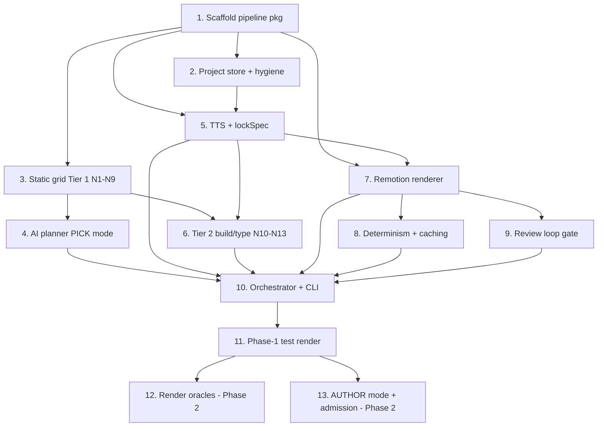

# Implementation Plan: render-pipeline

## Overview

This plan implements the `render-pipeline` design incrementally. Phase 1 tasks
(1–11) are the shippable scope and end with rendering one real test video on an
arbitrary topic. Phase 2 tasks (12–13) are specified but deferred. Each task is
test-driven where practical and references the requirements it satisfies.

Conventions: the new orchestration package is `@news/pipeline`
(`packages/pipeline`). Workspace packages import TypeScript sources directly via
the existing path aliases / Remotion webpack alias.

## Tasks

- [x] 1. Scaffold the `@news/pipeline` package and shared types
  - Create `packages/pipeline` (package.json `@news/pipeline`, tsconfig extending
    root, deps on `@news/schema`, `@news/design`, `@news/tts`,
    `@news/compositions`, `zod`).
  - Add the `@news/pipeline` path alias to root `tsconfig.json` and the Remotion
    `remotion.config.ts` webpack alias.
  - Define new pipeline data models: `ProjectBrief`, `TtsManifest`,
    `SafetyIssue`/`SafetyReport`/`Severity`, `ReviewChecklist`.
  - _Requirements: 11.1, 8.1_

- [x] 2. Project store and workspace hygiene
- [x] 2.1 Implement the project store
  - `videoToolHome()`, `projectPath(id)`, `ensureProject(id)`, `readJson`/
    `writeJson`, `createProjectId(prompt)`, `setStatus`/`appendEvent`.
  - Lay out `.video-tool/projects/<id>/` (brief, spec, lock, tts-manifest, audio,
    renders, review, logs) and shared `cache/tts`, `cache/renders`.
  - _Requirements: 11.1, 11.2, 11.3_
- [x] 2.2 Unit tests for the store
  - Assert directory layout, id slugging, and that nothing is written to repo
    root.
  - _Requirements: 11.3, 11.4_

- [x] 3. Static safety grid — Tier 1 lint (N1–N9)
- [x] 3.1 Structural + registry + prop checks (N1–N3)
  - Wrap `validateVideoSpecStructure` and per-scene
    `validateProps(component, props)`; map results into `SafetyIssue`s.
  - _Requirements: 2.1, 2.2, 2.3, 2.5_
- [x] 3.2 Vietnamese/TTS content checks (N6–N8)
  - Port phonetic-spelling detection, spaced-abbreviation detection, and
    display/narration number rules from `news_video_tool` validators.
  - _Requirements: 3.1, 3.2, 3.3, 3.4_
- [x] 3.3 Evidence-gate / no-media / CTA / hook checks (N9, N26, N27, media/subtitle bans)
  - Port invention/evidence-gate, no-media/no-subtitle, generic-CTA, and weak-hook
    detection; classify invention as hard error, style as warning.
  - _Requirements: 4.1, 4.3, 4.4, 4.5, 3.5_
- [x] 3.4 `runStaticGrid(spec, opts): SafetyReport` aggregator + severity gate
  - `ok === false` iff any `error`; expose `gate(reports[])`.
  - _Requirements: 8.1, 8.2, 8.3, 8.6_
- [x] 3.5 Non-vacuous self-tests for every Tier-1 check
  - Each check has a known-bad fixture proving it fires, and a clean fixture
    proving it passes.
  - _Requirements: 8.1, 12.4_

- [x] 4. AI planner (PICK mode)
- [x] 4.1 Planner catalog + prompt builder
  - `buildPlannerCatalog()` from `listComponents()`; assemble the system prompt
    embedding pacing ruler, content contract, and component guides.
  - _Requirements: 1.2, 1.3, 1.5_
- [x] 4.2 OpenAI-compatible + DeepSeek planner with validate-and-retry loop
  - Call chat completions, parse JSON (`parseAiJsonOutput`), run `runStaticGrid`,
    feed errors back for up to N attempts.
  - _Requirements: 1.1, 1.4, 2.5_
- [x] 4.3 Mock planner (evidence-safe)
  - Deterministic, structurally valid spec using only safe editorial components;
    invents no sources/prices/quotes.
  - _Requirements: 1.6_
- [x] 4.4 Planner tests
  - Mock planner output passes the full static grid; retry loop surfaces errors.
  - _Requirements: 1.1, 1.6, 8.3_

- [x] 5. TTS synthesis and measured-duration locking
- [x] 5.1 `synthesizeNarration(spec, opts): TtsManifest`
  - Per-scene Vivibe synth via `@news/tts`, cache by `text+voiceId+speed`, measure
    durations, concat into one track, optional `mixBgm`; stop-and-report on
    missing config.
  - _Requirements: 5.1, 5.2, 5.6, 7.3_
- [x] 5.2 `lockSpec(spec, tts, opts): LockedVideoSpec`
  - Convert measured seconds → frames (`secondsToFrames`), assign
    `startFrame`/`durationInFrames`, total frames; assert `validateLockedTimings`
    (N12). Preserve "renderDuration may exceed preset".
  - _Requirements: 5.3, 5.4, 5.5_
- [x] 5.3 SFX cue mapping
  - Map `none/transition/alert/emphasis/success` to ducked cues placed at the
    right frames.
  - _Requirements: 5.7_
- [x] 5.4 Locking tests (stubbed TTS manifest)
  - Property test: timeline contiguity (P1); `secondsToFrames` monotonic (P6);
    locked timing ends exactly at total.
  - _Requirements: 5.3, 5.4_

- [x] 6. Tier 2 build/type checks (N10–N13)
  - Wire `tsc --noEmit` (N10), Remotion bundle check (N11), `validateLockedTimings`
    (N12), and missing/empty scene-audio check (N13) into a build-tier runner.
  - _Requirements: 8.4_

- [x] 7. Deterministic Remotion renderer
- [x] 7.1 `renderVideo(opts)` via Node `@remotion/renderer`
  - `ensureBrowser` → `bundle` → `selectComposition` (inputProps `{ spec }`) →
    `renderMedia` (h264) to `renders/<id>.mp4`; progress callback.
  - _Requirements: 6.1, 6.2, 6.4, 6.5_
- [x] 7.2 `renderSceneStills(spec, outDir)` for the review loop
  - `renderStill` at each scene midpoint into `review/scene-NN.png`.
  - _Requirements: 10.1_
- [x] 7.3 Missing-component render fallback verified
  - Confirm `VideoComposition` renders the visible error panel for unknown ids
    (defense in depth behind N2).
  - _Requirements: 6.3_

- [x] 8. Determinism and caching
- [x] 8.1 `specHash(LockedVideoSpec)` + render cache
  - Stable stringify + sha256; reuse cached MP4 on hit; narration change → audio
    path change → hash change → cache invalidation.
  - _Requirements: 7.4, 7.5_
- [x] 8.2 Determinism guard (N16)
  - Render one sampled frame twice via `renderStill` and byte-compare before full
    render.
  - _Requirements: 7.2_
- [x] 8.3 Forbidden-API guard for registered scene code
  - Lint the compositions package sources for `Math.random`/`Date.now`/network/fs
    so registered components stay deterministic.
  - _Requirements: 7.1_
- [x] 8.4 Caching tests
  - Property: `specHash(a)===specHash(b)` ⇔ identical render inputs (P4);
    determinism (P2) on the sample spec.
  - _Requirements: 7.2, 7.4_

- [x] 9. Perceptual review loop gate
  - `buildReview(spec, opts)`: extract keyframes (stills or ffmpeg from MP4),
    assemble `review/contact.jpg`, write `review.json`; `reviewGatePassed` blocks
    "done" until the `ReviewChecklist` is complete (N24, N25); on pass report MP4
    and stop.
  - _Requirements: 10.1, 10.2, 10.3, 10.4_

- [x] 10. Orchestrator + CLI entry points
- [x] 10.1 `createVideoProject` and `renderProject` orchestration
  - `create`: plan → static grid → write spec/brief. `render`: TTS → lock → build
    grid → determinism guard → render → build review; persist status/events.
  - _Requirements: 1.1, 5.1, 6.5, 8.3, 8.5_
- [x] 10.2 CLI verbs `create` / `render` / `preview` / `doctor`
  - Wire verbs; `doctor`/`probe` checks `.env` (Vivibe), ffmpeg, browser, registry
    health; `preview` opens player/Studio on draft or locked spec.
  - _Requirements: 12.1, 12.2, 12.3_
- [x] 10.3 No-voice visual-draft path
  - Allow render of the bundled sample spec (and `--tts none`) without Vivibe.
  - _Requirements: 12.5, 14.3_

- [x] 11. Phase-1 end-to-end test render
- [x] 11.1 Wire required checks and add 2–3 more starter components
  - Ensure `npm run typecheck`, `npm test`, `npm run build` pass; broaden the
    catalog beyond the 4 starters so a 60s plan has enough variety.
  - _Requirements: 12.4, 14.4_
- [x] 11.2 Smoke render of the bundled sample (no Vivibe)
  - `npm run render -- NewsVideo out/sample.mp4` produces a playable MP4 with the
    expected `durationInFrames`.
  - _Requirements: 6.5, 14.3_
- [x] 11.3 Full pipeline test render on an arbitrary topic
  - `create` an arbitrary prompt → `render`; produce
    `projects/<id>/renders/<id>.mp4` + `review/contact.jpg`; complete the review
    checklist.
  - _Requirements: 14.1, 14.2, 10.2_

- [x] 12. Deterministic-render oracles **[Phase 2]**
  - Implement `runRenderGrid`: safe-area/overflow (N14), overlap (N15),
    truncation (N17), contrast/font (N18), dead-air (N19), pacing (N20),
    transition/flicker (N21), audio-sync (N22), richness (N23); each with a
    non-vacuous self-test.
  - _Requirements: 9.1, 9.2, 9.3_

- [x] 13. AI AUTHOR mode + admission gate **[Phase 2]**
  - `admitAuthoredComponent(tsxPath, policy)` AST gate (import whitelist + banned
    APIs + required exports, N4/N5); typecheck + registration handshake; sandboxed
    bundling; planner may reference authored ids only after admission.
  - _Requirements: 13.1, 13.2, 13.3, 13.4, 13.5_

## Task Dependency Graph



Critical path to the first test render: 1 → 2 → 3 → 4 → 5 → 6 → 7 → 8 → 9 → 10 → 11.
Tasks 3/4 (spec + planning) and 5/7 (audio + render) can progress in parallel
once task 1 lands.

```json
{
  "waves": [
    { "wave": 1, "tasks": ["1"], "rationale": "Scaffold the pipeline package + shared types; everything depends on it." },
    { "wave": 2, "tasks": ["2", "3", "7"], "rationale": "Project store, Tier-1 static grid, and the Remotion renderer only need task 1 and are independent of each other." },
    { "wave": 3, "tasks": ["4", "5"], "rationale": "Planner needs the static grid (3); TTS+lock needs the store (2) and renderer scaffolding (1)." },
    { "wave": 4, "tasks": ["6", "8", "9"], "rationale": "Build/type tier needs spec+lock (3,5); caching and review loop need the renderer (7) and lock (5)." },
    { "wave": 5, "tasks": ["10"], "rationale": "Orchestrator + CLI wires planner, TTS/lock, build grid, renderer, caching, and review together." },
    { "wave": 6, "tasks": ["11"], "rationale": "Phase-1 end-to-end test render once the full pipeline is wired." },
    { "wave": 7, "tasks": ["12", "13"], "rationale": "Phase 2: render oracles and AUTHOR mode, after the Phase-1 path is proven." }
  ]
}
```

## Notes

- Phase 1 (tasks 1–11) is independently shippable and is gated by the
  end-to-end test render in task 11.3.
- Tasks 12–13 are **[Phase 2]**: deterministic-render oracles and AI AUTHOR mode.
  They are designed now but not required for the first test video.
- Every safety-grid check (N-codes) must ship with a non-vacuous self-test
  (a known-bad fixture proving the check fires), per the `math_video_tool` rule.
- Run `npm run typecheck`, `npm test`, and `npm run build` after source/registry/
  schema changes; content-only render jobs do not require the full check loop.
- Do not modify `math_video_tool`; it is the reference design only.
