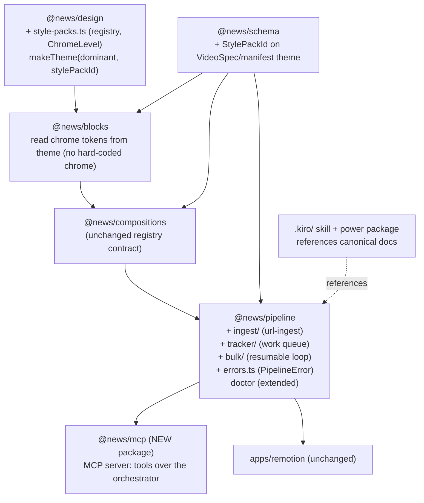
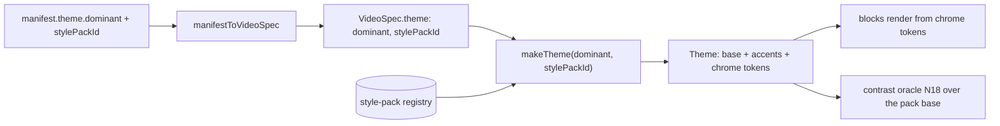

# Design Document: tool-productization

## Overview

`tool-productization` turns `news_remotion_tool` from a personal,
build-script-driven AUTHOR-mode pipeline into a **sellable, production-grade
product** without weakening any existing quality bar. It is purely additive: the
`author-mode-v2` pipeline (admission gate → manifest→spec → `N1–N9` static grid →
Vivibe TTS → transition-aware lock → `N10–N13` build gate → `N16` determinism →
Remotion render → `N14/N18–N30` render oracles → `N24–N25` review) stays the one
front door. Every new surface drives that same in-process orchestrator
(`scaffoldVideoProject` / `renderProject`), never a second path.

The work adds the genuinely valuable capabilities a competitor productized —
selectable looks, URL grounding, a programmable API, a packaged skill, overnight
bulk production, and buyer-grade ops — expressed in this repo's idioms.

**Goals (by phase)**

- **Phase 1 — Look & grounding**
  - *Style packs* (R1): a named look-parameterization layer that feeds
    `makeTheme()` a "chrome level" (borders, shadows, grid/ticks, accent count,
    whitespace, font), shipping `bold-editorial` (today's look) and
    `clean-premium` (restrained), extensible by registration.
  - *URL ingest* (R2): fetch an article, extract **text + metadata only**, write
    a grounded research file under `planning/<id>.md` as an authoring input.
- **Phase 2 — Programmable surface**
  - *MCP server* (R3): expose `ingest_url`, `scaffold_project`, `render_draft`,
    `render_full`, `doctor`, `list_projects`, and tracker ops as typed MCP tools
    over the single-process orchestrator.
  - *Skill / power package* (R4): bundle the authoring contract + workflow +
    style-pack references so a driving agent auto-loads the rules.
- **Phase 3 — Scale**
  - *Bulk loop* (R5): an agent-driven, resumable loop over a persisted *tracker*
    that processes pending items end-to-end through the MCP tools and degrades
    gracefully on usage limits.
- **Cross-cutting — Productization polish**
  - *Doctor* (R6): one readiness check (Vivibe `.env`, ffmpeg, browser, registry,
    style packs, MCP wiring) with actionable remediation, shared by CLI + MCP.
  - *Actionable errors* (R7): a structured `PipelineError` carrying stage, cause,
    safety-check id, scene id, and remediation — identical across CLI and MCP.
  - *Buyer docs* (R8) and *workspace hygiene* (R9).
  - *Invariants* (R10): the must-preserve safety/quality guarantees.

**Non-Goals** (carried from requirements)

- No real-image scraping/embedding — ingest is text + metadata only; the media
  ban + evidence gate (N9) stand unchanged.
- No local/offline TTS — Vivibe remains the voice provider, never silently
  downgraded.
- No return to fixed templates — style packs parametrize the look; pure AUTHOR
  mode is preserved.
- No in-tool LLM planner — the driving agent stays the authoring "brain"; new
  surfaces drive the existing pipeline.
- No chasing volume past the gate — bulk items pass the same `N1–N30` grid and
  the draft-first gate per item.

**Key design decisions**

1. *One orchestrator, many surfaces.* The MCP server, the bulk loop, and the CLI
   are all thin adapters over `scaffoldVideoProject` / `renderProject` in
   `@news/pipeline`. This is a hard constraint (R3.3, R5.2, Constraints): a
   second `@news/compositions` registry instance causes registration "not found"
   errors, so all surfaces import the pipeline from source in one process.
2. *Style packs sit between `@news/design` and `makeTheme`.* A style pack is a
   pure data record (the "chrome level"); `makeTheme(dominant, stylePackId)`
   stays deterministic. Blocks read chrome tokens from the theme rather than
   hard-coding the bold-editorial chrome, so adding a pack needs no block edits.
3. *Research files are inputs, never render inputs.* Ingest writes
   `planning/<id>.md` for the authoring agent to read; nothing in the render path
   reads it, so determinism (N16) is untouched.
4. *The tracker is a persisted work queue, not a planner.* It records items +
   status; the bulk loop reduces over it by calling the existing tools, and
   status transitions are the resume mechanism.

## Architecture

### Where the new pieces live

The layered dependency rule from `author-mode-v2` is preserved (`schema → design
→ blocks → compositions → pipeline → apps`, no cycles). New code is additive:



`@news/mcp` is a new leaf package that depends on `@news/pipeline` only. It
imports the orchestrator from source (single registry instance) exactly as the
CLI does, satisfying the single-process constraint.

### End-to-end productized flow

```mermaid
flowchart TD
  URL[Article URL] --> INGEST[ingest_url: fetch + extract text/metadata]
  INGEST --> RESEARCH[(planning/&lt;id&gt;.md research file)]
  RESEARCH -. read by agent .-> AUTHOR[Driving agent authors scenes + manifest<br/>chooses stylePackId]
  AUTHOR --> SCAFFOLD[scaffold_project]
  SCAFFOLD --> DRAFT[render_draft]
  DRAFT --> REVIEW{draft reviewed?}
  REVIEW -->|yes| FULL[render_full: draft-first gate]
  FULL --> DONE[(project: done)]
  TRACKER[(tracker.json/csv)] --> BULK[bulk loop]
  BULK --> INGEST
  BULK --> DRAFT
  BULK --> FULL
  BULK --> MARK[update item status: done / failed-reason / paused-resumable]
  MARK --> TRACKER
  subgraph surfaces[programmatic surfaces]
    MCPS[@news/mcp tools]
    CLI[CLI verbs]
  end
  MCPS --> SCAFFOLD
  MCPS --> DRAFT
  MCPS --> FULL
  MCPS --> INGEST
  CLI --> SCAFFOLD
```

Both the MCP tools and the bulk loop bottleneck through `scaffoldVideoProject` /
`renderProject`, so the safety grid, draft-first gate, determinism, caches, and
TTS provider rules apply identically regardless of surface.

### Style-pack resolution in the render path



Unknown `stylePackId` is a hard error raised at `manifestToVideoSpec` /
admission time (before TTS), naming the unknown id and listing registered ids
(R1.6). No `stylePackId` ⇒ defaults to `bold-editorial` (R1.5).

## Components and Interfaces

### 1. Style packs (`@news/design/src/style-packs.ts`)

A style pack is a pure data record describing the *chrome level* — everything
decorative that varies between looks. The fixed grammar (squared geometry,
canvas, light base philosophy, motion) stays in `@news/design`; only chrome and
font vary per pack.

```typescript
export type ChromeLevel = {
  /** Border treatment for delineated blocks. */
  border: { width: number; style: "solid" | "hairline" | "none" };
  /** Shadow treatment. */
  shadow: "hard-offset" | "soft-diffuse" | "none";
  /** Decorative full-frame grid behind content. */
  grid: boolean;
  /** Corner registration ticks. */
  registrationTicks: boolean;
  /** How many semantic accents the pack uses (1 = single accent; 7 = full PRINT set). */
  accentCount: 1 | 3 | 7;
  /** Whitespace/density bias for Content/Story spacing. */
  density: "compact" | "editorial" | "airy";
  /** Font family stack for display + body. */
  fontFamily: { display: string; body: string; mono: string };
};

export type StylePack = {
  id: string;            // e.g. "bold-editorial", "clean-premium"
  name: string;
  description: string;
  chrome: ChromeLevel;
};

export const STYLE_PACKS: Record<string, StylePack> = { /* bold-editorial, clean-premium */ };
export const DEFAULT_STYLE_PACK_ID = "bold-editorial";

export function getStylePack(id?: string): StylePack | undefined;
export function listStylePackIds(): string[];
export function registerStylePack(pack: StylePack): void; // extensibility (R1.4)
```

- `bold-editorial` (R1.2): `border {4, solid}`, `shadow hard-offset`, `grid true`,
  `registrationTicks true`, `accentCount 7`, `density editorial`, the current
  display/body/mono stacks. Reproduces today's look exactly (it is the default,
  so existing projects are byte-identical).
- `clean-premium` (R1.3): `border {1, hairline}` (or `none`), `shadow
  soft-diffuse`, `grid false`, `registrationTicks false`, `accentCount 1`,
  `density airy`, a clean sans stack (Inter / SF-class).
- Extensibility (R1.4): adding a pack is one `registerStylePack({...})` /
  `STYLE_PACKS` entry; no block or existing-pack edits.

`makeTheme` is extended (signature stays backward compatible):

```typescript
export function makeTheme(dominant?: string, stylePackId?: string): Theme;
```

It resolves the pack (default `bold-editorial`), keeps the **fixed light cream
base** (R1.7: dominant never tints the base into a dark/low-contrast wash),
derives `accent`/`signal`/data-viz from the dominant as today, and adds a
`chrome` field + pack-driven `fonts` to the `Theme`. It remains pure (no
`Math.random`/`Date`/IO), so same `(dominant, stylePackId)` ⇒ identical tokens
(R1.8). An unrecognized `stylePackId` does **not** silently default — the caller
(spec build) raises a hard error; `makeTheme` itself falls back to default only
for the no-id case.

```typescript
export type Theme = {
  /* …existing fields… */
  stylePackId: string;
  chrome: ChromeLevel;     // blocks read this instead of hard-coding chrome
};
```

Blocks (`Frame`, `Story`, `Panel`, `TitleBlock`, …) read `theme.chrome` for
border width/style, shadow, grid, ticks, density, and `theme.fonts` for type —
so the same authored scene adapts to the selected pack (R1.10). The
authoring-contract steering doc gains a short "reading chrome tokens" note.

#### Font loading & Vietnamese coverage (render-safe)

A pack's look only holds if its type renders correctly in Vietnamese, so font
coverage and loading are hard requirements of a pack, not a nicety:

- **Complete Vietnamese coverage is mandatory.** A style pack's `fontFamily`
  MUST be backed by a font that fully covers the Vietnamese diacritic set. If an
  accented glyph is missing, the browser silently falls back to a different face
  for that character, producing uneven stroke weights/sizes — the "nét to nét
  nhỏ" defect. Coverage is therefore part of the pack contract.
- **Fonts load render-safe.** Fonts MUST be loaded via
  `@remotion/google-fonts/<Font>` `loadFont()` requesting the explicit
  `vietnamese` subset (and only the weights the pack actually uses, to avoid load
  timeouts), in ONE shared module, and the load is **awaited** so the render
  blocks until the font is ready. This avoids the known race where frames render
  in Arial before a CSS `@import` finishes. Self-hosted/local `.woff2` files
  embedded in the bundle are an acceptable alternative — either way the font is
  embedded in the render and NEVER relies on a system font that exists only on
  the dev machine.
- **`clean-premium` font.** Recommended: **Be Vietnam Pro** — open-source (SIL
  OFL, embeddable/sellable), purpose-built for Vietnamese with refined adaptive
  diacritics so strokes stay consistent. **Inter** is an acceptable alternative
  (it ships a `vietnamese` subset), but Be Vietnam Pro is the safer guarantee for
  diacritic consistency.
- **`bold-editorial` must be re-backed (productization note).** The current
  `bold-editorial` pack uses Aptos/Segoe (Microsoft SYSTEM fonts) that may be
  ABSENT in a buyer's render environment, causing fallback/inconsistent output.
  As part of this work, every pack — including `bold-editorial` — MUST be backed
  by a bundled/Google font that carries the `vietnamese` subset, so the look is
  reproducible on any machine. Pick a bundled face whose weights match the
  current bold-editorial look closely; the exact face is an implementation choice
  to confirm during the tasks.
- **Family names must match.** `ChromeLevel.fontFamily`'s family names MUST match
  the family name registered by `loadFont()` so CSS resolves to the loaded
  (embedded) font.
- **Determinism is unaffected.** Font loading happens at bundle/render setup and
  is awaited; it introduces no per-frame nondeterminism.

### 2. URL ingest (`@news/pipeline/src/ingest/url-ingest.ts`)

```typescript
export type IngestResult = {
  id: string;             // derived slug (or supplied)
  researchPath: string;   // absolute path to planning/<id>.md
  metadata: ArticleMetadata;
  wordCount: number;
};

export type ArticleMetadata = {
  sourceUrl: string;
  title: string;
  site?: string;
  author?: string;
  publishedDate?: string;
  fetchedAt: string;      // ISO provenance timestamp
};

export async function ingestUrl(
  url: string,
  opts?: { id?: string; fetchImpl?: FetchLike },
): Promise<IngestResult>;
```

- Fetches the page (injectable `fetchImpl` for tests, no live network in unit
  tests) and extracts the main readable text + metadata (title, site, author,
  publication date when present) using **`@mozilla/readability`** (the proven
  article main-content extraction algorithm) running over a DOM parsed by
  **`linkedom`** (a fast, lightweight Node DOM — lighter than `jsdom`) (R2.1).
  Rationale: `@mozilla/readability` is the battle-tested extractor behind reader
  modes, and `linkedom` gives it a DOM without the weight of `jsdom` (the heavier
  fallback if a page needs fuller DOM emulation).
- Writes `planning/<id>.md` with a YAML/Markdown header section carrying the
  source URL, metadata, and `fetchedAt` provenance, then the extracted body
  (R2.2, R2.9). **Text + metadata only** — no image/media URLs are downloaded,
  embedded, or referenced (R2.3).
- The research file is an **input artifact** for the authoring agent; nothing in
  the render path reads it, preserving determinism (R2.4). The evidence gate
  (N9) still governs which facts may appear on screen (R2.5, R10.4).
- Failure handling: a fetch failure (network, non-2xx, timeout) raises a
  `PipelineError(stage: "ingest")` naming the URL + reason and writes **no
  partial file** (R2.6); a successful fetch with no extractable article text
  raises an extraction-failure error rather than writing an empty file (R2.7).
- Research files live under a documented, stable location (`planning/` resolved
  under `VIDEO_TOOL_HOME`, never the repo root) (R2.8, R9.1, R9.4).
- New dependencies introduced by this module: **`@mozilla/readability`** (article
  extraction) and **`linkedom`** (the DOM it parses over; `jsdom` is the heavier
  fallback).

### 3. MCP server (`@news/mcp`)

A standalone MCP server (stdio transport) registered in `.kiro/settings/mcp.json`
that exposes the pipeline as typed tools. Each tool has a Zod/JSON input schema
and returns a structured `ToolResult` (R3.2).

| Tool | Maps to | Notes |
|------|---------|-------|
| `ingest_url` | `ingestUrl` | text/metadata only; returns research path + metadata |
| `scaffold_project` | `scaffoldVideoProject` | creates the self-contained project unit (R3.7) |
| `render_draft` | `renderProject(id, { quality: "draft" })` | fast preview; never cached as full |
| `render_full` | `renderProject(id, { quality: "full", forceFull })` | draft-first gate enforced (R3.4) |
| `doctor` | `runDoctor` | equivalent results to the CLI (R6.5) |
| `list_projects` | `listProjects` | each project id + pipeline state (R3.8) |
| `tracker_list` / `tracker_add` / `tracker_update` | tracker ops | list/add/update items (R3.1) |

```typescript
export type ToolResult<T> =
  | { ok: true; data: T }
  | { ok: false; error: SerializedPipelineError }; // stage/cause/check/remediation (R7.5)
```

- Single-process constraint (R3.3): the server imports `@news/pipeline` from
  source and holds the one `@news/compositions` registry instance — no
  second-registry or ad-hoc runner.
- Every render through the server runs the full `N1–N30` grid; a hard-check
  failure returns `ok: false` and the project is **not** reported done (R3.5,
  R10.1).
- `render_*` preserve the configured Vivibe provider/voice; incomplete TTS config
  fails with the exact missing key/endpoint/voice id and never downgrades (R3.6,
  R10.9).
- Long-running renders surface progress via the orchestrator `onProgress`
  callback mapped to MCP progress notifications, and always return a terminal
  success/failure (R3.9).
- Hygiene: all artifacts under `.video-tool/` + `planning/`; generated entry /
  scratch auto-removed by the orchestrator `finally` block (R3.10, R9.3).

### 4. Skill / power package (`.kiro/` + power manifest)

A power/skill bundle that makes a driving agent auto-load the authoring rules
(R4.1–R4.7). It **references** canonical docs rather than copying them, so it
cannot drift (R4.7):

- Rules: `AGENTS.md`, `.kiro/steering/authoring-contract.md`,
  `docs/visualization-playbook.md`, `docs/design-language.md`.
- Workflow doc: scaffold → author → draft → review → full, including the
  draft-first gate and review loop (R4.2).
- Style-pack reference: lists `bold-editorial` / `clean-premium` and how to set
  `stylePackId` per project (R4.3).
- MCP reference: names the recommended tools as the programmatic surface (R4.4).
- Invariants block: the full grid, determinism, evidence gate, Vietnamese rules,
  draft-first, Vivibe voice, captions (R4.6).
- No embedded LLM planner — rules + workflow only (R4.5).

### 5. Tracker + bulk loop (`@news/pipeline/src/tracker/`, `.../bulk/`)

**Tracker** — a persisted work queue at a stable location
(`VIDEO_TOOL_HOME/tracker.json`, or a CSV the operator points at), never the repo
root (R9.4):

```typescript
export type TrackerStatus = "pending" | "in-progress" | "done" | "failed" | "paused-resumable";

export type TrackerItem = {
  id: string;
  url: string;
  title: string;
  source: string;
  status: TrackerStatus;
  reason?: string;        // failure / pause detail
  projectId?: string;     // link to the produced project
  updatedAt: string;
};

export function readTracker(path?: string): Promise<TrackerItem[]>;
export function writeTracker(items: TrackerItem[], path?: string): Promise<void>;
export function upsertItem(items: TrackerItem[], patch: Partial<TrackerItem> & { id: string }): TrackerItem[];
```

Supports both JSON and CSV with at least `id`, `url`, `title`, `source`,
`status` (R5.1).

**Bulk loop** — a resumable reducer over pending items:

```typescript
export type BulkOutcome = { id: string; status: TrackerStatus; reason?: string; projectId?: string };

export async function runBulkLoop(opts: {
  trackerPath?: string;
  limit?: number;
  onItem?: (o: BulkOutcome) => void;
}): Promise<{ outcomes: BulkOutcome[] }>;
```

For each pending/in-progress item it runs ingest → scaffold → (agent authors) →
draft → full → mark done **by reusing the MCP tools / orchestrator path** (R5.2):

- Each produced item passes the full `N1–N30` grid + draft-first gate; the loop
  never bypasses a quality bar for throughput (R5.3, R10.1).
- Resumable: on restart it skips `done` items and resumes `pending` /
  `in-progress` / `paused-resumable` without redoing completed work (R5.4).
- Usage-limit handling: on an API/usage limit it records the item's progress +
  `paused-resumable` status, stops gracefully without corrupting the tracker,
  and can resume from the recorded point (R5.5).
- Per-item isolation: a single item failure (ingest failure, admission
  rejection, render hard error) marks that item `failed` + reason and **continues**
  the remaining items (R5.6).
- Records per-item outcome (`done` / `failed`+reason / `paused-resumable`) for a
  post-run report (R5.7).
- Reuses the shared TTS + render caches so a re-run does not re-synthesize or
  re-render unchanged work (R5.8, R10.3).

The bulk loop authoring step is performed by the **driving agent** (no in-tool
planner, R4.5/Constraints); the loop orchestrates ingest/render/tracker
bookkeeping and hands authoring to the agent between scaffold and draft.

### 6. Doctor (extended `runDoctor`)

The existing `runDoctor` (Vivibe `.env`, ffmpeg, browser, registry) gains two
checks and never short-circuits — it runs **all** checks and lists every failure
(R6.4):

- **Style packs**: the registry resolves and `bold-editorial` + `clean-premium`
  are present (R6.1).
- **MCP wiring**: the server entry resolves and `.kiro/settings/mcp.json` lists
  it (R6.1).
- **Fonts**: each registered style pack's font(s) resolve and load with the
  Vietnamese subset (fail with remediation naming the missing font/subset).

Each check reports pass/fail + an actionable remediation naming the exact missing
key/binary/config (R6.2); overall ready only when all pass (R6.3). It is invoked
from the CLI (`doctor`) and the MCP `doctor` tool with equivalent results (R6.5).

### 7. Structured errors (`@news/pipeline/src/errors.ts`)

```typescript
export type PipelineStage =
  | "ingest" | "admission" | "static-grid" | "build-gate"
  | "determinism" | "render" | "render-oracle" | "review" | "tts" | "config";

export class PipelineError extends Error {
  stage: PipelineStage;
  cause: string;          // specific cause
  check?: string;         // safety-check id, e.g. "N9", "N14" (R7.2)
  sceneId?: string;       // affected scene when applicable
  remediation?: string;   // known fix (R7.4)
  severity: "error" | "warning"; // hard vs advisory (R7.3)
  toSerialized(): SerializedPipelineError; // structured form for MCP (R7.5)
}
```

Stage failures throughout the orchestrator are wrapped so the message names the
failing stage + specific cause (R7.1). Safety-grid failures carry the technical
check id + scene id; the error is identified **by the id only** and need not
embed a verbose description (R7.2) — remediation is attached separately when
known (R7.4). The MCP `ToolResult` failure branch carries the same
stage/cause/check/remediation as the CLI text (R7.5).

### CLI additions

```text
ingest <url> [--id <id>]        # write planning/<id>.md (R2)
tracker list | add <url> ... | update <id> --status ...   # tracker ops (R5.1)
bulk [--tracker <path>] [--limit N]                        # resumable bulk loop (R5)
doctor                          # extended checks (R6)
mcp                             # start the MCP server (or via @news/mcp bin)
```

## Data Models

### Manifest + spec theme (style pack)

```typescript
// manifest.json theme — add stylePackId (optional)
type ManifestTheme = { dominant: string; mood?: string; stylePackId?: string };

// VideoSpec.theme (@news/schema) — carry stylePackId through to makeTheme
type SpecTheme = { dominant?: string; mood?: string; stylePackId?: string };
```

`manifestToVideoSpec` copies `stylePackId` through; the composition calls
`makeTheme(spec.theme?.dominant, spec.theme?.stylePackId)`. Unknown id ⇒ hard
error before TTS (R1.6).

### Research file (`planning/<id>.md`)

```markdown
---
sourceUrl: https://example.com/article
title: ...
site: ...
author: ...            # when present
publishedDate: ...     # when present
fetchedAt: 2026-06-07T12:00:00Z
---

# <title>

<extracted main article text — no media references>
```

Provenance header lets a reviewer trace every claim to the source (R2.9). It is
never read at render time (R2.4).

### Tracker file (`VIDEO_TOOL_HOME/tracker.json` or CSV)

```json
[
  { "id": "n1", "url": "https://…", "title": "…", "source": "…",
    "status": "pending", "projectId": null, "reason": null, "updatedAt": "…" }
]
```

CSV form carries the same columns. `status` is the resume key (R5.4).

### Project state (reused)

`ProjectBrief.state` (`scaffolded → tts → locking → rendering → reviewing → done
| failed`) is reused unchanged; `list_projects` returns `{ projectId, state }`
from it (R3.8). The bulk loop maps a project reaching `done` to a tracker item
`done`, and any orchestrator throw to `failed`+reason.

## Correctness Properties

*A property is a characteristic or behavior that should hold true across all
valid executions of a system — essentially, a formal statement about what the
system should do. Properties serve as the bridge between human-readable
specifications and machine-verifiable correctness guarantees.*

These properties are derived from the prework analysis of the acceptance
criteria. They target the deterministic, input-driven units this spec adds
(style-pack theme building, URL ingest, the tracker, the bulk loop, doctor, and
structured errors) plus the must-preserve invariants of Requirement 10. Whole-
project, render-heavy criteria (e.g. R1.9 "each pack passes the full grid",
R10.2 byte-identical render) are validated with integration/example tests or the
existing `N16` determinism self-test rather than 100-iteration property runs —
see the Testing Strategy. Each property below is implemented by a single
property-based test with a minimum of 100 iterations and is tagged with its
design property number.

### Property 1: Default style pack

*For any* dominant hue, building a theme with **no** `stylePackId` SHALL produce
a theme whose pack is `bold-editorial` and whose chrome tokens equal the
`bold-editorial` chrome — so existing projects stay byte-identical.

**Validates: Requirements 1.5, 10.10**

### Property 2: Unknown style pack is a hard error

*For any* string that is not a registered style-pack id, building the project
theme/spec SHALL raise a `PipelineError` that names the unknown id and lists
every registered id, and SHALL NOT silently fall back to a default.

**Validates: Requirements 1.6, 7.4**

### Property 3: Style-pack theme determinism

*For any* `(dominant, stylePackId)` pair with a registered pack, calling
`makeTheme` twice SHALL produce identical theme tokens (no `Math.random` /
`Date` / IO).

**Validates: Requirements 1.8, 10.2**

### Property 4: Base wash stays light and legible

*For any* dominant hue and *any* registered style pack, the resolved theme's base
SHALL remain the light cream base (luminance at or above the cream threshold) and
the foreground-text and caption contrast against that base SHALL meet the `N18`
contrast ratio.

**Validates: Requirements 1.7, 1.9**

### Property 5: Ingest extraction and provenance fidelity

*For any* fetched article HTML that contains a main body, the ingest result SHALL
carry a non-empty extracted text (`wordCount > 0`), and the written research
file's header SHALL round-trip the source URL, a `fetchedAt` timestamp, and every
metadata field (title, site, author, publication date) present in the source.

**Validates: Requirements 2.1, 2.9**

### Property 6: Ingest is text and metadata only

*For any* fetched HTML — including pages seeded with images, video, logos, and
data-URI media — the written research file SHALL contain no image/media URLs and
no asset references, so the media ban is never breached through ingest.

**Validates: Requirements 2.3, 10.4**

### Property 7: Failed ingest leaves no partial file

*For any* fetch that fails (non-2xx, network error, or timeout) or that yields no
extractable article body, ingest SHALL raise a `PipelineError(stage: "ingest")`
naming the URL and reason, and SHALL leave no research file on disk.

**Validates: Requirements 2.6, 2.7**

### Property 8: Draft-first gate

*For any* project state, `render_full` SHALL be refused exactly when no prior
draft exists **and** `forceFull` is not set; in all other cases the gate SHALL
permit the render.

**Validates: Requirements 3.4, 10.8**

### Property 9: The full grid is in force on every surface

*For any* surface (CLI, MCP, or bulk loop) and *any* project containing a hard
safety-grid defect, the operation SHALL fail (the MCP `ToolResult` is `ok:false`
naming the failing checks) and the project SHALL NOT be reported `done`.

**Validates: Requirements 3.5, 5.3, 10.1**

### Property 10: TTS provider is never downgraded

*For any* incomplete TTS configuration (missing key, endpoint, or voice id),
`render_draft` / `render_full` SHALL fail with an error naming the exact missing
field and SHALL keep the provider as Vivibe — never substituting `mock`/`none`.

**Validates: Requirements 3.6, 10.9**

### Property 11: Tracker serialization round-trip

*For any* list of tracker items, in *either* the JSON or CSV format,
`readTracker(writeTracker(items))` SHALL return a list equivalent to the original
(preserving `id`, `url`, `title`, `source`, `status`, and the optional fields).

**Validates: Requirements 5.1**

### Property 12: Bulk loop resumes without redoing work

*For any* tracker, a bulk run SHALL process exactly the non-`done` items
(`pending` / `in-progress` / `paused-resumable`), SHALL leave `done` items
untouched, and on restart SHALL not reprocess any item already marked `done`.

**Validates: Requirements 5.4**

### Property 13: Usage-limit pause is graceful and resumable

*For any* point at which a usage limit is signalled, the bulk loop SHALL mark the
current item `paused-resumable` with its progress, SHALL leave the tracker valid
(still round-trips), and a subsequent run SHALL complete the remaining items from
the recorded point.

**Validates: Requirements 5.5**

### Property 14: Bulk per-item isolation

*For any* run in which an arbitrary subset of items fails, every non-failing
pending item SHALL still reach `done`, each failure SHALL be recorded as `failed`
with a reason, and the run SHALL NOT abort early.

**Validates: Requirements 5.6, 5.7**

### Property 15: Caches are reused across surfaces

*For any* unchanged locked spec and narration, a second run over identical inputs
SHALL reuse the TTS and render caches — performing zero re-synthesis and zero
re-render of unchanged work.

**Validates: Requirements 5.8, 10.3**

### Property 16: Doctor reports every failure

*For any* subset of checks configured to fail, `runDoctor` SHALL report overall
not-ready and SHALL list every failing check (never stopping at the first), each
with an actionable remediation.

**Validates: Requirements 6.2, 6.3, 6.4**

### Property 17: Doctor is equivalent across CLI and MCP

*For any* environment, the CLI `doctor` result and the MCP `doctor` tool result
SHALL carry equivalent per-check pass/fail status and overall readiness (both
derive from the one `runDoctor`).

**Validates: Requirements 6.5**

### Property 18: Structured error fidelity across surfaces

*For any* `PipelineError`, `toSerialized()` SHALL preserve its `stage`, `cause`,
`check` id (when set), `sceneId` (when set), `severity`, and `remediation` (when
set), and the MCP failure branch SHALL carry the same stage/cause/check/
remediation detail as the CLI text.

**Validates: Requirements 7.1, 7.2, 7.3, 7.5**

### Property 19: Style-pack fonts cover Vietnamese and load render-safe

For every registered style pack, its fonts SHALL load via the render-safe shared
loader with the Vietnamese subset and SHALL fully cover the Vietnamese diacritic
set, so rendered Vietnamese display/caption text uses the pack font with no
fallback face.

**Validates: Requirements 1.3, 1.9, 10.7**

## Error Handling

All failure reporting flows through the single structured `PipelineError` type
defined in Components and Interfaces (§7). The goal is one error vocabulary that
reads the same whether a buyer is on the CLI or driving the MCP server: a failing
stage, the specific cause, the safety-check id when a grid check tripped, the
affected scene id when applicable, a known remediation, and a hard-vs-advisory
severity (R7.1–R7.5).

### Principle: every stage wraps its failures

The orchestrator already bottlenecks every surface through
`scaffoldVideoProject` / `renderProject`, so each pipeline stage wraps the
faults it can produce into a `PipelineError` tagged with its `PipelineStage`
before the error escapes the stage boundary. A surface never sees a raw
exception with no stage; the `stage` field is always populated. Hard errors block
lock/render/done exactly as the existing grid semantics dictate; warnings are
attached as advisory and do not block (R7.3).

### Surface parity

`PipelineError.toSerialized()` produces the wire form the MCP `ToolResult`
failure branch carries, so the MCP client receives the identical
stage/cause/check/remediation that the CLI prints as text (R7.5). The CLI
formatter and the MCP serializer are two renderings of one error object — there
is no second, surface-specific error path. This is what makes Property 18 hold.

### Failure paths

| Failure | Stage | Detail carried | Remediation |
|---------|-------|----------------|-------------|
| URL fetch failure (non-2xx / network / timeout) | `ingest` | URL + reason; **no partial file written** (R2.6) | check URL / connectivity; retry |
| Fetched but no extractable article text | `ingest` | URL + "extraction failed"; **no empty file written** (R2.7) | supply a different URL / article page |
| Unknown `stylePackId` | `admission` / `static-grid` | the unknown id + the list of registered ids (R1.6) | use one of the listed pack ids |
| Style-pack font missing / no Vietnamese coverage | `config` | the pack id + missing font/subset | bundle the font (e.g. Be Vietnam Pro) with the vietnamese subset via @remotion/google-fonts |
| Incomplete TTS config | `config` / `tts` | the exact missing key/endpoint/voice id (R3.6, R10.9) | set the named env var; provider stays Vivibe, never downgraded |
| Draft-first gate refusal | `render` | "no prior draft for project &lt;id&gt;" (R3.4, R10.8) | render a draft first, or pass `forceFull` |
| Safety-grid hard error | `static-grid` / `build-gate` / `render-oracle` | the technical check id (e.g. `N9`, `N14`) + `sceneId` when applicable (R7.2) | per-check remediation when known (R7.4) |
| Determinism mismatch | `determinism` | the diffing scene/frame (N16) | re-author the offending scene to be frame-pure |
| Bulk per-item failure | the underlying stage | item id + the wrapped cause; isolated to that item (R5.6) | the loop marks the item `failed`+reason and continues |
| Usage / API limit during bulk | the underlying stage | item id + progress; item set `paused-resumable` (R5.5) | resume the bulk loop later from the recorded point |

Safety-grid errors are identified **by the technical check id only** — the error
object is not required to embed a verbose description of what the check means;
remediation, when known, is attached in the separate `remediation` field
(R7.2, R7.4). The bulk loop treats a single item's `PipelineError` as isolated:
it records the failure on that tracker item and continues the remaining items
rather than aborting the run (R5.6), and it distinguishes a usage-limit signal
(→ `paused-resumable`, graceful stop, tracker left valid) from an item defect
(→ `failed`+reason) (R5.5).

## Testing Strategy

Validation uses the project's existing dual approach — fast unit/integration
tests for concrete behavior and infrastructure wiring, and property-based tests
for the universal invariants in the Correctness Properties section — and adds
the same **non-vacuous self-test discipline** the `N`-grid already follows for
every new safety oracle.

### Property-based tests

- **Library**: use the repo's existing property-testing setup under Vitest
  (`fast-check`); do **not** hand-roll generators or a bespoke runner.
- **Iterations**: each property runs a minimum of 100 generated cases.
- **Tagging**: each property test is tagged with a comment referencing its design
  property — **Feature: tool-productization, Property {number}: {property text}**.
- **Coverage**: one property-based test per property (Properties 1–18). Style-pack
  properties (1–4) use generated dominant hues × registered packs and never touch
  IO. Ingest properties (5–7) drive `ingestUrl` with an **injectable `fetchImpl`**
  so no live network is used — synthetic HTML fixtures (with/without bodies,
  seeded with media tags, failing responses) are generated in-process. Tracker
  property 11 is a serialization round-trip over generated `TrackerItem[]` for both
  JSON and CSV. Bulk properties (12–15) drive `runBulkLoop` with a stubbed
  per-item processor (and a counting cache stub for 15) so no renders occur.
  Doctor properties (16–17) inject per-check pass/fail. Error property 18
  round-trips generated `PipelineError` instances through `toSerialized()`.

### Unit and integration tests (not property-based)

- **Style-pack determinism vs the grid (R1.9)**: for *each* registered pack, run
  the existing sample fixture end-to-end through the safety grid and assert no
  hard failures — one integration example per pack rather than 100 random
  renders (rendering is expensive and behavior does not vary with input here).
- **Style-pack font coverage (R1.3, R1.9, R10.7)**: a self-test asserts each
  pack's fonts resolve/load with the `vietnamese` subset, and an integration
  check renders a Vietnamese diacritic-heavy string per pack and asserts the pack
  font is applied (no fallback) — non-vacuous: a deliberately uncovered font
  fixture must fail it.
- **Single-process registry constraint (R3.3, R5.2, Constraints)**: the MCP
  server and bulk loop are exercised the **same way the existing test suite
  exercises the pipeline** — importing `@news/pipeline` from source so a single
  `@news/compositions` registry instance is resolved. A regression test asserts a
  tool round-trip (scaffold → register → render a fixture) succeeds with no
  "registration not found" error, proving no second registry is created.
- **MCP tool schema/result tests**: for each tool, validate representative
  good/bad inputs against its Zod input schema and assert the `ToolResult`
  discriminated union shape (success vs `{ ok:false, error }`) (R3.2).
- **Tracker read/write/resume tests**: example-based tests for the JSON and CSV
  readers/writers (including malformed-file handling) complementing the
  round-trip property.
- **Doctor check tests**: example tests for each individual check's pass and fail
  rendering and its remediation string (R6.1, R6.2).
- **Determinism (R10.2 / N16)** and the **Vietnamese normalization rules
  (R10.5)** are re-affirmed by the existing `N16` and `N6/N7/N8` self-tests,
  which must continue to pass unchanged; this spec adds no render-time
  nondeterminism.

### Non-vacuous self-tests for any new safety oracle

Mirroring the `N`-grid rule in AGENTS.md — *every check ships with a non-vacuous
self-test (a known-bad fixture proving it fires)* — any new safety oracle or hard
gate introduced by this work (e.g. the unknown-style-pack guard, the ingest
media-ban check, the draft-first gate, the contrast assertion on a new pack's
base) ships with a **known-bad fixture that proves the check fires** and a
known-good fixture that proves it passes. A guard with only a passing test is
treated as untested. This keeps the new productization surfaces held to the same
discipline as the existing grid.

### Required checks

After source/registry/schema changes, the standard project checks gate the work
(per AGENTS.md):

```bash
npm run typecheck   # tsc -p tsconfig.json --noEmit
npm test            # vitest run (unit + property + self-tests)
npm run build       # Remotion webpack bundle of the app
```
