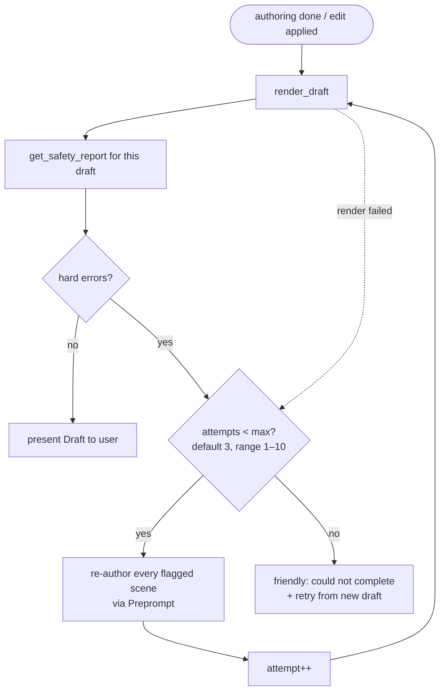

# Design Document

## Overview

The **Web Dashboard** (`web-dashboard`) is a desktop application — an Electron
shell — that gives non-technical Vietnamese users a graphical surface over the
EXISTING `news_remotion_tool` engine. It does not reimplement the pipeline; it is
a **thin surface** that drives the same single-process orchestrator
(`scaffoldVideoProject` / `renderProject`) and the same `@news/mcp` tool layer
(`ingest_url`, `scaffold_project`, `render_draft`, `render_full`, `doctor`,
`list_projects`, `tracker_*`) that already ship. Every hard invariant of the
engine — the N1–N30 safety grid, the evidence gate (N9), draft-first rendering,
determinism, the Vivibe voice rule, workspace hygiene, and the single
`@news/compositions` registry instance — is preserved unchanged because the
dashboard never bypasses the orchestrator (Req 12; AGENTS.md contract).

### Two-plane split

The product is organized into two planes, mirroring the vision doc (Mục 1):

- **Control plane** — pure code, no AI. The React GUI plus the deterministic
  logic behind it: first-run/license, the project gallery and friendly-status
  mapping, the topic/URL create form, the per-scene Storyboard review surface,
  progress display, settings and progressive disclosure, and the typed IPC that
  connects the renderer to the engine host. Nothing in this plane needs a model;
  it is ordinary application logic and is the part this design can test
  exhaustively.
- **Authoring plane** — requires AI. The **Agent_Worker**: a background process
  that ingests research, authors scene `.tsx` + manifest + narration, drives
  draft renders, reads the safety-grid report, and repairs flagged scenes. The
  user never chats with it; it runs silently and surfaces only progress and the
  resulting Storyboard.

### Thin-surface principle

The dashboard owns **presentation, orchestration sequencing, and edit routing**.
It owns **no** rendering, no safety logic, no registry. Concretely:

- Project creation, drafts, and full renders go through `@news/mcp` tools (which
  themselves call `@news/pipeline`), so the draft-first gate, the grid, and the
  Vivibe TTS guard already enforced in `tools.ts` apply identically here.
- The per-scene "slides" in the Storyboard are the engine's existing review
  keyframes (`review/scene-NN.png` produced by `buildReview` / `renderSceneStills`).
- A `Plain_Text_Edit` is applied to the manifest through the engine's content
  normalization (the same Vietnamese number/phonetics rules N6/N7/N8 enforce) and
  involves **no** AI. A `Visual_Edit` is the only path that re-invokes the
  Agent_Worker, and only for the affected scenes.

The dashboard adds exactly one new engine-facing capability — a **safety-grid
report tool** the Agent_Worker calls to read hard-error checks after a draft —
because the generate-validate-repair loop (Req 6) needs the grid result as data,
not just a pass/fail render exit. Everything else is reuse.

### First build risk

The single largest open risk is **which Agent_Worker implementation to adopt**.
Requirement 7 defines a **POC_Spike**: embed a headless open-source agent-runtime
(path Y) that auto-loads `SKILL.md`/`AGENTS.md` and calls our MCP tools, with the
bundled Model_Gateway as model source; fall back to our own agent loop with a
Preprompt (path X) if the runtime cannot clear 8/10 passing runs headless. This
design defines a single `AgentWorker` interface so either implementation drives
the SAME orchestrator and MCP tools, and treats the spike as the first task to
resolve before committing to the rest of the authoring plane.

## Architecture

### Electron process model

The app uses the standard Electron split, with a hard security boundary
(`contextIsolation: true`, `nodeIntegration: false`, a typed `preload` bridge):

- **Main process** = the **engine host**. It runs in Node, imports
  `@news/pipeline` and `@news/mcp` from source (a single registry instance),
  supervises the bundled **Model_Gateway** (9Router) child process, owns the
  **License manager** (the only code that talks to the external License_Service),
  spawns/supervises the **Agent_Worker**, and exposes all of this to the UI over
  typed IPC channels. Render reuses Electron's bundled Chromium via the existing
  Remotion renderer.
- **Renderer process** = the **React UI** (the control plane). It holds no
  secrets, makes no network calls of its own, and reaches the engine only through
  the preload-exposed `window.dashboard` IPC client.
- **Preload** = the thin, audited bridge that exposes a typed, allow-listed IPC
  surface to the renderer and nothing else.

```mermaid
graph TB
  subgraph Renderer["Renderer process — React UI (control plane)"]
    UI[Views: Onboarding · Create · Storyboard · Gallery · Settings]
    VM[View-models + friendly-status map + edit router UI]
    UI --> VM
  end

  Preload[preload bridge: window.dashboard typed IPC]
  VM <-->|invoke / on| Preload

  subgraph Main["Main process — engine host (Node)"]
    IPC[IPC router: typed channels]
    LIC[License manager]
    GW[Model_Gateway manager · 9Router child]
    AW[Agent_Worker supervisor]
    ORCH[Orchestrator facade → @news/pipeline]
    MCP[@news/mcp tools incl. NEW get_safety_report]
    IPC --> LIC
    IPC --> GW
    IPC --> AW
    IPC --> ORCH
    AW --> MCP
    MCP --> ORCH
  end

  Preload <--> IPC

  subgraph Engine["Existing engine (reused unchanged)"]
    PIPE["@news/pipeline: scaffoldVideoProject / renderProject\nsafety grid N1–N30 · review · cache · store"]
    REG["@news/compositions (single registry instance)"]
    SCHEMA["@news/schema · @news/blocks · @news/design · @news/tts"]
    PIPE --> REG
    PIPE --> SCHEMA
  end

  ORCH --> PIPE
  MCP --> PIPE

  subgraph External["External (network)"]
    LS[License_Service · Gumroad/Lemon Squeezy/Keygen]
    AIACC[AI provider sign-in delegated via the Model_Gateway UI\nbrowser / device-code / api-key · open provider set]
  end
  LIC -->|activate/verify| LS
  GW -->|delegated login + poll connection state| AIACC
```

The new code is a single workspace package, **`apps/desktop`** (Electron main +
preload + React renderer), that depends on `@news/pipeline` and `@news/mcp`. It
introduces **no second registry**: it imports the orchestrator/tools from source
exactly as the test suite and CLI do, so registration resolves to the one
`@news/compositions` instance (AGENTS.md "Authoring & render — the reliable
path"; Req 12.10).

### End-to-end create → draft → review → full flow

```mermaid
sequenceDiagram
  participant U as User
  participant UI as Renderer (React)
  participant M as Main (engine host)
  participant AW as Agent_Worker
  participant E as Orchestrator + MCP

  U->>UI: enter topic/URL, press "Create draft"
  UI->>M: dashboard.createProject(input, style?)
  M->>E: scaffold_project (one registry)
  M->>AW: start authoring(projectId, scriptGate=on)
  AW->>E: ingest_url / web-search+ingest
  AW-->>UI: onProgress + scenes appear (Storyboard grows)
  opt Script approval gate (default ON)
    AW-->>UI: outline + narration text
    U->>UI: edit/approve (or disable gate)
    UI->>M: applyScriptEdits / approveScript
    M->>E: normalize + write manifest (no AI)
  end
  loop generate-validate-repair (max attempts, default 3)
    AW->>E: render_draft
    AW->>E: get_safety_report(draft)
    alt hard errors remain
      AW->>E: re-author flagged scenes → render_draft
    else zero hard errors
      AW-->>UI: present Draft + full Storyboard
    end
  end
  U->>UI: review per-scene stills, write edits, submit
  UI->>M: submitEdits(batch)
  alt plain-text edits
    M->>E: normalize + write manifest (no AI)
  else visual/structural edits
    M->>AW: re-author ONLY affected scenes via Preprompt
  end
  M->>E: render_draft (re-render only changed scenes; cache keeps rest byte-identical)
  E-->>UI: updated Draft v(n+1)
  U->>UI: Approve
  UI->>M: approveDraft → render_full
  M->>E: render_full (refused if no reviewed draft)
  E-->>UI: finished MP4 path + embedded player
```

### Generate-validate-repair loop

The loop (Req 6) is the quality backbone: the grid — not the prompt — guarantees
correctness. The dashboard exposes `render_draft` and the new `get_safety_report`
as tools; the Agent_Worker renders, reads hard errors, repairs flagged scenes,
and loops until zero hard errors or the attempt budget is spent.



A failed repair render still counts toward the budget (Req 6.6). Auto-applied
fixes are described in plain language; raw N-check codes never reach the UI
(Req 6.8) — the grid's `SafetyIssue.check` strings stay on the
Agent_Worker/main-process side and are translated before display.

## Components and Interfaces

All interfaces below live in `apps/desktop`. Engine types (`ProjectBrief`,
`ProjectState`, `SafetyReport`, `SafetyIssue`, `RenderProjectResult`,
`IngestResult`, `ProjectSummary`, `SerializedPipelineError`) are imported from
`@news/pipeline` / `@news/mcp` — not redefined.

### License manager (+ License_Service)

Runs only in the main process; the renderer sees license **state**, never the
key or network details (Req 1).

```ts
export type LicenseState =
  | { kind: "unactivated" }
  | { kind: "activating" }
  | { kind: "active"; machineLocked: true; lastVerifiedAt: string }
  | { kind: "lapsed"; reason: "revoked" | "expired" } // keeps existing videos, blocks new
  | { kind: "error"; reason: "timeout" | "offline" | "invalid" | "limit" | "revoked" };

export interface LicenseService {
  activate(key: string, machineId: string, signal: AbortSignal): Promise<ActivationOutcome>;
  verify(machineId: string, signal: AbortSignal): Promise<ActivationOutcome>;
}

export type ActivationOutcome =
  | { ok: true; nodeLocked: true }
  | { ok: false; reason: "invalid" | "limit" | "revoked" | "timeout" | "offline" };

export interface LicenseManager {
  current(): LicenseState;
  activate(key: string): Promise<LicenseState>; // 30s timeout (Req 1.3), retry same key
  verifyAtLaunch(): Promise<LicenseState>;       // skips re-entry if node-locked (Req 1.8)
  /** Pure gate consumed by IPC + UI: may the user create a NEW video? */
  canCreate(state: LicenseState): boolean;        // false unless kind==="active"
}
```

`canCreate` is the single source of truth for Req 1.7 / 1.9 / 12: a `lapsed`
license preserves access to already-created videos (gallery, playback, full
render of an existing reviewed draft) but `canCreate` returns false, blocking new
creation. The 30-second timeout, the offline/invalid/limit/revoked branches, and
"retry with same key" all map to the `LicenseState` error reasons, each rendered
as a plain-language message (Req 1.3/1.5/1.6).

### Bundled Model_Gateway manager (lifecycle + dynamic provider connect + model selection)

Owns the **9router** child process (OpenAI-compatible API at
`http://localhost:20128/v1`, management API under `http://localhost:20128/api/*`)
and the set of AI-account connections (Req 2). The `Local_Gateway_Key` — the
internal OpenAI bearer the Agent_Worker uses to call `/v1` — is generated and
wired internally and is **never** returned across IPC (Req 2.3). Note the term
"API key" may legitimately appear as a provider *login-type label* (see
`ProviderInfo.loginType`), but never refers to the `Local_Gateway_Key`.

Providers are **not** a fixed set and are **not** a single OAuth flow. The manager
**discovers** the available providers from the gateway (the set is open and
includes user-defined custom providers), and the gateway owns three distinct
login flows plus custom nodes:

- **OAuth Authorization-Code** (e.g. Claude Code, Codex, Gemini CLI, Antigravity,
  iFlow) — login happens in an **external browser** page (which may itself be a
  Google/GitHub page).
- **OAuth Device-Code** (e.g. GitHub Copilot, Qwen, Kiro) — a verification URL +
  user code; the gateway polls for completion.
- **API-Key** (e.g. OpenRouter, GLM, Minimax, Kimi, OpenAI, Anthropic, Gemini) —
  paste a provider key.
- **Custom provider** nodes the user defines in the gateway.

The Dashboard **delegates** provider-specific login to the gateway's own login
interface (it does NOT reimplement OAuth / device-code / api-key screens). It
signposts whether login appears in an external browser or in-app, then **polls**
the gateway connection state to detect a completed connection. Multiple
connections may be active at once; the user then selects which **model** (from
the gateway's model list, e.g. `kr/claude-sonnet-4.5`, `cx/gpt-5.2-codex`) is
used for generation.

```ts
export type GatewayState =
  | { kind: "starting"; attempt: number }     // up to 3 attempts (Req 2.2)
  | { kind: "ready"; baseUrl: "http://localhost:20128/v1" }
  | { kind: "unavailable" };                  // surfaced after 3 failed attempts

/** Open provider id discovered from the gateway (NOT a fixed union). */
export type AiProviderId = string;

/** A provider discovered from the gateway's management API. */
export type ProviderInfo = {
  id: AiProviderId;
  name: string;
  loginType: "browser" | "device" | "api-key" | "custom"; // login-type indicator (Req 2.4)
  connectedCount: number;                                  // active connections (Req 2.4)
};

/** A model the gateway reports as available (GET /v1/models). */
export type ModelInfo = { id: string; label: string };

/** One completed AI-account connection. */
export type ConnectedAccount = { provider: AiProviderId; label: string };

export type AiAccountState =
  | { kind: "disconnected" }
  | { kind: "connecting"; provider: AiProviderId }
  // many connections may be active at once (Req 2.10); selectedModel may be unset (Req 2.13)
  | { kind: "connected"; accounts: ConnectedAccount[]; selectedModel?: ModelInfo };

export interface ModelGatewayManager {
  start(): Promise<GatewayState>;             // localhost only, no window/console (Req 2.1)
  state(): GatewayState;
  /** Internal: generate + auto-wire the Local_Gateway_Key. Returns void — key never leaves main. */
  ensureLocalKey(): Promise<void>;            // Req 2.3 (never shown; no "API key" term for it)
  /** Discover the open provider set from the gateway (Req 2.4). */
  listProviders(): Promise<ProviderInfo[]>;
  /** Delegate login to the gateway's own UI; report where it appears (Req 2.6). */
  beginConnect(providerId: AiProviderId): Promise<{ loginSurface: "external-browser" | "in-app" }>;
  /** Poll the gateway connection state for newly completed connections (Req 2.7). */
  pollConnections(): Promise<ConnectedAccount[]>;
  /** The set of currently connected accounts — supports many (Req 2.8/2.10). */
  account(): AiAccountState;
  /** Models the gateway reports as available (Req 2.11). */
  listModels(): Promise<ModelInfo[]>;
  selectModel(modelId: string): Promise<AiAccountState>;   // Req 2.11
  selectedModel(): ModelInfo | undefined;
  /** Pure gate: may silent draft generation start? (Req 2.12/2.13) */
  aiReady(gw: GatewayState, acc: AiAccountState): boolean;
  // true iff gw.ready && acc.kind==="connected" && acc.accounts.length>0 && acc.selectedModel set
}
```

The renderer shows the **discovered** provider list — each with its name, active
connection count, and login-type indicator (Req 2.4) — with **no** provider
preselected (Req 2.5). Initiating a connect delegates to the gateway's login UI
and signposts whether it opens in an external browser or in-app (Req 2.6), after
which the manager polls until a connection completes (Req 2.7/2.8). `aiReady`
gates the Create action: it requires the gateway ready, **at least one** connected
account, **and** a selected model — so an attempt to start generation with no
account is blocked with a "connect an account first" prompt (Req 2.12), and with
an account but no model selected is blocked with a "select a model" prompt
(Req 2.13). Vivibe stays the default voice (Req 2.14) — the gateway's TTS is not
used.

> **Implementation note.** This revises the implementation of tasks **6.3/6.4**
> and the shared IPC types: the fixed `kiro | codex | gemini` provider union and
> the single `connectAccount` OAuth flow are replaced by dynamic discovery,
> delegated login (browser/device/api-key/custom), multi-connection state, and
> explicit model selection. The bundled gateway is concretely **9router**
> (OpenAI-compatible `/v1` at `http://localhost:20128`, management API `/api/*`).

### Agent_Worker abstraction (one interface, two implementations)

A single interface so the POC_Spike (Req 7) can swap implementations without
touching the orchestrator or UI. Both implementations drive the SAME MCP tools.

```ts
export interface AgentWorker {
  /** Author scenes for a fresh project: ingest → author → (script gate) → draft. */
  author(job: AuthorJob, hooks: AgentHooks): Promise<AuthorOutcome>;
  /** Re-author ONLY the named scenes from batched visual edits (Req 8.7). */
  reauthorScenes(job: ReauthorJob, hooks: AgentHooks): Promise<AuthorOutcome>;
  /** Run the generate-validate-repair loop to zero hard errors or budget. */
  generateValidateRepair(projectId: string, opts: RepairLoopOptions, hooks: AgentHooks): Promise<RepairOutcome>;
}

export type AuthorJob = {
  projectId: string;
  input: { kind: "url"; url: string } | { kind: "topic"; text: string };
  scriptGate: boolean;
};

export type ReauthorJob = { projectId: string; sceneIds: string[]; preprompt: PrepromptPayload };

export type RepairLoopOptions = { maxAttempts: number }; // default 3, clamped to [1,10] (Req 6.4)

export type RepairOutcome =
  | { kind: "passed"; attempts: number }
  | { kind: "exhausted"; attempts: number; remainingHardErrors: number };

export interface AgentHooks {
  onProgress(ratio: number): void;                  // 0..1 → UI % (Req 5.2)
  onSceneProduced(sceneId: string, stillPath: string): void; // Storyboard grows (Req 5.3)
  onRepair(fix: FriendlyFix): void;                 // plain-language, no N-code (Req 6.8)
}
```

The two implementations:

- **(Y) Headless runtime adapter** — wraps an embedded open-source agent-runtime
  (OpenCode/Cline/…) configured headless, pointed at the Model_Gateway as its
  model source, auto-loading `SKILL.md` + `AGENTS.md`, discovering our MCP tools.
  The adapter translates the runtime's tool calls/results into `AgentHooks`.
- **(X) Custom-loop adapter** — our own loop: assemble a `Preprompt` (the fixed
  contract-bearing template), call the Model_Gateway via an OpenAI-compatible
  client (`baseURL = http://localhost:20128/v1`), and orchestrate MCP tool calls
  ourselves.

The POC_Spike harness runs path Y headless 10× and counts passing videos (clears
all hard grid checks + the review gate); ≥8/10 adopts Y, else X (Req 7.3/7.4).

#### New tool the loop needs: `get_safety_report`

The existing `render_draft` returns a `RenderProjectResult` whose `report`
already carries the grid issues, but the loop needs to read the **hard-error
subset for a given draft** as an explicit capability (Req 6.1/6.2). We add one
MCP tool in `@news/mcp` that reads the orchestrator's last report for a project
(from `review.json` / the render result) and returns it:

```ts
// new in @news/mcp tools.ts — reuses SafetyReport from @news/pipeline
export const getSafetyReportInput = z.object({ projectId: z.string().min(1) });

async function get_safety_report(
  input: z.infer<typeof getSafetyReportInput>,
): Promise<ToolResult<{ ok: boolean; hardErrors: SafetyIssue[]; warnings: SafetyIssue[] }>>;
```

This does not change the grid; it exposes the report the orchestrator already
produces. Hard errors carry their `check` ids for the Agent_Worker/logs only
(Req 12.2) and are translated before any UI surfacing.

### Create / ingest flow

```ts
export type CreateInput = {
  raw: string;                       // topic (1–500) or URL (1–2048)
  stylePackId?: string;              // L2; default applied when omitted (Req 3.4/3.5)
  accentColor?: string;
};

export type CreateValidation =
  | { ok: true; classified: { kind: "url"; url: string } | { kind: "topic"; text: string } }
  | { ok: false; reason: "empty" | "too-long" | "malformed-url" };

export interface CreateController {
  validate(input: CreateInput): CreateValidation;     // pure (Req 3.1/3.7/3.8)
  start(input: CreateInput): Promise<{ projectId: string }>; // scaffolds via one registry (Req 3.6)
}
```

`validate` is pure and total over arbitrary strings: empty/whitespace → `empty`
(retain text, don't start); over-length or malformed URL → the matching reason;
otherwise classified as URL vs topic. Ingest failures (Req 3.9) and empty
topic-search results (Req 3.10) come back from the Agent_Worker as friendly
messages that leave authoring unstarted.

### Storyboard review model

The per-scene still source is the engine's existing review keyframe
(`projects/<id>/review/<sceneId>.png`). The dashboard reads the keyframe paths
from the render result / `review.json`; it does not generate stills itself.

```ts
export type SceneCard = {
  sceneId: string;             // stable scene-NN
  order: number;
  stillPath: string;           // existing review keyframe (Req 8.1)
  editText: string;            // per-scene edit box, ≤ 2000 chars
};

export type StoryboardModel = {
  projectId: string;
  scenes: SceneCard[];
  globalNotes: string;         // ≤ 4000 chars (Req 8.2)
};

export type SceneAction =
  | { kind: "regenerate"; sceneId: string }
  | { kind: "add"; afterSceneId?: string }
  | { kind: "remove"; sceneId: string }
  | { kind: "reorder"; sceneId: string; toIndex: number }
  | { kind: "restyle"; stylePackId?: string; accentColor?: string };
```

#### Plain-text vs visual edit routing

The router is a pure function that classifies each per-scene edit and the batch,
deciding which edits apply directly to the manifest (no AI) and which require
re-authoring. This is the heart of Req 8.6/8.7 and the most safety-relevant pure
logic in the app.

```ts
export type EditClass = "plain-text" | "visual";

export type ParsedSceneEdit = {
  sceneId: string;
  // a plain-text edit only changes wording of these fields:
  textChanges?: Partial<{ headline: string; narration: string; cta: string }>;
  // anything else (imagery, layout, structure, restyle) is visual:
  visualIntent?: string;
};

export interface EditRouter {
  classify(edit: ParsedSceneEdit): EditClass;          // pure, total
  /** Split a submitted batch into the two execution paths. */
  route(batch: EditBatch): {
    plainText: PlainTextEdit[];   // apply to manifest with normalization, no AI
    visual: { sceneIds: string[]; preprompt: PrepromptPayload }; // re-author affected only
  };
}
```

A `Plain_Text_Edit` is applied through the engine's content
validation/normalization (the Vietnamese number/phonetics rules, N6/N7/N8)
before writing the manifest (Req 8.14); a `Visual_Edit` is merged into the
`Preprompt` and only the affected scene ids are re-authored (Req 8.7) and
re-rendered, with the render cache keeping unchanged scenes byte-identical
(Req 8.8 — the cache key already includes authored source + locked spec, so
unchanged scenes are cache hits).

#### Batch → Preprompt

```ts
export type EditBatch = {
  perScene: { sceneId: string; text: string }[];
  globalNotes: string;
};

export type PrepromptPayload = {
  contractRef: "SKILL.md+AGENTS.md";   // fixed contract bearer (path X)
  affectedSceneIds: string[];
  perSceneIntent: Record<string, string>;
  globalNotes: string;
};

export interface BatchSubmitController {
  /** Reject empty submissions (Req 8.11); enforce ≥1 scene (Req 8.13). */
  validateBatch(b: EditBatch, sceneCount: number): { ok: true } | { ok: false; reason: "no-changes" | "last-scene" };
  submit(b: EditBatch): Promise<{ projectId: string }>; // batches, routes, re-renders changed only
}
```

An evidence-gate warning from a visual edit that requests an unsupported figure
leaves the scene's existing figure unchanged and surfaces a friendly warning
naming the figure (Req 8.9) — this is N9 acting through the Agent_Worker.

### Project gallery + friendly-status mapping

```ts
export type FriendlyStatus = "building" | "draft-ready" | "done" | "error";

export const FRIENDLY_LABELS: Record<FriendlyStatus, string> = {
  building: "Đang dựng…",
  "draft-ready": "Nháp sẵn sàng để duyệt",
  done: "Hoàn tất",
  error: "Gặp lỗi — thử lại",
};

/** TOTAL mapping from engine ProjectState → FriendlyStatus (Req 10.2/10.3). */
export function toFriendlyStatus(state: ProjectState | string): FriendlyStatus {
  switch (state) {
    case "scaffolded":
    case "tts":
    case "locking":
    case "rendering":
      return "building";
    case "reviewing":
      return "draft-ready"; // "reviewing" or draft-ready
    case "done":
      return "done";
    case "failed":
      return "error";
    default:
      return "building"; // any unmapped/unknown state (Req 10.3)
  }
}

export type ProjectCardVM = {
  projectId: string;
  title: string;
  thumbnailPath: string | null;  // placeholder when null (Req 10.6)
  status: FriendlyStatus;
  createdAtLabel: string;        // "ngày D tháng M năm YYYY" (Req 10.1)
};

export interface GalleryController {
  /** Build cards from @news/pipeline ProjectSummary[], newest first. */
  toCards(summaries: ProjectSummary[]): ProjectCardVM[];
  loadState(): "loading" | "empty" | "populated"; // empty-state only after load (Req 10.8)
}
```

`toFriendlyStatus` is total by construction (the `default` branch), so no
internal state name ever reaches the gallery (Req 10.4). The Advanced/Batch view
surfaces the existing tracker via `tracker_*` tools (Req 10.9). Badge updates
within 5 s come from the same `onProgress`/state-change stream that drives the
percentage (Req 10.5).

### Settings / progressive-disclosure model

```ts
export type DisclosureLevel = "L0" | "L1" | "L2" | "L3";

export type ControlId =
  | "topic-input" | "create-action" | "draft-player" | "scene-edit-box" | "approve" // L1
  | "style-pack" | "accent-color" | "regenerate-scene" | "scene-add" | "scene-remove" | "scene-reorder" // L2
  | "ai-account" | "voice" | "output-location" | "advanced-render"  // L3
  | "grid-codes" | "determinism" | "manifest-json" | "tsx-source" | "mcp" | "stack-trace"; // L0 (never shown)

/** Pure: where does this control live? L0 ⇒ never rendered (Req 11.5). */
export function disclosureOf(id: ControlId): DisclosureLevel;

export type SettingsModel = {
  aiAccount: AiAccountState;
  voiceProvider: "vivibe";       // default, pre-populated (Req 11.7)
  voiceId?: string;
  outputDir: string;             // defaults to .video-tool home
  maxRepairAttempts: number;     // default 3, clamp [1,10]
  scriptGateEnabled: boolean;    // default true (Req 4.1)
};
```

Every L3 setting is pre-populated with a default so a user can complete the whole
flow without opening Settings (Req 11.7); leaving Settings preserves in-progress
project state (Req 11.8).

### IPC API surface (typed channels)

One typed contract shared between preload and main. Request/response channels use
`ipcRenderer.invoke`; streaming uses `ipcRenderer.on` for `onProgress`/scene/state
events.

```ts
export interface DashboardApi {
  // license (Req 1)
  license: {
    get(): Promise<LicenseState>;
    activate(key: string): Promise<LicenseState>;
  };
  // AI account + gateway (Req 2)
  ai: {
    gatewayState(): Promise<GatewayState>;
    listProviders(): Promise<ProviderInfo[]>;                  // discovered set (Req 2.4)
    connectedAccounts(): Promise<AiAccountState>;              // many connections (Req 2.8/2.10)
    beginConnect(providerId: AiProviderId): Promise<{ loginSurface: "external-browser" | "in-app" }>; // Req 2.6
    listModels(): Promise<ModelInfo[]>;                        // Req 2.11
    selectModel(modelId: string): Promise<AiAccountState>;     // Req 2.11
    selectedModel(): Promise<ModelInfo | undefined>;
  };
  // create / projects (Req 3, 10)
  projects: {
    create(input: CreateInput): Promise<{ projectId: string }>;
    list(): Promise<ProjectCardVM[]>;
    open(projectId: string): Promise<StoryboardModel>;
  };
  // script gate (Req 4)
  script: {
    get(projectId: string): Promise<ScriptGateModel>;
    applyEdits(projectId: string, edits: ScriptEdit[]): Promise<ApplyResult>;
    approve(projectId: string): Promise<void>;
    setEnabled(enabled: boolean): Promise<void>;
  };
  // review / edit (Req 8) + render (Req 9)
  review: {
    submitEdits(projectId: string, batch: EditBatch): Promise<SubmitResult>;
    approveDraft(projectId: string): Promise<{ outputPath: string } | RefusedResult>;
  };
  // settings (Req 11)
  settings: { get(): Promise<SettingsModel>; update(p: Partial<SettingsModel>): Promise<SettingsModel> };
  // streaming events (Req 5, 9, 10)
  events: {
    onProgress(cb: (e: { projectId: string; ratio: number; phase: "draft" | "full" }) => void): Unsubscribe;
    onScene(cb: (e: { projectId: string; sceneId: string; stillPath: string }) => void): Unsubscribe;
    onStatus(cb: (e: { projectId: string; status: FriendlyStatus }) => void): Unsubscribe;
    onFriendlyError(cb: (e: FriendlyError) => void): Unsubscribe;
  };
}
```

All payloads crossing IPC are already-translated view-models: no `SafetyIssue`
`check` ids, no manifest JSON, no `.tsx`, no stack traces (Req 11.5/11.6). The
main process is the redaction boundary.

### onProgress → UI progress mapping

The engine's `renderProject` and the MCP `render_draft`/`render_full` already
accept `onProgress(ratio: number)` where `ratio ∈ [0,1]`. The main process
forwards these as `events.onProgress` with `ratio` and a `phase`; the renderer
renders `Math.round(ratio*100)` as a percentage and, for full render, may show
the current pipeline stage instead. Draft progress updates at least every 2 s
(Req 5.2); full at least every 5 s (Req 9.5). A `FriendlyStatus` derived from the
brief state drives the badge in parallel.

## Data Models

The dashboard **reuses** the engine's persisted models and adds only UI-side
view-models and edit payloads. It never duplicates `ProjectBrief`, the manifest,
or the tracker — those remain owned by `@news/pipeline` under `.video-tool/`.

### Reused engine models (imported, not redefined)

- `ProjectBrief` (`brief.json`) — `state: ProjectState`, `tts`, `styleId`,
  `createdAt`/`updatedAt`. Source of truth for friendly-status and gallery cards.
- `ProjectState` — `planning | planned | scaffolded | tts | locking | rendering |
  reviewing | done | failed`. Mapped (totally) to `FriendlyStatus`.
- Manifest / `VideoSpec` — scenes (`scene-NN`, component, props, `narration`).
  `Plain_Text_Edit` writes here through normalization; `Visual_Edit` re-authors
  the scene module.
- `ProjectSummary` (`listProjects`) — `{ projectId, root, brief?, hasRender }`,
  newest first. Becomes `ProjectCardVM[]`.
- Review keyframes (`review/<sceneId>.png`, `review.json`) — the Storyboard's
  per-scene stills.
- `SafetyReport` / `SafetyIssue` — read via `get_safety_report` for the repair
  loop; never serialized to the renderer.
- Tracker (`tracker.json`, `TrackerItem`) — the Advanced/Batch view.

### Desktop app state (new, UI-side)

```ts
export type DesktopState = {
  license: LicenseState;
  gateway: GatewayState;
  aiAccount: AiAccountState;
  settings: SettingsModel;
  gallery: { load: "loading" | "empty" | "populated"; cards: ProjectCardVM[] };
  openProject?: {
    projectId: string;
    storyboard: StoryboardModel;
    draft: DraftRevisionPointer;   // which draft is currently shown
    progress?: { ratio: number; phase: "draft" | "full" };
  };
};

/** Points at the current reviewable draft for the open project (Req 5/9). */
export type DraftRevisionPointer = {
  hasReviewedDraft: boolean;       // gates Approve (Req 9.1/9.2) + full render (Req 9.4/12.5)
  draftMp4Path?: string;
  revision: number;                // increments each re-draft (no history kept in v1)
};
```

`DraftRevisionPointer.hasReviewedDraft` is the UI mirror of the engine's
draft-first gate; the orchestrator still independently refuses a full render with
no draft (Req 9.4/12.5), so the pointer is an enabler for the Approve button, not
the authority.

### Per-scene edit / batch payload

```ts
export type ScriptEdit = { sceneId: string; narration?: string; headline?: string };
export type ApplyResult =
  | { ok: true }
  | { ok: false; reason: "empty-narration"; sceneId: string }   // Req 4.4
  | { ok: false; reason: "write-failed" };                       // Req 4.5 (manifest unchanged)

export type SubmitResult =
  | { ok: true; revision: number }
  | { ok: false; reason: "no-changes" }                          // Req 8.11
  | { ok: false; reason: "last-scene" }                          // Req 8.13
  | { ok: true; warnings: EvidenceWarning[] }                    // Req 8.9
  | { ok: false; reason: "scene-render-failed"; sceneId: string };// Req 8.12

export type EvidenceWarning = { sceneId: string; unsupportedFigure: string };
export type RefusedResult = { refused: true; reason: "draft-first" }; // Req 9.4
```

### Friendly-status enum mapping (total)

The mapping table (also the implementation of `toFriendlyStatus`):

| Internal `ProjectState`                  | `FriendlyStatus` | Label (vi)                    |
| ---------------------------------------- | ---------------- | ----------------------------- |
| `scaffolded`, `tts`, `locking`, `rendering` | `building`    | Đang dựng…                    |
| `reviewing` (+ draft-ready)              | `draft-ready`    | Nháp sẵn sàng để duyệt        |
| `done`                                   | `done`           | Hoàn tất                      |
| `failed`                                 | `error`          | Gặp lỗi — thử lại             |
| `planning`, `planned`, any unknown       | `building`       | Đang dựng… (Req 10.3 default) |

### Friendly error / fix view-models

```ts
export type FriendlyError = {
  projectId?: string;
  message: string;          // plain language, what happened + next action (Req 11.6)
  retry?: "draft" | "full" | "create" | "activate" | "connect";
};
export type FriendlyFix = { sceneId?: string; message: string }; // "Cảnh 7 bị tràn chữ — đã tự sửa"
```

These are the ONLY error/fix shapes that cross IPC; they are produced in the main
process by translating `SerializedPipelineError` / `SafetyIssue` and stripping
every L0 internal (Req 6.8, 11.5, 11.6, 12.2).

## Correctness Properties

*A property is a characteristic or behavior that should hold true across all
valid executions of a system — essentially, a formal statement about what the
system should do. Properties serve as the bridge between human-readable
specifications and machine-verifiable correctness guarantees.*

This feature is an Electron/React shell over an existing, already-tested engine.
PBT applies here to the dashboard's **pure control-plane logic** — input
validation, gating, edit classification/routing, the repair-loop budget,
mappings, and message redaction — where behavior varies meaningfully with input
across a large space. The real safety grid (N1–N30), determinism (N16), the
evidence gate (N9), the Vivibe TTS guard, workspace hygiene, the single registry,
and actual rendering are covered by the existing engine tests and by integration
tests (see Testing Strategy); they are explicitly NOT re-derived as dashboard
properties.

### Property 1: Create input validation is total and correct

*For any* string (including empty, whitespace-only, over-length, malformed-URL,
valid-URL, and plain-topic inputs), `CreateController.validate` returns a result
such that: empty/whitespace-only ⇒ `{ ok:false, reason:"empty" }`; a topic over
500 chars or a URL over 2048 chars ⇒ `{ ok:false, reason:"too-long" }`; a
URL-shaped-but-malformed input ⇒ `{ ok:false, reason:"malformed-url" }`;
otherwise `{ ok:true }` classified as URL vs topic — and creation is never
started for any `ok:false` result while the entered text is retained.

**Validates: Requirements 3.1, 3.7, 3.8**

### Property 2: License gates new creation iff active

*For any* `LicenseState`, `LicenseManager.canCreate(state)` returns true if and
only if `state.kind === "active"`; in particular a `lapsed` (revoked/expired)
state returns false (new creation blocked) while access to already-created
videos remains available.

**Validates: Requirements 1.7, 1.9**

### Property 3: AI generation is gated by gateway-ready and account-connected

*For any* `GatewayState` and `AiAccountState`, `aiReady(gw, acc)` is true if and
only if the gateway is `ready`, at least one account is `connected`, AND a model
is selected; and any attempt to start silent draft generation when `aiReady` is
false is blocked and leaves draft generation unstarted.

**Validates: Requirements 2.12, 2.13**

### Property 4: Script edits never write an empty narration

*For any* set of script edits applied to a manifest, if any edit would leave a
scene's narration with zero non-whitespace characters, that confirmation is
rejected, the prior text for that scene is retained, and the rejected scene is
identified; and if applying the edits fails, the pre-edit manifest is left
unchanged.

**Validates: Requirements 4.3, 4.4, 4.5**

### Property 5: The generate-validate-repair loop respects its budget

*For any* `maxAttempts` (clamped into the range 1–10) and *for any* sequence of
safety-grid reports, the loop performs at most `maxAttempts` draft renders, stops
on the first report with zero hard errors and presents that draft, counts a
failed (non-renderable) attempt toward the budget, and — if the budget is reached
with hard errors still present — returns an `exhausted` outcome that drives a
friendly "could not complete" message plus a retry-from-new-draft action.

**Validates: Requirements 6.3, 6.4, 6.6, 6.7**

### Property 6: No engine internals leak into user-facing messages

*For any* engine error or safety issue (including content embedding N-check codes
`N1`–`N30`, manifest JSON, `.tsx` source, MCP references, or stack traces), the
`FriendlyError`/`FriendlyFix` produced for the UI contains a non-empty
plain-language message and contains none of those L0 internal tokens.

**Validates: Requirements 6.8, 11.5, 11.6, 12.2**

### Property 7: Edit routing — plain-text never invokes AI, visual touches only affected scenes

*For any* submitted edit batch, every edit classified as `plain-text` is applied
directly to the manifest with no AI invocation (the visual re-author set is
empty), and every edit classified as `visual` results in re-authoring and
re-rendering of only the scene ids named in that batch (the re-rendered set is a
subset of the visually-edited scene ids); plain-text edits are routed through the
engine's content normalization before the manifest write.

**Validates: Requirements 8.6, 8.7, 8.8, 8.14**

### Property 8: Empty and last-scene submissions are rejected without changing the draft

*For any* edit batch, if it contains no per-scene edit text and no global notes
the submission is rejected with reason `no-changes`; and *for any* removal
request targeting the only remaining scene, the removal is rejected with reason
`last-scene`; in both cases the current Draft is left unchanged.

**Validates: Requirements 8.11, 8.13**

### Property 9: Approve and full render are gated by a reviewed draft (draft-first)

*For any* open-project state, the Approve action is enabled if and only if a
reviewed Draft exists for that project, and a Full_Render requested with no
reviewed Draft and no explicit force-full override is refused with a
`draft-first` result that leaves the Draft and project unchanged.

**Validates: Requirements 5.6, 9.1, 9.2, 9.4, 12.5**

### Property 10: Friendly-status mapping is total and leaks no internal state name

*For any* internal state value (every `ProjectState` plus arbitrary/unknown
strings), `toFriendlyStatus` returns exactly one of the four friendly statuses,
maps any unmapped/unknown value to `building` ("Đang dựng…"), and never returns a
value equal to an internal technical state name.

**Validates: Requirements 10.2, 10.3, 10.4**

### Property 11: Gallery cards are complete and ordered newest-first

*For any* list of `ProjectSummary` values, `GalleryController.toCards` produces
one card per project, each carrying a title, a thumbnail path or placeholder, a
friendly status, and a creation date formatted as `ngày D tháng M năm YYYY`, with
the cards ordered by creation date most-recent-first.

**Validates: Requirements 10.1, 10.6**

### Property 12: Disclosure placement is total and hides all L0 internals

*For any* `ControlId`, `disclosureOf` returns exactly one disclosure level, every
L0 control id maps to level `L0`, and no L0 control id ever appears in the set of
controls rendered in the user-facing interface.

**Validates: Requirements 11.1, 11.2, 11.4, 11.5**

## Error Handling

All errors surface as `FriendlyError` view-models built in the main process by
translating `SerializedPipelineError` / `SafetyIssue`, stripping every L0
internal (Property 6). Each maps to a requirement's IF-THEN path and offers the
appropriate retry.

- **License / network (Req 1.3, 1.5, 1.6, 1.9).** Activation runs with a 30 s
  timeout. Timeout ⇒ "activation timed out", retry with same key. Offline ⇒
  "internet connection required", retry. Invalid/limit/revoked ⇒ "activation
  could not be completed", keep the activation screen, do not grant creation. A
  previously-active license reported revoked/expired ⇒ `lapsed`: existing videos
  stay reachable, new creation blocked.
- **Model_Gateway start / OAuth (Req 2.2, 2.8).** Gateway start retries up to 3
  times; persistent failure ⇒ "the local service could not start", AI authoring
  disabled. OAuth that fails, is cancelled, or exceeds 120 s ⇒ "the connection
  did not complete", AI authoring stays disabled, any previously connected
  account is retained unchanged.
- **Ingest / search failure (Req 3.9, 3.10).** URL unreachable / no usable
  content / timeout, or a topic search with no usable source ⇒ a plain-language
  message; authoring is not started; entered input is retained.
- **Generate-validate-repair exhaustion (Req 6.7).** Budget reached with hard
  errors remaining ⇒ "the video could not be completed" plus a retry that
  restarts the loop from a new draft render. Auto-repaired errors along the way
  are reported as friendly fixes ("Cảnh 7 bị tràn chữ — đã tự sửa"), never
  N-codes (Req 6.8).
- **Script-gate apply failure (Req 4.4, 4.5).** Empty-narration edit ⇒ reject,
  retain prior text, identify the scene. Manifest write failure ⇒ retain pre-edit
  manifest, withhold the first draft, indicate edits were not saved.
- **Render failure (Req 9.7).** Full render fails ⇒ stop progress, plain-language
  message, retain the existing Draft, offer a retry that re-initiates the full
  render.
- **Per-scene re-render failure (Req 8.12).** A changed scene fails to re-render
  ⇒ retain that scene's previously rendered still, preserve the submitted edits,
  and indicate the failed scene by id.
- **Evidence-gate on edit (Req 8.9).** A visual edit requesting an unsupported
  figure ⇒ no fabrication, the scene's existing figure is unchanged, and an
  evidence-gate warning names the unsupported figure.
- **Voice config incomplete (Req 12.8).** Surface the exact missing setting (key,
  endpoint, or voice id); never substitute a lower-quality voice (the engine's
  `assertVivibeConfig` is the authority).

## Testing Strategy

A dual approach: property-based tests for the pure control-plane logic, plus
example/integration tests for I/O, lifecycle, UI, and engine-boundary behavior.

### Property-based tests (dashboard logic)

Implemented with **`fast-check`** (the standard PBT library for TypeScript),
co-located with the `apps/desktop` logic modules and run under the existing
Vitest setup. Each property test:

- runs a **minimum of 100 iterations**;
- is tagged with a comment referencing its design property, format
  **`Feature: web-dashboard, Property {n}: {property text}`**;
- implements exactly one of the correctness properties (Properties 1–12) with a
  single property-based test.

Generators target the real input spaces: arbitrary strings (incl.
whitespace/unicode/over-length) for validation and redaction; arbitrary
`LicenseState` / `GatewayState` / `AiAccountState` for the gates; arbitrary
sequences of `SafetyReport` for the repair loop; arbitrary `ProjectState` and
unknown strings for the status mapping; arbitrary `ProjectSummary[]` for gallery
ordering; the full `ControlId` set for disclosure. The logic under test is pure
(no Electron, no real render), so tests stub the orchestrator/agent.

### Unit / example tests

Concrete scenarios that are not universal: script-gate default ON (Req 4.1),
gate sequencing incl. approve-before-initialized waits (Req 4.2, 4.6–4.8),
node-locked launch skip (Req 1.8), the ActivationOutcome→message table
(Req 1.3/1.5/1.6), Vivibe default (Req 2.10), placeholder thumbnail (Req 10.6),
empty-state only after load (Req 10.8), L3 defaults pre-populated (Req 11.7),
settings round-trip preserving project state (Req 11.8), and the POC_Spike's
≥8/10 adoption decision rule (Req 7.3/7.4).

### Integration tests (engine boundary, stubbed where possible)

To test UI/orchestration logic without real renders, the orchestrator and
Agent_Worker are **stubbed** behind their interfaces (`AgentWorker`, the MCP
tool deps via `createTools` overrides — the same injection the existing
`tools.test.ts` uses). These cover: create→scaffold wiring through one registry
(Req 3.6, 12.10); the `get_safety_report` tool reading the orchestrator's report
(Req 6.1/6.2); `onProgress` ratio → percentage forwarding and cadence with a fake
clock (Req 5.2, 5.3, 9.5); draft-first refusal end-to-end (Req 9.4); badge update
on state change (Req 10.5); ingest/search failure paths (Req 3.9, 3.10).

Network-dependent paths (License_Service activation/verify, OAuth connect, gateway
child-process lifecycle and 3-attempt retry) are integration tests against
stubbed services with 1–3 representative cases each — input variation adds no
value there.

### Covered by existing engine tests (not re-tested here)

The real N1–N30 grid and its self-tests, determinism (N16), the evidence gate
(N9), the Vivibe TTS guard (`assertVivibeConfig`), the render cache's
byte-identity for unchanged scenes (Req 8.8), workspace hygiene
(`videoToolHome`), and the single-registry render path are already covered by
the engine's suite (228 tests green per the tool-productization spec). The
dashboard relies on them unchanged and must not weaken them (Req 12).

### First build risk — POC_Spike (Requirement 7)

The POC_Spike is the first task to resolve: a headless harness that runs the
path-Y agent-runtime 10 consecutive times and records, per run, whether it loaded
`SKILL.md`/`AGENTS.md`, invoked the MCP tools, and produced a video clearing all
hard grid checks + the review gate (Req 7.1, 7.2, 7.6). ≥8/10 ⇒ adopt path Y;
otherwise build path X (the custom loop + Preprompt) (Req 7.3, 7.4). Either way
the `AgentWorker` interface keeps the rest of the design unchanged (Req 7.5).
